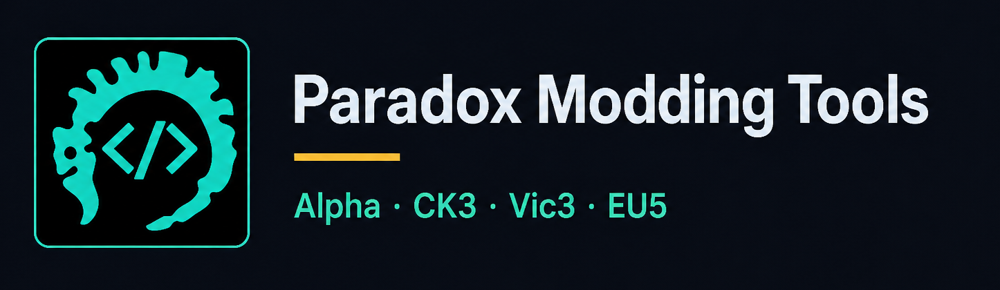
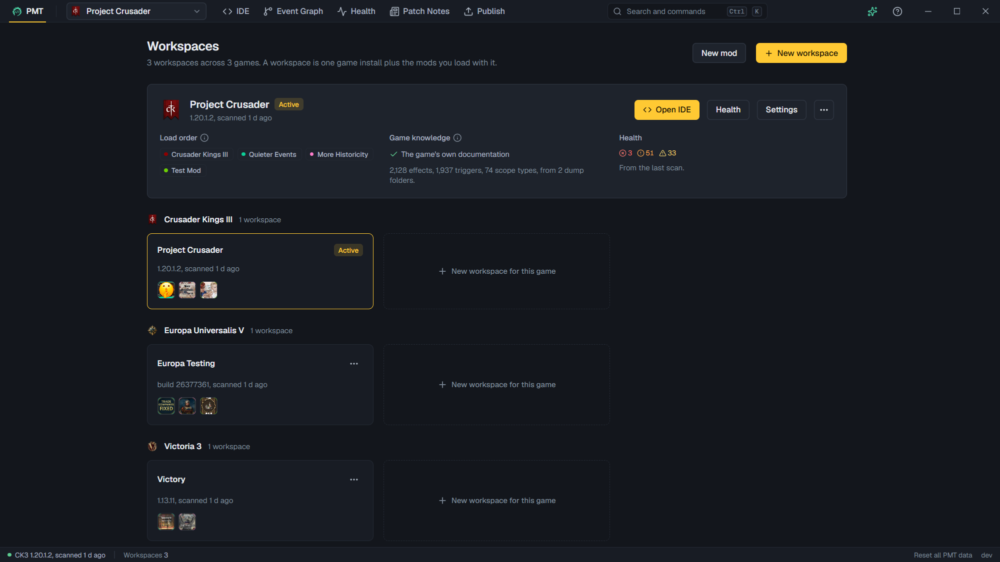
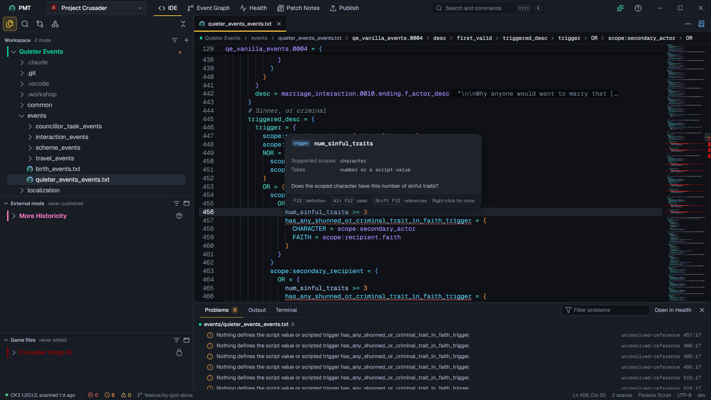
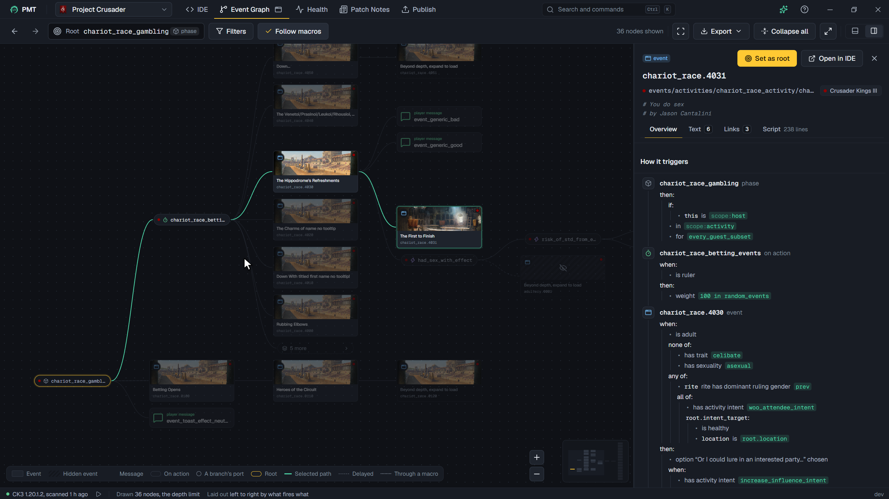
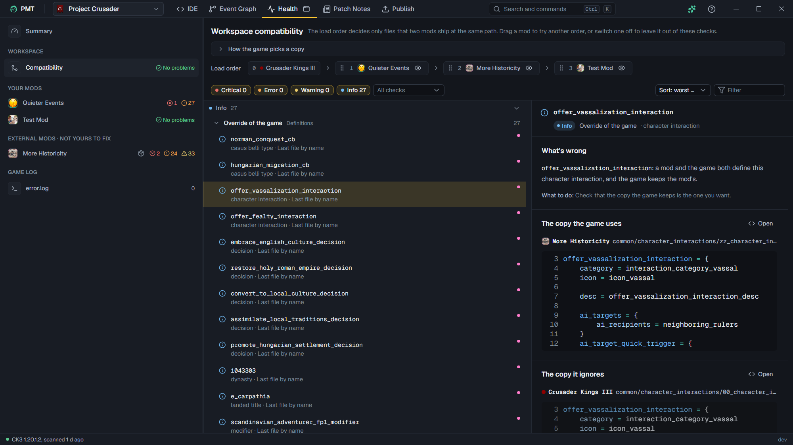
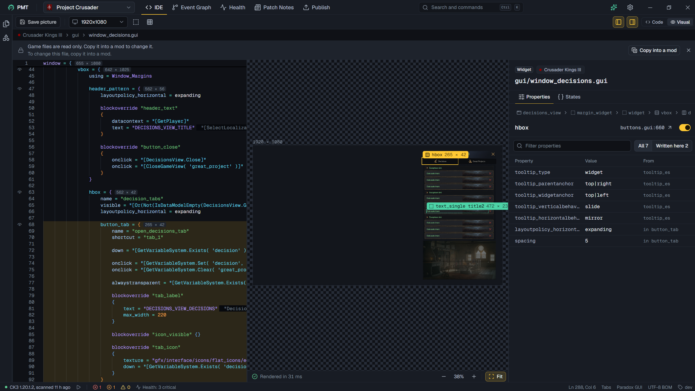
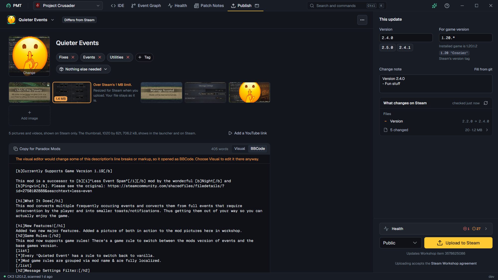
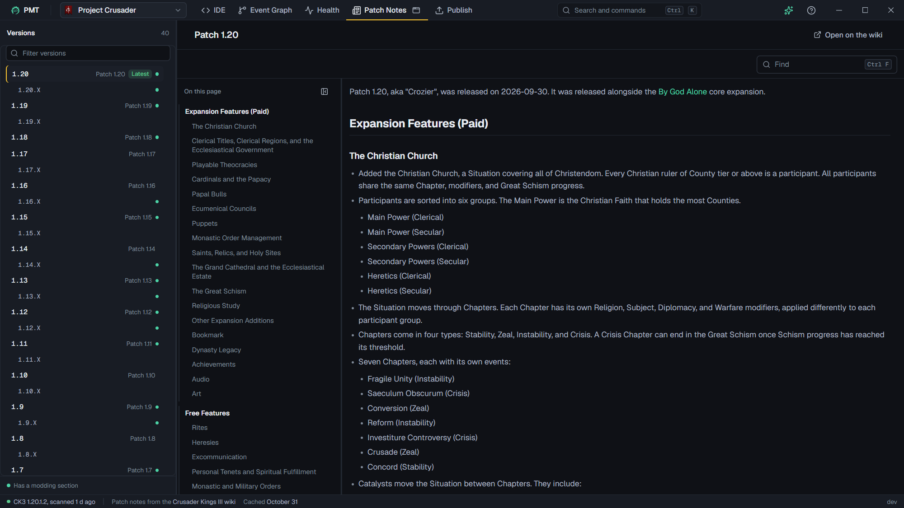

# Paradox Modding Tools

A desktop workspace for modding **Crusader Kings III**, **Victoria 3** and **Europa Universalis V** (partial). Open a
game install with the mods you are working on, and PMT gives you an editor that knows the game's script, a graph of
your events, a health check of your load order, the wiki's patch notes and Workshop publishing, in one window.

**Alpha: expect bugs.** Windows and Linux. Unofficial, and not affiliated with Paradox Interactive. Tested on CK3
1.20.1.2, Victoria 3 1.13.11 and EU5's current release.

[Download](https://github.com/idodavis/paradox-modding-tools/releases) · [Features](docs/FEATURES.md) ·
[Roadmap](docs/ROADMAP.md) · [Contributing](docs/CONTRIBUTING.md) · [All the docs](docs/README.md)

## What you get

| | |
|---|---|
|  |  |
| **[IDE](docs/FEATURES.md#ide):** an editor that knows the game's script: hover cards, completion, go to definition, checks as you type, and the game's own files beside yours. | **[Event Graph](docs/FEATURES.md#event-graph):** what fires what, from any event, with each branch's conditions. |
|  |  |
| **[Health](docs/FEATURES.md#health):** what conflicts between your mods and the game, and what is wrong in each mod, worst first. | **[Visual view](docs/FEATURES.md#visual-view):** GUI windows and coats of arms drawn as the game draws them. |
|  |  |
| **[Publish](docs/FEATURES.md#publish):** your Workshop page, written and uploaded from PMT, and compared with Steam's copy. | **[Patch Notes](docs/FEATURES.md#patch-notes):** the wiki's notes for each game version. |

Source control, a terminal, the wiki beside your file, a coding assistant and pop-out windows are in
[FEATURES.md](docs/FEATURES.md) too.

## Download

Get the latest zip from [Releases](https://github.com/idodavis/paradox-modding-tools/releases):
`paradox-modding-tools-windows-amd64.zip` or `paradox-modding-tools-linux-amd64.zip`.

## Getting started

1. Unzip PMT into a folder you can write to, such as one in your home folder, not Program Files. PMT downloads its
   updates beside itself.
2. Run `paradox-modding-tools.exe` on Windows, or `paradox-modding-tools` on Linux.
3. Make a workspace: pick the game and its install, then your mods in load order. PMT finds Steam's installs itself,
   and you can add one by hand.

PMT keeps itself up to date: the version in the status bar checks for a newer release.

### Windows

Windows 10 or 11. The zip is not signed yet, so SmartScreen may warn about it: click **More info**, then **Run
anyway**. PMT needs Microsoft Edge WebView2, which Windows 11 has; on Windows 10, install it from Microsoft if PMT does
not start. Windows on ARM runs the amd64 zip under emulation.

### Linux

A desktop distro with GTK 4 and WebKitGTK 6:

| Distro family | Install |
|---|---|
| Debian, Ubuntu | `sudo apt install libgtk-4-1 libwebkitgtk-6.0-4` |
| Fedora, RHEL | `sudo dnf install gtk4 webkitgtk6.0` |
| Arch | `sudo pacman -S gtk4 webkitgtk-6.0` |
| openSUSE | `sudo zypper install libgtk-4-1 libwebkitgtk-6_0-4` |
| Gentoo | `sudo emerge gui-libs/gtk net-libs/webkit-gtk:6` |

The Steam Deck, Flatpak and AppImage are not supported, and neither is macOS.

## What PMT changes on your disk

- **Your mods:** only what you do in PMT. The files you save, create, rename or delete; a new mod's folder and files
  when you make one; and a `.workshop` folder inside a mod you publish, which holds its Workshop page. A file you delete
  goes to PMT's trash first, so Undo brings it back.
- **The game:** nothing. The game's files, and the Workshop mods Steam downloaded, are read only in PMT.
- **PMT's own folders:** your settings and workspaces, and the log and caches, in the two folders under
  [Uninstall](#uninstall). The updates PMT downloads go beside the app.
- **Source control:** git runs in a mod's folder only when you use Source control there.

## Troubleshooting

- **Report a bug.** Open Help (in the top bar's gear menu, or F1) and press **Copy diagnostics**: your version, your system, your
  installs and the end of PMT's log. Paste them into a bug report.
- **The log** is `pmt.log`, in `%LocalAppData%\paradox-modding-tools` on Windows and in
  `~/.cache/paradox-modding-tools` on Linux.
- **Start over.** On the Library page, **Reset all PMT data** in the status bar removes every workspace, install
  record and cache. Your mods, the game's files and your settings stay.
- **Publishing to the Workshop** needs Steam running and signed in.

## Uninstall

PMT installs nothing, so Reset data is not the whole of it. To remove PMT completely:

1. Close PMT and delete the folder you unzipped it into.
2. Delete its two data folders:

   | | Windows | Linux |
   |---|---|---|
   | Your settings and workspaces | `%AppData%\paradox-modding-tools` | `~/.config/paradox-modding-tools` |
   | The log and the caches | `%LocalAppData%\paradox-modding-tools` | `~/.cache/paradox-modding-tools` |

   On Linux, these are under `$XDG_CONFIG_HOME` and `$XDG_CACHE_HOME` instead if you set them. The second folder is
   the large one: it holds the game's scanned files, the coding agents PMT installed for its assistant, and PMT's
   copy of each Workshop item you compared.
3. If you added PMT's tools to a coding agent, remove the `pmt` server from it the way you added it, such as
   `claude mcp remove pmt` for Claude Code.

Your mods stay as they are. A mod you published through PMT keeps its Workshop page in a `.workshop` folder inside
it, which you can delete if you no longer want it.

## Check a download

Each release has a `SHA256SUMS` file to check its zips against, and the app's updater checks every update against it.
Each zip is also attested as built by this repository's workflow; with the [GitHub CLI](https://cli.github.com/),
`gh attestation verify <zip> --repo idodavis/paradox-modding-tools` checks it.

## Community

- Questions and ideas: [Discussions](https://github.com/idodavis/paradox-modding-tools/discussions).
- Bugs and feature requests: [the issue forms](https://github.com/idodavis/paradox-modding-tools/issues/new/choose).
- The author on Discord: [discord.com/users/168438474905616386](https://discord.com/users/168438474905616386).
- A security problem: report it privately, as [SECURITY.md](docs/SECURITY.md) says.

Everyone taking part follows the [code of conduct](docs/CODE_OF_CONDUCT.md).

Building PMT from source is in [CONTRIBUTING.md](docs/CONTRIBUTING.md), and how it is made is in
[ARCHITECTURE.md](docs/ARCHITECTURE.md).

## License

[Apache-2.0](LICENSE). See also [NOTICE](NOTICE).
