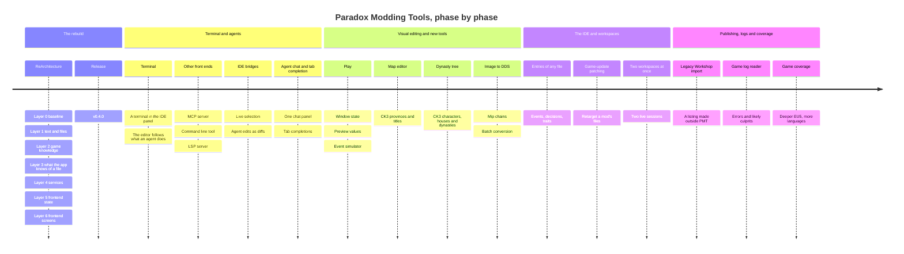

# Roadmap

Where Paradox Modding Tools is going. This is direction, not a calendar: the phases are in the order they are planned,
no phase has a date, and the order can change. To push on one, open an issue with the feature request template.

## The ReArchitecture

Today the same question is answered in several places: what a word in a script names, which definition the game keeps,
where a file is, what is wrong with it, how an error is reported. Every extra copy is a chance for two screens to
disagree. The ReArchitecture rewrites the app so that each question has one answer in one place, and everything else
asks that place. What the app does stays the same, apart from the additions listed below. Each layer ends with the
app working, `task check` passing, and the same measurements taken on Crusader Kings III, Victoria 3 and Europa
Universalis V, so a layer that makes any of them worse does not count as done.

- [x] **Layer 0, the baseline.** The measurements every later layer is compared with. Every dependency moves to its
  latest release (Wails, Go, the frontend libraries, the build actions). The docs site is removed in favor of the
  README, CONTRIBUTING.md and this page, and the glossary and syntax notes leave the repository. The latest patch
  notes of each game are read for what they change for modders.
- [x] **Layer 1, text and files.** Reading script text, localization, files, paths and pictures, written once each:
  the shapes a word can have, the walk over a folder, how two paths are compared, DDS and TGA decoding, and the edits
  to localization files.
- [x] **Layer 2, game knowledge.** What is true of each game, as tables of facts: its folders, how it combines files,
  how a later definition replaces or adds to an earlier one, where it keeps its dumps, its error log and its
  executable. The readers of the game's dumps and docs, a count of how often the game's own files write each key, and
  a form for any kind of definition.
- [ ] **Layer 3, what the app knows of a file, and everything that reads it.** One pass over a file notes what each
  key and value is: what it names, what it may hold, where it runs. The checks then turn that into problems, such as
  an unknown name or a value of the wrong type. Hover, completion, diagnostics, Health, the event graph and the Visual
  view all read what was noted instead of working it out again.
- [ ] **Layer 4, the services.** Each Wails service only passes a question to the package that answers it. Every
  change to a workspace or a mod announces one event, and the frontend refreshes from those events. The settings list
  lives in Go, and the app can launch the game.
- [ ] **Layer 5, the frontend's state.** One place for a file's text and whether it is unsaved, one for everything read
  from Go, one for which window holds a file, one for which workspace is active, and one table of commands.
- [ ] **Layer 6, the frontend's screens.** The shared components, then the IDE, Health, the event graph, Publish,
  settings and the Visual view on top of them. Last, the Help of every page is rewritten from what the page does by
  then, since the app's Help is the user's guide.

What the layers add for people who use the app:

- Completion ranked by how often the game's own files use a word in that place, and completion and go to definition
  for file paths such as textures.
- The game's `error.log` read as problems, in a Health card and as marks in the editor, while the game runs.
- Launching the game with its debug switch from the app, and an offer to rescan when the game has written fresher
  dumps than the app knows.
- More from Health: definitions nothing refers to (a hint, never an error), localization keys nothing uses, a card
  of each mod's definitions by kind, and a button that writes a language's missing localization files with the source
  text as a placeholder.
- A form for any kind of definition (a trait, a culture, a decision), drawn from what the game's own files declare,
  beside the code in the IDE and in the event graph's detail.
- In the Visual view, a panel that writes a widget's property into the `.gui` text (Ctrl Z steps back through it) and a
  reference screenshot drawn under the picture. The window's states move from the toolbar into the panel, which lists
  only the states that change what is drawn and has a Show it button for a hidden widget; a coat of arms' template
  lists are drawn at their heaviest option and changed in a Picks tab.
- In the event graph, an event's background picture in its detail (CK3 from `override_background` or `theme`, EU5
  from `image`; Vic3's event pictures are videos, so it has none) and an export of the graph as an SVG picture.
- In Publish, the required-DLC tags and a title and description per language.
- In the Wiki pane, a catalogue tab of the game's own triggers, effects, scopes and data functions, with example
  sites from vanilla.

## Release v0.4.0

The first release: a zip for Windows and one for Linux, with one `SHA256SUMS` file listing both, built and published by
the release workflow when a change other than Markdown alone lands on `main`. The version starts at v0.4.0 and goes up
by one patch number per release after that. The app's footer button checks for updates against those zips.

## Terminal

First, a terminal in the IDE's panel, so git or a command line agent such as Claude Code or GitHub Copilot CLI runs
beside the editor. The editor follows what the agent does.

- **The shells.** The app starts and keeps each shell, so a panel popped out into its own window shows the same shell
  with its recent output and goes on. A shell ends when you close it, when its program exits or when the app does.
  On Windows it is PowerShell 7 if installed, else Windows PowerShell; on Linux it is your `$SHELL`, else `sh`. A
  setting overrides this. A new shell opens in the mod folder of the active file, else the workspace's first mod.
- **The view.** A third tab in the panel beside Problems and Git, with several shells as tabs inside it, colored from
  the page's theme.
- **Following an agent.** A `path:line` in a shell's output is a link that opens the file at that line. A command in
  the editor sends the selection to the active shell as a file reference in the form both agents read. A file an agent
  changes on disk while its tab has unsaved text is marked, with a compare of the two texts and the choice to keep
  either, where today the change is skipped and the next save overwrites it.

## Other front ends: an MCP server, a command line tool and an LSP server

After the ReArchitecture every question has one answer in one package, and the app's own screens are one way to ask
it. Another front end is another way to ask the same questions, written over the engine in `internal/` without
changing it.

- **An MCP server**, so an agent can ask PMT for the problems in a file, where a name is defined, what is valid at a
  position and what Health finds, and check the Paradox script it writes against the game's own schema. MCP is the
  one interface both Claude Code and Copilot CLI support for outside tools, so this is the one agents use first.
- **A command line tool**, to check a mod from a terminal or a build script and print what Health would show.
- **An LSP server**, so other editors get the same hover, completion, definitions and diagnostics.

## IDE bridges

Claude Code and Copilot CLI each connect to VS Code in their own way: the editor's selection is shared live, and the
agent's edits open as diffs in the editor. PMT would offer the same to them. Both connections are undocumented today,
so this waits until they are.

## Agent chat and tab completion

Copilot and Claude in one chat panel inside the editor, through the Agent Client Protocol (ACP), the open standard
that Zed, JetBrains and Neovim use: plans, edits shown as diffs you accept, and commands run in PMT's terminal.
Copilot's tab completions come with it. This waits for the second version of ACP, which changes how edits and
permissions are described.

## Play, with preview values and the event simulator

A window in the game keeps state while it is open: its variables, a panel's selected tab. Its GUI writes that state
on a click and reads it to decide what is shown, so a tab shows its page and an expand button opens its panel. The
Visual view today draws a window in one state, and the toolbar lets you pick each group of conditions by hand; nothing
is simulated.

Play is the runtime side: a click presses what it lands on, as in the game. It is built once, as the foundation for
everything a window decides while it runs (its state, hovers, tooltips and animations), not as a feature of its own.
A first try that kept a state per file and pressed only what the file also showed covered 59 of 417 GUI files in
CK3's folders, 56 of 204 in Vic3's and 71 of 483 in EU5's, so it was dropped for a design that covers every
window.

Two things sit on top of it:

- **Preview values.** A binding such as `[Character.GetName]` is drawn as `[…]` today. With preview values, a binding
  shows text or a number you give it, or one read from a save game.
- **An event simulator** that steps through an event, its options and what each one fires, over those values.

## Map editor

CK3's political layer first.

- Read `provinces.png` (one color per province), `definition.csv` and the `landed_titles` tree.
- Go builds the picture of the provinces; the page draws it as the canvas with an inspector beside it.
- Write the edits as `zz_pmt_map*.txt` plus localization (UTF-8 with a BOM) into a mod of the workspace.

The game's own `-mapeditor` still owns baking the heightmap, locators and splines. Victoria 3's `state_regions` and
EU5's locations come later, on the same idea.

## Dynasty tree

A second graph beside the Event Graph, made with the same machinery and read from the index: CK3's characters,
houses and dynasties as the game's history files define them. It is CK3's alone, and measured on CK3's install before
it is built.

## Image to DDS

Today PMT only reads DDS and TGA pictures. This adds the other direction: turn a picture into the DDS the games read,
with its smaller copies (mip chains) built in, save a DDS back out as PNG, and convert a whole folder at once. It
needs an encoder, either written in PMT for the two formats most pictures use (BC1 and BC3) or taken from a library;
a library is reviewed, with everything it pulls in, before it is added.

## Entries of any file

The Entries tab beside Source control in the IDE lists what a GUI or coat of arms file draws, searchable, each coat
with a picture of it; a click draws it. Later the same tab lists the entries of any script file, its events,
decisions, traits and the rest, grouped by kind, each with its name in your language from its localization; a click
opens it in the code.

## Game-update patching

After a game patch today, reopen the workspace (the install is scanned again by itself) and read Health: dangling
references and overrides. Later, a file-level retarget in the IDE: open the mod's copy of a changed game file and copy
forward what you still own.

## Two workspaces at once

Windows of the same workspace work today: a page, an editor, the game's files or the panel in a window of its own, all
on one live session. What is left is two workspaces open together. Only one is open at a time now, because an
install's index is most of the app's memory, so this needs that rule relaxed.

## Legacy Workshop import

Bring a mod's Workshop listing that was made outside PMT into a project. Publish already imports a listing's pictures
and videos from Steam; this would bring in the rest of the listing in one step. How far it goes is settled when it is
built.

## Game log reader

The error log as problems arrives with the ReArchitecture. This goes further: import the game's other log files and
get a report of what errors were found, which mods are the likely culprits, and a map of what else the logs print
beyond errors.

## Game coverage

Deeper extract rules and wiki coverage for EU5. More localization languages in hover without a full rescan (today
an install's cache is kept per language).

## Done

- The language engine is rebuilt: each install's schema is learned from its own files and the game's `script_docs`,
  and the IDE, the Event Graph and Health all read one index.
- A new look across the app: seven theme families, each dark and light, that the pages and the editor share.
- The IDE is rebuilt on Monaco: editor groups and splits, hover cards, search and replace, the Wiki pane, and git
  source control with a graph and merge conflicts resolved in the editor.
- Code is colored from what the engine knows of it, in the editor and everywhere else the app shows code.
- The Event Graph and Health are redesigned: a graph with its detail beside or below it; six cards over a sortable,
  filterable table with each row's definitions beside it.
- A `.gui` file has a Visual view in the IDE: its window drawn from the game's own types, templates, textures and
  fonts, with a panel beside it. A coat of arms file has one too, with its layers edited through the file.
- Windows of the same workspace: a page, an editor, the game's files or the panel in a window of its own.
- Patch Notes reads the game's patch notes from its wiki.
- Publish is a three-step flow: the description from Markdown, BBCode or Steam's own text, screenshots and videos
  imported from Steam, and a compare with what Steam has.
