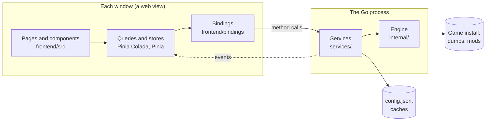
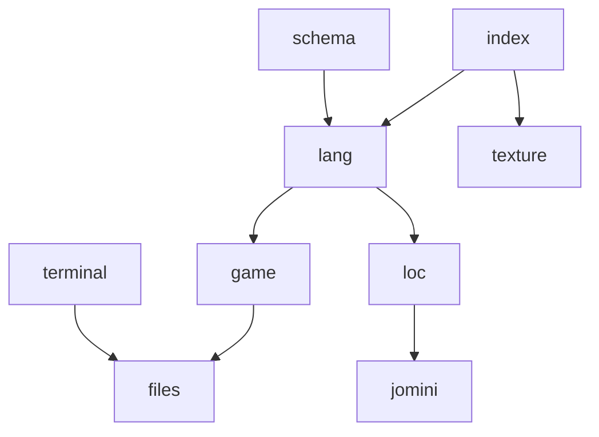
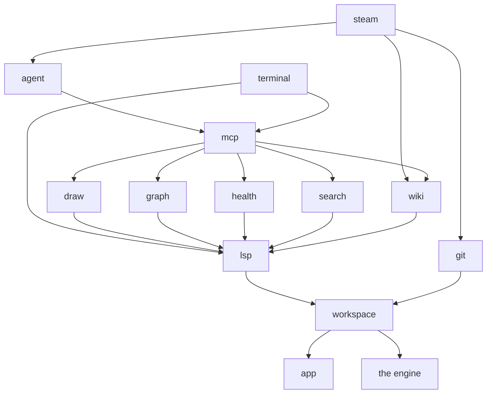
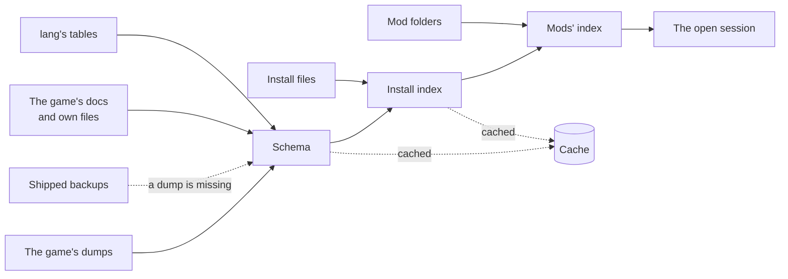
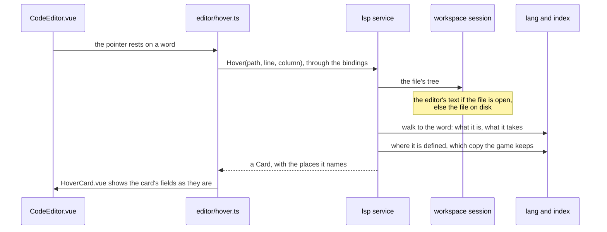
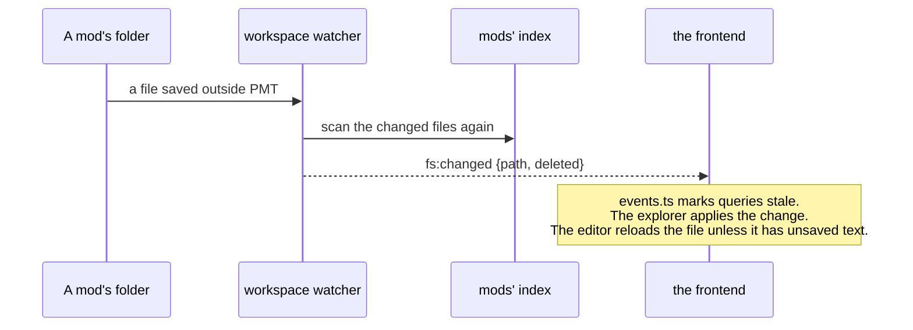
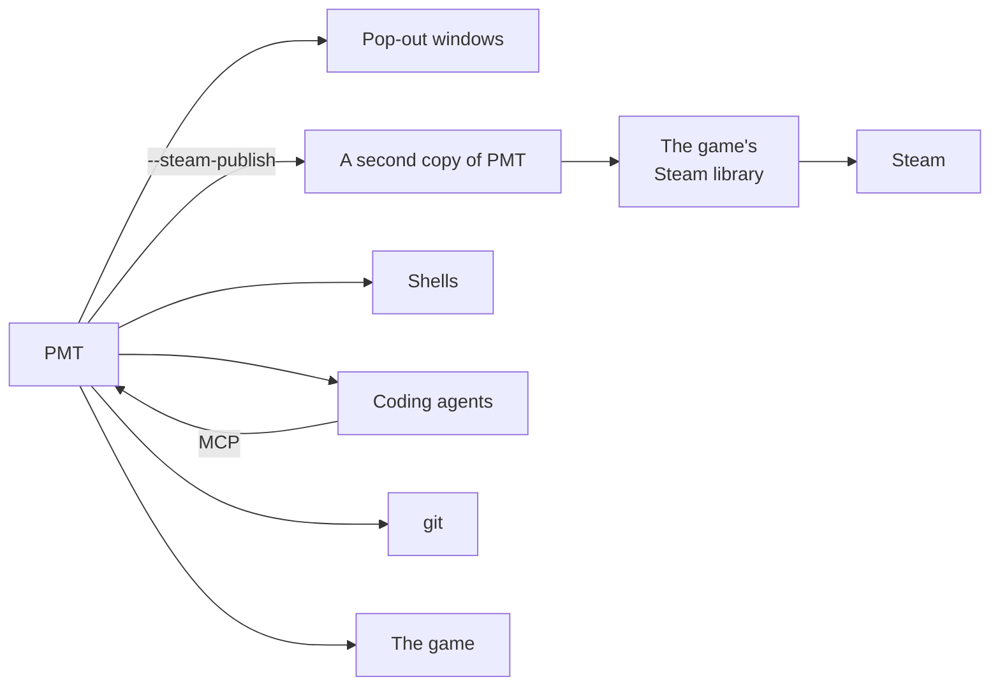

# Architecture

How Paradox Modding Tools is built: what runs, where the code lives, and how a request travels from a page to the
game's files and back. Start here. Every package README is linked from [the layers](#the-layers), and the other docs
from [the end of this page](#other-docs).

## The app in one picture

PMT is one Go program built on [Wails v3](https://v3.wails.io/). Go reads, checks and writes the games' files. Each
window is a web view running the Vue app in `frontend/`, which shows what Go returns and passes on what you do.

The two sides talk through bindings that Wails generates. A page calls a Go method as if it were a TypeScript
function, and Go sends events back when something changes on its side.



## Folder layout

```text
paradox-modding-tools/
├── main.go          starts the app: the config, the log, the services, the main window, the updater
├── internal/        the engine, one package per folder (see the layers below)
├── services/        the Wails services, one package per folder (see the layers below)
├── frontend/
│   ├── src/         the Vue app
│   └── bindings/    generated from the services; never edited by hand
├── build/           Wails' Taskfiles, the icons and each system's build files
├── .github/         CI, the release workflow and the issue forms
└── Taskfile.yml     task dev, task build, task check and the rest
```

## The layers

There are four layers, and each calls only the ones below it.

| Layer | Folder | What it does |
|---|---|---|
| Frontend | `frontend/src/` | Shows what Go returns and handles interaction. [Its README](../frontend/src/README.md) covers its folders. |
| Bindings | `frontend/bindings/` | TypeScript that Wails generates from the services' methods and types: `task common:generate:bindings`. |
| Services | `services/` | One Wails service per feature. Their methods are what the pages call. |
| Engine | `internal/` | Reads and models the games' files. It knows nothing of Wails, so it builds and tests alone. |

A few rules hold the layers together:

- **The engine is game-agnostic.** The parser and the language model are shared by every game. Anything one game does
  differently is a row of a table, in the lowest package whose topic it is: a rule of the script language in `lang`,
  a game's identity and installs in `game`, and a fact one feature reads beside the function that reads it. `jomini`
  never imports `game`.
- **One open workspace.** The workspace service holds the one open workspace. The other services ask it for the
  session at every call, so none keeps a copy that could go stale.
- **Go computes, the page shows.** A payload carries what a page displays, such as a file's relative path and its
  origin, and the page renders those fields as they are.
- **No database.** PMT stores JSON (`config.json`) and gob caches.

### The engine



Arrows point to what a package imports. An import that follows from others is left out.

| Package | What it does |
|---|---|
| [jomini](../internal/jomini/README.md) | Parses Paradox script, GUI and asset files into a flat tree. |
| [loc](../internal/loc/README.md) | Reads and writes localization files: messages, languages and markup. |
| [files](../internal/files/README.md) | Lists the files of an install, a mod or a dump folder, tells each one's format, and decides which of them the game reads. |
| [texture](../internal/texture/README.md) | Reads DDS, TGA and PNG images and their headers through dds-go and pdx-asset-go, and writes DDS in a given DXGI format. |
| [game](../internal/game/README.md) | The supported games: each one's identity, how its mods are laid out and how it is started. It also finds a game's installs on this machine. |
| [lang](../internal/lang/README.md) | The script language of one game version: its fixed rules as tables, the model of what is learned about it, and the one walk over a file that every reader of script uses. |
| [schema](../internal/schema/README.md) | Builds the model of one game version's language from the game's dumps, its docs and its own files. |
| [index](../internal/index/README.md) | Every definition, reference and localization message a scan found, and which copy of a definition the game keeps. |
| [terminal](../internal/terminal/README.md) | Runs shells under Windows' pseudo console or a Linux pty. |

[`schema/gen`](../internal/schema/gen/) writes the shipped backup schemas, the only game data the app embeds.

### The services



| Package | What it does |
|---|---|
| [app](../services/app/README.md) | The app itself: `config.json`, settings, the log, windows and updates. |
| [workspace](../services/workspace/README.md) | The one open workspace: its schema and indexes, its files, and the watcher on its mods. |
| [lsp](../services/lsp/README.md) | The editor's language features: hover cards, completion, checks, go-to and references. |
| [draw](../services/draw/README.md) | The Visual view: GUI windows as widgets, and coats of arms. |
| [graph](../services/graph/README.md) | The Event Graph: what fires what, from one root. |
| [health](../services/health/README.md) | The Health report: what is wrong in the workspace's mods, and the game's error log. |
| [search](../services/search/) | Text search and replace over the workspace, and the file search behind Ctrl P. |
| [git](../services/git/README.md) | Source control, through the git installed on the machine. |
| [wiki](../services/wiki/README.md) | The community wiki: cached pages, patch notes, and the Wiki pane's pages for a file. |
| [steam](../services/steam/README.md) | Publishing to the Steam Workshop, and the compare with Steam. |
| [terminal](../services/terminal/README.md) | The IDE's Terminal: its shells, streamed to the window that shows them. |
| [mcp](../services/mcp/README.md) | PMT's tool server for coding agents. |
| [agent](../services/agent/README.md) | Installs and runs the coding agents of the assistant pane. |

## The data

### What PMT reads

- **The game install:** its script, localization, GUI files, pictures and models, and the notes the game keeps on its
  own folders (`.info` files and readmes).
- **The game's dumps:** the lists of triggers, effects, scopes, on_actions and data types that the game writes when it
  runs with its debug flag, in the game's folder under Documents.
- **The mods:** each mod's folder and its descriptor, CK3's `.mod` file or Vic3's and EU5's `metadata.json`.
- **The community wiki**, for the Wiki pane and Patch Notes.
- **Steam**, through the game's own copy of Steam's library, for publishing.

### What PMT builds

Opening a workspace builds or loads this chain:



- **The schema** models the language of one game version: which databases exist, what each key takes and which
  commands run in which scope. It is built from the dumps, the game's docs and what the game's own files write. The
  rules no source states are `lang`'s rows.
- **The install's index** records every definition, reference and localization message in the game's files.
- Both are cached in a folder named for the install's version, the time of its dumps and PMT's version, so a game
  patch, fresh dumps or a new build of PMT each scan again.
- **The mods' index** stands on the install's and holds only the mods' files. A lookup reads both, in load order. When
  a mod's file changes, the watcher scans it again into a copy of the index, so readers never wait on a lock.
- **A file's tree** is parsed when a service asks for it, from the editor's text when the file is open.

### What PMT stores

| What | Where |
|---|---|
| `config.json` (installs, workspaces, mods, settings, agents, the window) and the MCP token | The user config folder: `%AppData%\paradox-modding-tools` on Windows, `~/.config/paradox-modding-tools` on Linux |
| `pmt.log` | The user cache folder: `%LocalAppData%\paradox-modding-tools` on Windows, `~/.cache/paradox-modding-tools` on Linux |
| The caches (schemas, indexes, wiki pages, Steam snapshots, the agents' installs) and the trash | `cache/` in that same folder. Reset data empties it. |
| A mod's Workshop listing | The mod's own `.workshop` folder |

## One request: a hover

When the pointer rests on a word in the editor, the page asks Go for that word's card:



Every editor feature follows this path. Each edit goes to `lsp.SetText`, which parses the editor's text and returns its
problems. Completion, go-to-definition, references and the semantic colors are Monaco providers
(`editor/providers.ts`) that hand the lsp service's answers to Monaco.

### Events coming back

Go tells the pages when something changes on its side. Each event is a constant in the service that sends it, and the
frontend's `app/events.ts` lists which cached queries each one makes stale.



`config:changed` works the same way: it names the section of `config.json` that was written, and the queries that
read that section refresh. Each package README lists the events its service sends.

## Where each feature lives

| Feature | Frontend | Services | Engine |
|---|---|---|---|
| Library, New workspace, New mod | `pages/library`, `pages/wizard`, `pages/newmod` | workspace, app | game, files |
| The editor | `pages/ide`, `pages/ide/editor` | lsp, workspace | jomini, loc, lang, schema, index |
| The explorer | `pages/ide/ExplorerTree.vue` | workspace | files, index |
| Search, command palette | `pages/ide/SearchView.vue`, `app/CommandPalette.vue` | search, lsp | index |
| Visual view, images, Save as DDS | `pages/ide/draw`, `ImageView.vue`, `SaveDdsModal.vue` | draw, workspace | texture, lang, index |
| Source control | `SourceControlView.vue`, `stores/git.ts` | git | |
| Wiki pane | `pages/ide/WikiPane.vue` | wiki | |
| Terminal | `pages/ide/terminal`, `stores/terminal.ts` | terminal | terminal |
| Assistant | `app/AgentPane.vue`, `ui/AgentSession.vue`, `stores/agent.ts` | agent, mcp | |
| Event Graph | `pages/graph` | graph | index, lang |
| Health | `pages/health` | health | index, lang, loc |
| Patch Notes | `pages/notes` | wiki | |
| Publish | `pages/publish`, `stores/uploads.ts` | steam | files, game |
| Settings | `app/settings` | app, workspace | |

## Other processes and windows

PMT starts other programs when a feature needs one:



- **Windows.** The main window and every pop-out (a page, an editor group, the Terminal, the Wiki pane) run the same
  Vue app. Wails' JavaScript runtime acts only on the window that calls it, so opening, showing or closing another
  window goes through the app service. Windows hand tabs to each other over broadcast channels (`stores/windows.ts`).
- **The Steam copy.** Publishing starts a second copy of PMT with `--steam-publish` or one of its sibling flags. The
  copy loads the Steam library the game ships, opens it for the game's app id, does one job and exits. Its orders
  arrive as JSON on its input, and its progress comes back as JSON lines. PMT ships nothing of Steam's.
- **The MCP server.** Coding agents on this computer reach PMT's tools at `http://127.0.0.1:<port>/mcp`, with a token.
  Every shell and agent PMT starts has the address and the token in its environment.
- **Coding agents.** The assistant pane runs Claude, Copilot or Codex through their ACP adapters, installed with npm on
  Node. Go starts the program and pipes its lines to the page over a Wails stream; the page speaks the protocol.
- **Shells.** The Terminal runs shells under Windows' pseudo console or a Linux pty, streamed to the page over a Wails
  stream. No port is opened.
- **git.** Source control runs the git installed on the machine, one command at a time.
- **The game.** Launch starts the game with its debug flag, so that it writes fresh dumps. When it exits, PMT says
  whether they are newer than the ones the schema was built from.

## Other docs

| Doc | For |
|---|---|
| [README.md](../README.md) | What PMT is, the download, getting started |
| [FEATURES.md](FEATURES.md) | Every page and what it does |
| [CONTRIBUTING.md](CONTRIBUTING.md) | Building from source, the tests, a first change |
| [AGENTS.md](../AGENTS.md) | The code conventions, for people and the coding agents they bring |
| [GLOSSARY.md](GLOSSARY.md) | The one word PMT uses for each of its own things |
| [RELEASING.md](RELEASING.md) | How a release goes out, and its checklist |
| [ROADMAP.md](ROADMAP.md) | What comes next |
| [frontend/src/README.md](../frontend/src/README.md) | The Vue app's folders and patterns |
