# Features

What Paradox Modding Tools (PMT) does, page by page, for a modder. Getting it and setting it up is in the
[README](../README.md). What comes next is in the [roadmap](ROADMAP.md), and how it is built is in the
[architecture](ARCHITECTURE.md).

PMT works on one workspace at a time: a game install and the mods you load with it, in load order. Every page below
reads that workspace. Each page also has its own Help, the ? in the top bar or F1.

- [Library](#library)
- [New workspace](#new-workspace)
- [IDE](#ide)
- [Event Graph](#event-graph)
- [Health](#health)
- [Patch Notes](#patch-notes)
- [Publish](#publish)
- [Settings](#settings)
- [The IDE's parts](#the-ides-parts): [Visual view](#visual-view), [Save as DDS](#save-as-dds),
  [source control](#source-control), [Wiki pane](#wiki-pane), [Terminal](#terminal), [assistant](#assistant),
  [pop-out windows](#pop-out-windows)
- [External mods](#external-mods)
- [Each game](#each-game)
- [Each system](#each-system)

## Library

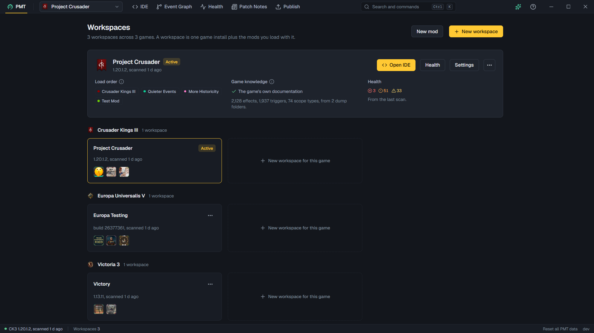

Your workspaces, as cards, grouped by game. The active one is at the top. Open another card to make it active, then
press **Open IDE** to start working.

- **New workspace** starts the setup. **New mod** makes a new mod, or adds one to the open workspace.
- A card's menu has **Launch**, which starts the game with its debug flag. When the game closes, PMT says what your
  mods logged. If the game wrote fresher documentation, it offers to scan the install again.
- **Remove from PMT** takes a workspace out of PMT. Your mod folders stay on disk.
- A new modder sees a short checklist for a first mod on the card. Settings can turn it off.
- **Reset all PMT data**, in the status bar, removes every workspace, install record and cache. Your mods, the game's
  files and your settings stay.

The status bar also shows the install and its scan, and the version. The version checks for a newer release. Its
Releases list can also install an older one, and PMT restarts into it.

## New workspace

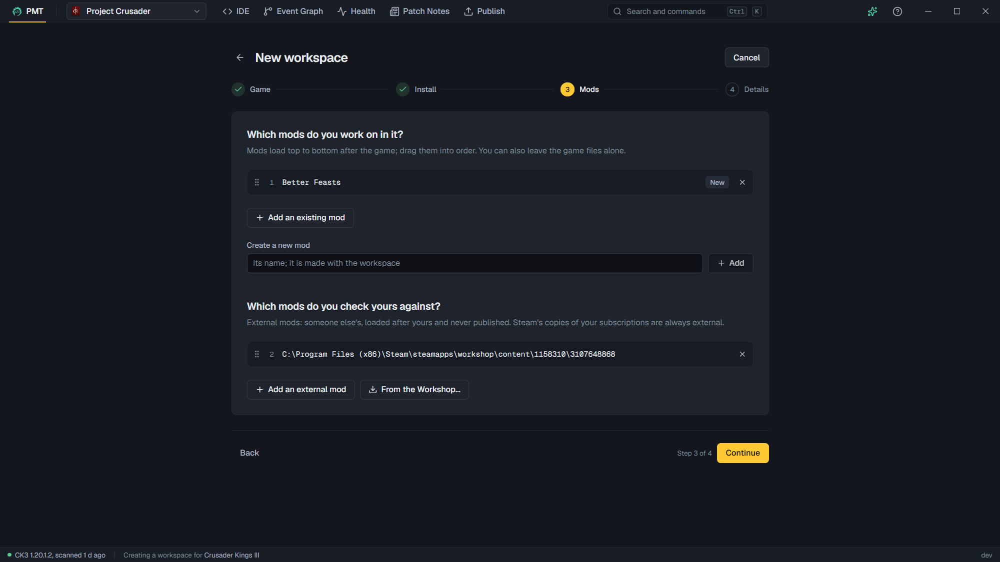

Pick the game, the install PMT reads its files from, and the mods you work on. Then name the workspace. PMT finds
Steam's installs itself, and you can add one by hand. Add a mod folder you already have or make a new mod, and drag the
mods into load order. A second list takes mods you only want to check yours against. See
[External mods](#external-mods).

Everything can be changed later in Settings. The new workspace opens on the page you chose to start on.

**Make a new mod** is the short way in for a new modder. Pick the game, name the mod and choose its language. PMT shows
the folder it will make, makes a workspace with the mod in it, and opens the IDE. **How a mod works** explains what the
mod's folders are for. Guidance for new modders, in Settings, shows it and the first-mod checklist.

## IDE

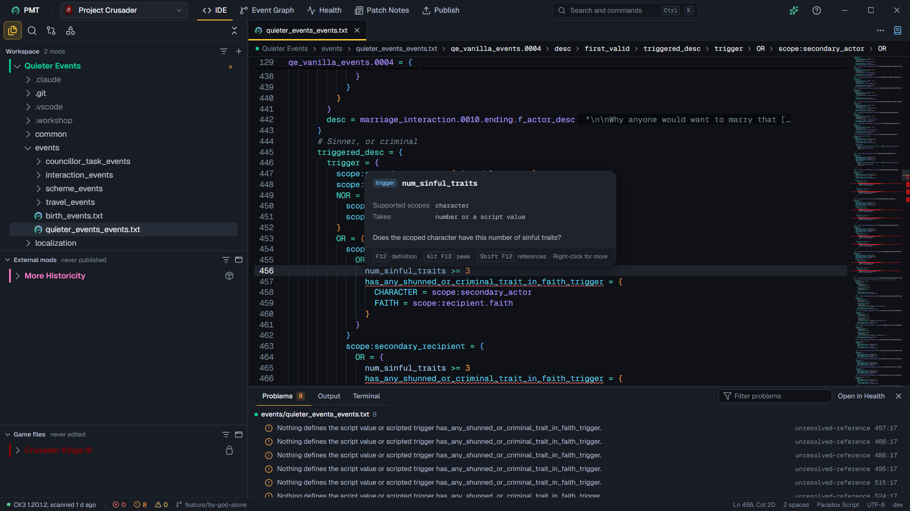

An editor that knows the game's script, localization and GUI files.

- **The explorer** shows your mods in load order, then your external mods, then the game's files. The game's files are
  read only. Edit in a mod folder. The filter on each tree narrows it by path. Ctrl P finds a file by path, and
  Ctrl Shift F searches the text of the files and can replace it.
- **Tabs.** A single click opens a preview tab that the next click replaces. A double click or an edit keeps it. Drag a
  tab to another group, or out to a window of its own. Your open tabs come back when you open the workspace again.
- **Hover.** Rest the pointer on a key or a value to see what it is, what it takes and where it is defined. For a
  name, the card shows the copy the game keeps first.
- **Go to.** Ctrl click goes to a definition. A search for references finds every use. F2 renames a name in every mod
  file. Alt Left and Alt Right step back and forward through the places you jumped between.
- **Completion** offers what fits the block you are in, and then what fits the value.
- **Problems** show as squiggles with quick fixes. The Problems panel (Ctrl J) lists them for the open files, then the
  compatibility findings from Health about those files. Checks can be switched off one by one in Settings.
- **Override one entry.** In a read-only game file, copy just one entry into your mod. Where the game has entry modes,
  PMT writes the copy with `REPLACE:`.
- **Compare** a mod's file with the game's copy, with another file, or with its last commit.
- **Find what fires an event**, an on_action, a decision or a scripted effect from the editor's right-click menu.
- **Entries**, the sidebar's fourth view, lists the file's entries by type, with their titles and keys.
- **Delete** moves a file to PMT's trash. **Undo** in the message brings it back.
- **The command palette** (Ctrl K) runs any command. Type `>` for the commands and settings.

## Event Graph

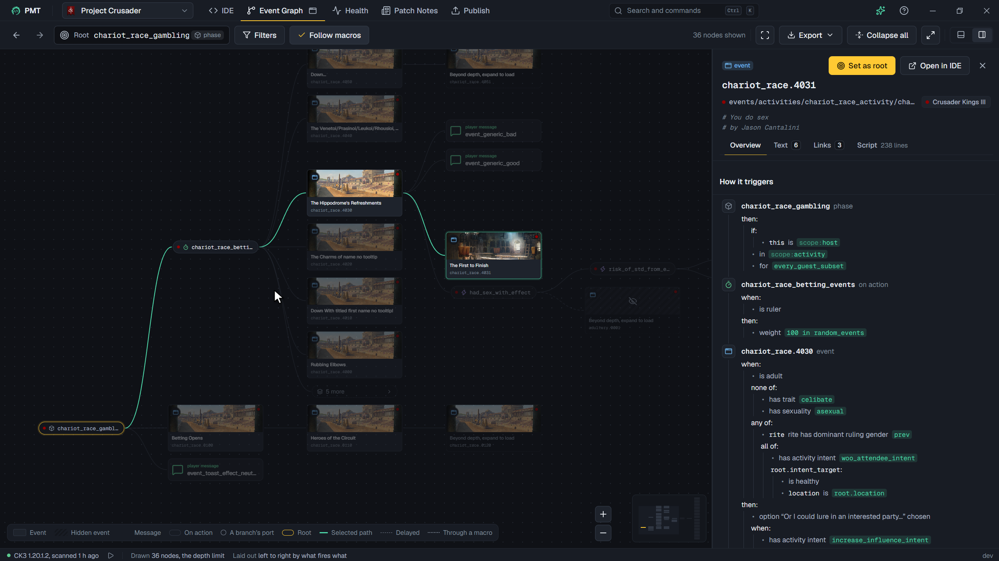

Type an event id, a namespace or a number in **Root**. The graph shows what that event, on_action, decision, message
or scripted effect fires, and what fires it. It reads left to right, one step at a time.

- A hidden event is hatched, and a message is drawn as a toast. An on_action the game calls from its own code is marked.
- **Filters** picks the kinds drawn, the mods shown, the depth and the node limit. **Follow macros** walks into
  scripted effects to find the events they fire.
- Click a node for its detail: how it triggers, its texts, every firing both ways, and its script. If it replaces the
  game's copy, you can compare the two.
- **Path** opens the nodes on the way from the root to the one you picked, with the block each firing sits in, its
  weight and its delay.
- **Export** saves the graph as a PNG image or as SVG.

A weight is the number as written, marked where blocks change it. A trigger is shown, never worked out. A CK3 message
sent without a type is not drawn.

## Health

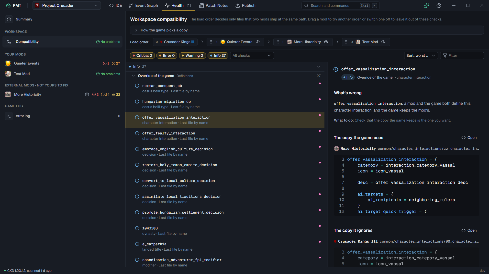

Three questions, each with its own panel, worst rows first:

- **Compatibility:** how your mods touch the same things.
- **Mods:** whether each mod is sound on its own.
- **Game log:** what the game's last run logged.

Every finding has a level by how much the game loses. **Critical:** the game loses a whole file, definition or mod.
**Error:** it skips one line or value and goes on. **Warning:** it may be fine, or only show the wrong text. **Info:**
how things are.

- **Compatibility** explains how your game picks between two copies, and what the load order can change. Drag the order
  to preview another one, then save it or drop it. Where another order would fix a clash, **Try this order** previews
  it. Open a finding to see each copy and put the two side by side. You can ignore the clashes between two mods.
- **A mod's view** says which mods it is judged with, counts what it holds and shows how much of its text each language
  covers. **Write the missing keys** adds the keys a language lacks, with the base language's text as the placeholder.
- **The game log** lists the lines from your mods apart from the game's own. Open it in the IDE, or let it follow the
  log while you play.

## Patch Notes

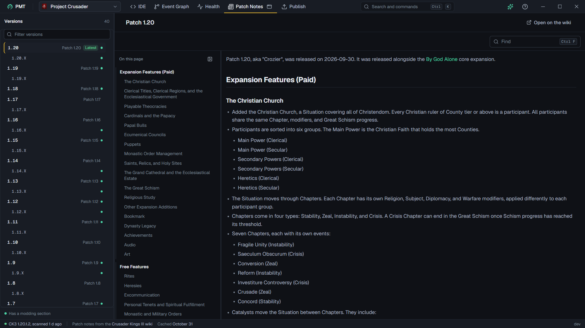

The game's patch notes, from its wiki, for the game of the open workspace. Pick a version to read it. A dot marks a
note with a Modding section. Ctrl F finds in the note shown. PMT reads the notes when it starts and keeps them.

## Publish

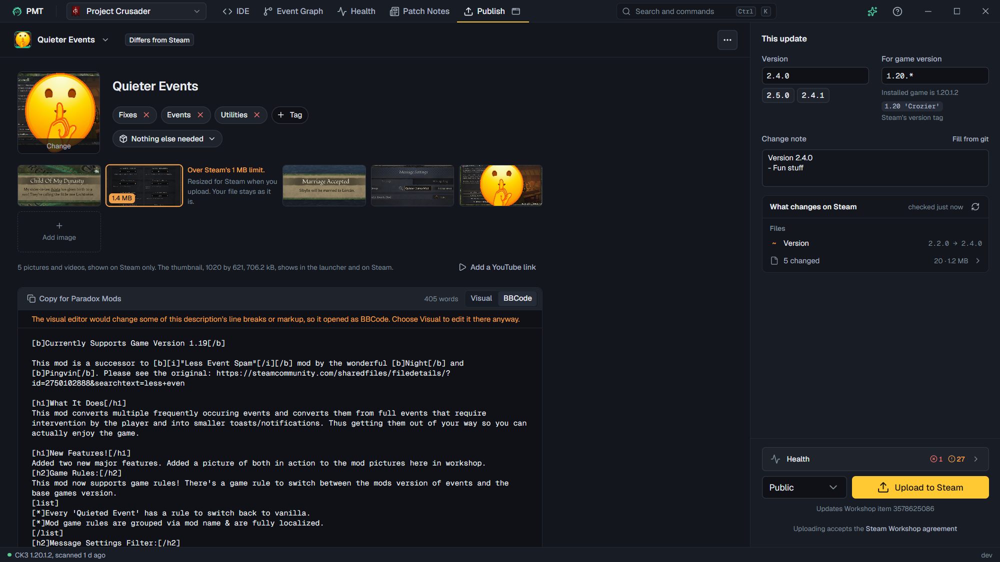

The mod's Workshop page, as players see it. Click the name, tags, requirements, pictures or description to change
them. Every change is saved in the mod's files as you stop typing.

- **The description** is written as it looks on Steam, or as BBCode.
- **The rail** on the right is this update: its version, the game version it is for and its change note. PMT drafts the
  note from the mod's git history. The rail lists what the upload changes on Steam, and a click shows a change
  beside Steam's copy.
- **Compare with Steam** is also in the IDE, for the active file's mod.
- **Older versions.** A mod can have a separate Workshop item for an older game version.
- **Paradox Mods** has no way in for tools. Copy the description for it from the BBCode view, and paste it in the
  Paradox Launcher.

Steam must be running and signed in as the item's owner. A new item stays private until you make it public on its
Workshop page. PMT never touches an item that belongs to someone else, and never publishes an
[external mod](#external-mods).

## Settings

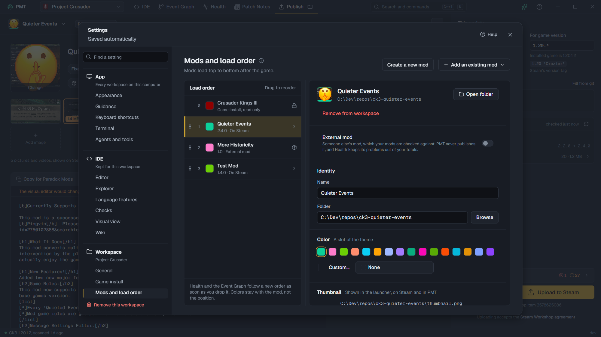

Opened from the top bar. It has three groups.

- **App**, for every workspace:
  - Appearance: the theme (PMT, Catppuccin, One, Pierre, or a look for each game), light or dark, the interface scale,
    the pages shown, and a simple interface that hides the IDE's advanced parts.
  - Guidance, keyboard shortcuts, the Terminal's default shell, and Agents and tools.
- **IDE**, kept for each workspace: the editor, the explorer, the language features, the checks, the Visual view and
  the wiki.
- **Workspace:**
  - General: the name, the localization language, the page it opens on and the IDE's start.
  - Game install: the install this workspace reads, and **Launch**.
  - Mods and load order: drag to reorder. Each mod's card has its calendar, its Workshop link, what an upload leaves
    out, and its [external mod](#external-mods) switch.

## The IDE's parts

### Visual view

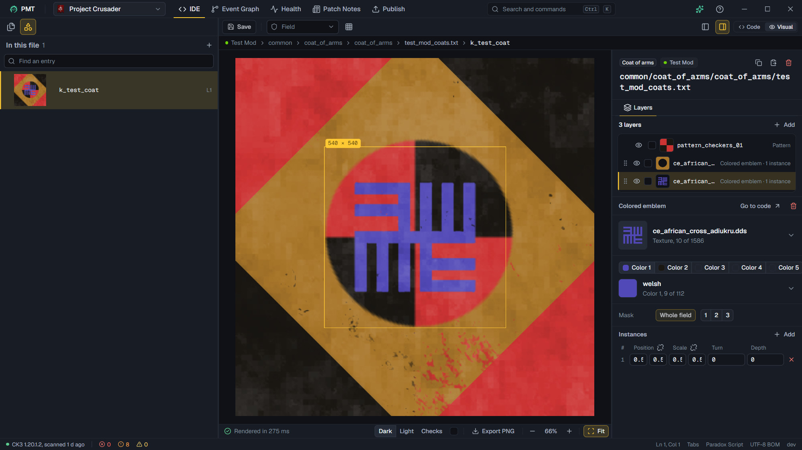

A GUI file or a coat of arms file can open as a picture instead of code. Switch with the Code and Visual buttons at the
end of the tab, or Ctrl Shift V.

- **A GUI window** is drawn from the game's own files, with the texts, pictures, colors and fonts the game would use.
  Where the game fills in data while it runs, such as a portrait or a number, PMT shows a stand-in.
- **States.** The panel lists the widgets with each property as written, and the states that show or hide them. Pick
  one to see the window change. The window opens as the game opens it.
- **A coat of arms** is drawn from its layers: the pattern, the emblems and the colors. The panel lists the layers and
  lets you add, move and remove them.
- Click a widget or a layer to see where it is written. The Structure list in the sidebar lists everything the file
  draws.
- Tools over the picture: Save, the resolution or the coat's frame, Bounds, Grid, and the code beside the picture.

PMT writes your changes to the code in the editor, so undo works as it always does.

### Save as DDS

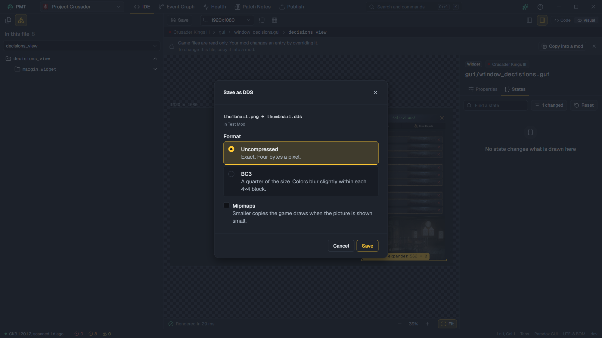

Right-click a PNG or TGA picture, or a folder of them, and choose **Save as DDS**. PMT writes a `.dds` beside each one,
either uncompressed (exact) or BC3 (a quarter of the size, with slightly blurred colors). Mipmaps are optional. The
image view has the same button. PMT starts from the settings of the DDS already beside the picture, or else of the
game's own DDS at that place.

### Source control

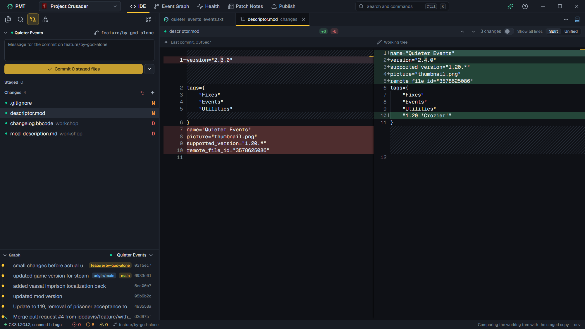

The sidebar's third view runs the git installed on your computer on each mod that is a repository. Each repository has
a section with its branch, its commit box and its changes. The Graph shows the history of the active file's repository.

Diffs open as tabs. Merge conflicts are resolved in the editor. PMT reimplements none of git, so git must be installed.

### Wiki pane

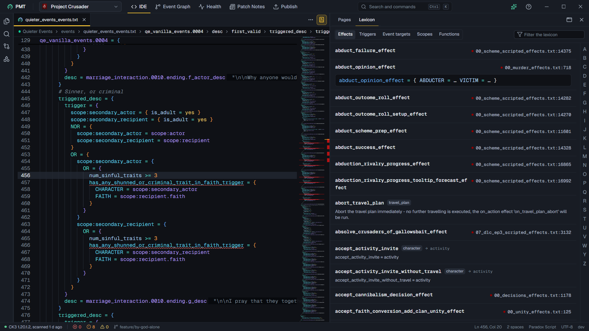

The Wiki button at the end of the editor's tabs (Ctrl Shift W) opens the wiki's pages for the file you are in. It
can follow the open file. It also holds the **Lexicon**: the game's triggers, effects and scopes, each with where the
game's own files use it. Look a name up from the editor's right-click menu.

### Terminal

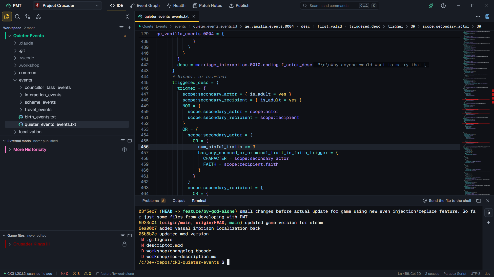

A shell in the IDE's bottom panel, started in the folder of the mod you are editing. It shows file names with a line
number in its output as links to the file. Windows offers PowerShell, Git Bash and WSL where they are installed. Linux
offers your `$SHELL` and the shells in `/etc/shells`. Settings picks the default. The Terminal can also move to a
window of its own.

### Assistant

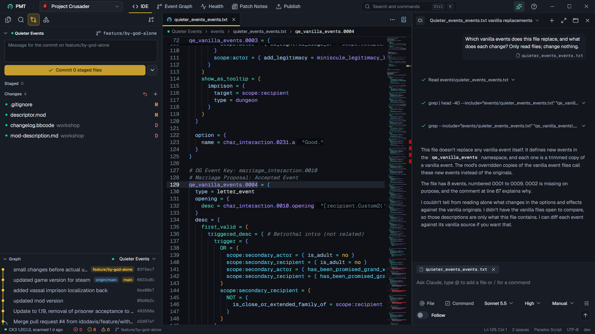

A pane that chats with a coding agent: Claude, GitHub Copilot, Codex, or one of your own. Each runs on your computer
and signs in to its own account. PMT never sees it. PMT installs the agent for you from the Agent Client Protocol's
registry into its own folder, with Node if your system has none new enough.

- The agent is given PMT's tools, so it finds names, problems, Health's findings and the Event Graph as PMT does, with
  your unsaved text. The same tools can be added to an agent you run yourself.
- What it asks permission for shows in the session. Nothing opens before you choose.
- What the page has in front of you goes with your prompt as an attachment.
- **Follow the agent** opens the files it reads. An edit can be undone from its row, or all of a session's at once.

### Pop-out windows

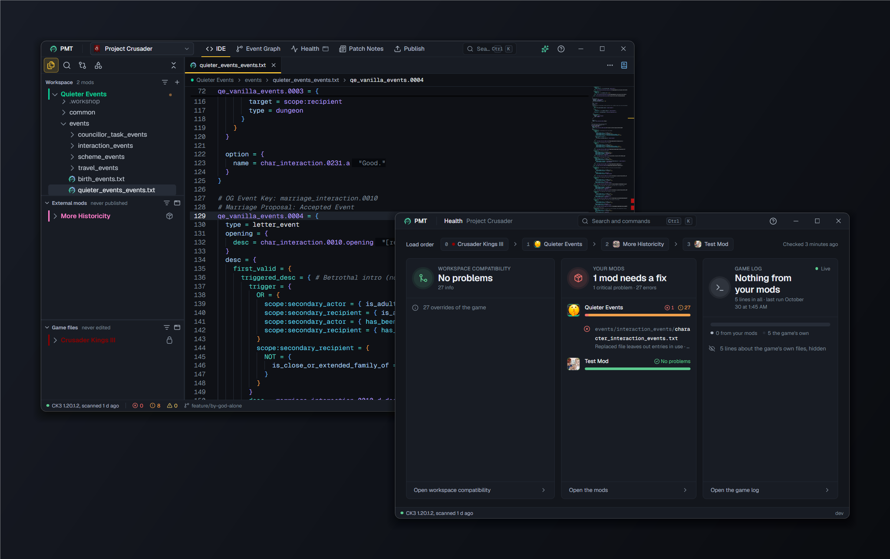

Drag an editor tab out of the window to make a window of its own for it. Every page but the IDE can open in a window
of its own from the top bar, so Health can sit on a second screen. The Terminal and the Wiki pane can too. A window can
hand its tabs back to the main window.

## External mods

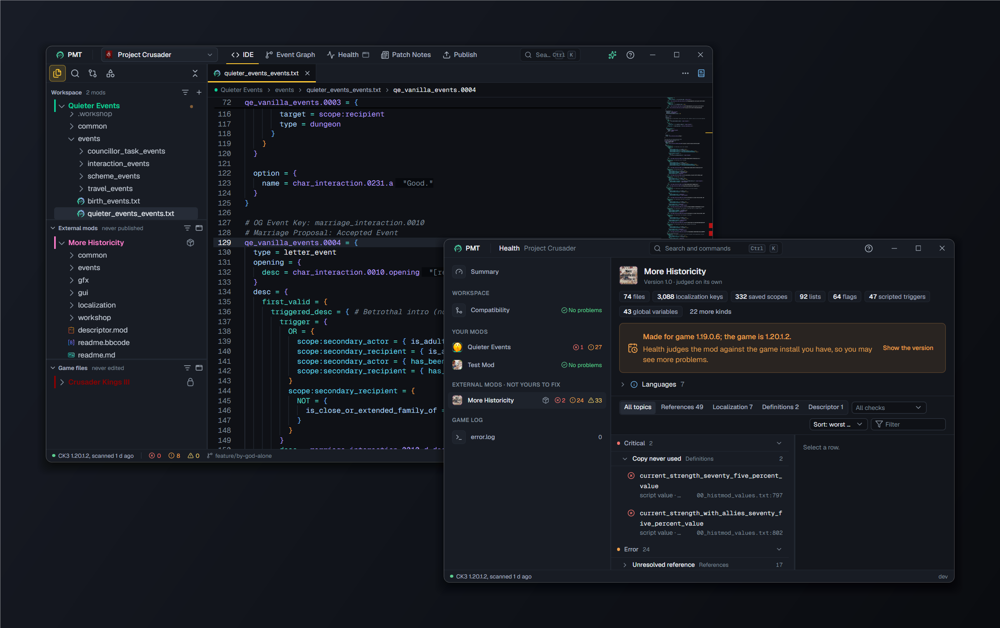

Some mods in a workspace are not yours: a Workshop mod you subscribe to, or a copy of someone else's work. Add them as
**external mods** to check your own against them. PMT never publishes an external mod, and keeps it out of your totals.

- **Adding.** Settings and the IDE have an add menu: a mod of yours, an external mod, or **From the Workshop**, which
  lists the mods Steam has downloaded for your game. Steam does not have to be running. The new workspace setup has a
  second list for them.
- **A Workshop copy is always external.** Steam's copy of a mod you subscribe to is read only, and the mod's card says
  so. Any other mod has an **External mod** switch on its card.
- **The explorer** puts external mods under their own heading, "External mods · never published".
- **Health** judges the mods together, so it still finds where yours clash with theirs. Its rail lists "Your mods" and
  "External mods" apart, and the totals count yours only.
- **Publish** greys external mods in its mod menu. If you pick one, the page is blurred under a note that says why and
  how to publish your own version: copy its folder, add the copy as a mod of yours, and give it a new name. A mod of
  yours whose Workshop item belongs to another Steam user is held back the same way.

## Each game

### Crusader Kings III

Every page works. A mod's descriptor is its `.mod` file. When two events share an id, the game keeps the one with the
highest `id_override_priority`, and Health's Compatibility view explains how the game picks. The Visual view draws
CK3's GUI windows and coats of arms. The Event Graph follows CK3's events, on_actions, decisions and messages.

### Victoria 3

Every page works. A mod's descriptor is `.metadata/metadata.json`. A mod changes a definition the game already loaded
by writing `REPLACE:` before its name, and the editor knows the entry modes. Where two events share an id, the game
keeps the first one loaded. The Visual view draws Victoria 3's GUI windows.

### Europa Universalis V

EU5 is partial. All the pages open an EU5 workspace and read EU5's files. The game is the newest of the three and the
least tested here, so you may meet more gaps than in CK3 and Victoria 3: a hover card with nothing in it, a check that
is wrong, a window drawn with stand-ins. Please report them.

What EU5 has:

- The editor, with hover, completion, go to and rename, over EU5's three stages (`in_game`, `main_menu` and
  `loading_screen`).
- Entry modes such as `INJECT:` and `REPLACE:` before a name, which the editor knows and checks.
- The Event Graph, Health, Patch Notes, the Visual view and Publish.

EU5 has no Linux build. On Linux it runs through Proton, PMT finds its documents folder in Steam's Proton folder, and
PMT cannot start the game for you. See [Each system](#each-system).

## Each system

PMT runs on Windows 10 and 11 and on desktop Linux. macOS is not supported.

| | Windows | Linux |
|---|---|---|
| Needs | Microsoft Edge WebView2 | GTK 4 and WebKitGTK 6 |
| Steam installs | Steam's default and extra libraries | Native Steam, Flatpak Steam and extra libraries |
| Terminal shells | PowerShell, Windows PowerShell, Git Bash, WSL | `$SHELL` and the shells in `/etc/shells` |
| Launch | CK3, Victoria 3 and EU5 | Where the game has a Linux build |
| EU5 | Native | Through Proton. PMT cannot start it, and publishing EU5 to the Workshop from Linux is untested. |
| Your data | `%AppData%` and `%LocalAppData%` | `~/.config` and `~/.cache` |

Everything else is the same on both. Setup and troubleshooting are in the [README](../README.md).
