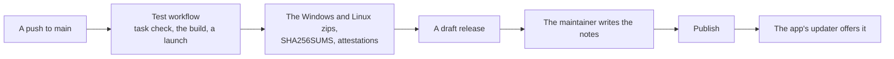

# Releasing

[Architecture](ARCHITECTURE.md) › Releasing

How a release of Paradox Modding Tools goes out, and what is checked before it does. Only the maintainer publishes.

## How a release goes out



1. **A push to `main`** that changes more than Markdown runs `release.yml`. It runs the test workflow first, so no
   release ships untested.
2. **The version** is the open draft's, if there is one. Else it is the newest tag's patch number plus one, starting at
   v0.5.0. Running the workflow by hand can set it instead.
3. **The build** makes `paradox-modding-tools-windows-amd64.zip` and `paradox-modding-tools-linux-amd64.zip`. Each holds
   the binary alone, as the app's updater swaps one file for the running app and refuses a zip that holds more. LICENSE,
   NOTICE and each system's `THIRD_PARTY_NOTICES-<system>.txt` go on the release beside them, under names that hold no
   architecture, so the updater never takes them for the app. Then come `SHA256SUMS`, which the updater checks a
   download against, and an attestation of each zip. What Windows and Linux need to run PMT goes in the notes.
4. **The draft.** The release is made as a draft, with notes GitHub generates from the merged pull requests, sorted by
   label into Features, Fixes and Other (`.github/release.yml`). Only the repository's writers can see a draft, so the
   updater and the Releases list offer nothing yet. A second push before publishing replaces the draft's zips under
   the same version.
5. **The notes.** Rewrite the generated notes for modders: what changed for them, in their words.
6. **Publish.** Publishing tags the commit and makes the release the latest. From then on the app's updater offers it.

There is no CHANGELOG file: the releases are the changelog.

To check a download, run `gh attestation verify <zip> --repo idodavis/paradox-modding-tools`.

## Before each release

### The shipped schemas

The app carries a backup of each game's dumps (`internal/schema/shipped/<game>.gob`) for an install that lacks a
dump file. Bring it up to date, then commit the files it rewrites:

```bash
task schema:shipped
```

It reads each game from the install its `PMT_TEST_INSTALL_*` variable names (a `.env` beside the Taskfile can set
all three) and prints one line per game: up to date, rebuilt, or the dumps still to make. A game whose dumps are
missing, or older than its last update, needs them made first: start it with its debug flag (PMT's Launch does) and
run `script_docs` and `dump_data_types` in its console, then run the task again. A release of PMT alone, with no game
update since the last one, finds them all up to date.

### Automated

- The test workflow passes on Windows and Linux: `task check`, the race run, the build, and the
  built app starting.

### By hand

On a clean Windows (Windows Sandbox or a VM) and on Ubuntu (a VM or distrobox):

- [ ] `task test:gate` with the three installs.
- [ ] Unzip and first run.
- [ ] Installs found: Steam's default and extra libraries; native and Flatpak Steam on Linux; EU5 through Proton.
- [ ] A workspace for each game.
- [ ] Edit and save; an edit made outside the app is picked up.
- [ ] Source control.
- [ ] The Terminal: PowerShell and bash.
- [ ] The Visual view and Save as DDS.
- [ ] The Event Graph.
- [ ] Health.
- [ ] Patch Notes.
- [ ] Publish to a hidden test item, and the compare. EU5 from Linux: its install has no `libsteam_api.so`.
- [ ] The assistant's install and MCP.
- [ ] Pop-out windows.
- [ ] Scale and themes.
- [ ] Reset data.
- [ ] Quit and reopen.

### After publishing

Against the release before it, on Windows and on Ubuntu:

- [ ] The earlier release updates to the new one through the footer.
- [ ] From the new one, the Releases list shows the earlier one, and installing it restarts into it with the Library
  intact.
- [ ] Check for updates then passes the new one by, and offers it again once `config.json`'s `skipped` is cleared.
- [ ] An install with the network off fails and leaves the app as it was.
