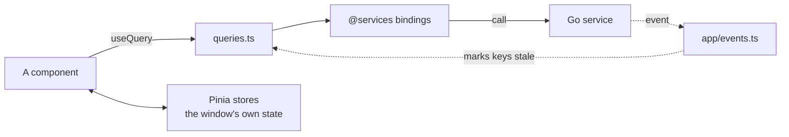

# frontend/src

[Architecture](../../docs/ARCHITECTURE.md) › Frontend

The Vue app that every PMT window runs. It shows what Go returns and handles interaction: the facts, paths and checks
all come from the [services](../../docs/ARCHITECTURE.md#the-services), and the app draws them as they are.

It is Vue 3 with `<script setup>` and TypeScript, [Nuxt UI](https://ui.nuxt.com/) for components, Pinia for state and
[Pinia Colada](https://pinia-colada.esm.dev/) for reading Go. The editor is Monaco, the explorer `@pierre/trees`, the
Event Graph Vue Flow laid out by dagre, and the Terminal xterm.js.

## Folders

| Folder       | What it holds                                                                                                                                                                       |
| ------------ | ----------------------------------------------------------------------------------------------------------------------------------------------------------------------------------- |
| `main.ts`    | The bootstrap: plugins, the one error handler, Monaco's setup, the mount.                                                                                                           |
| `app/`       | The frame every page sits in: the top bar, the status bar, the command palette, the agent pane, Settings, and the tables the whole app reads (pages, commands, events, the router). |
| `pages/`     | One folder per page: `library`, `wizard`, `newmod`, `ide`, `graph`, `health`, `notes`, `publish`.                                                                                   |
| `ui/`        | Components more than one page uses, such as the hover card, a source link or the load order.                                                                                        |
| `stores/`    | The Pinia stores.                                                                                                                                                                   |
| `queries.ts` | Every query that reads Go, and the keys that events and mutations refresh.                                                                                                          |
| `lib/`       | Plain functions: confirmations and toasts, the sentences the UI writes from facts, placeholders.                                                                                    |
| `styles/`    | `themes.css`, the one palette, and Nuxt UI's and the articles' styles.                                                                                                              |
| `assets/`    | Fonts, game icons and the logo.                                                                                                                                                     |

## Reading Go

Every call into Go goes through the generated bindings, imported from `@services/<service>/service`. Their types
come from `@services/<service>/models`. Run `task common:generate:bindings` after a Go method or payload changes, and
never edit `frontend/bindings/` by hand.

A page reads Go through a query from `queries.ts`: one query per Go method, each with a key. Pinia Colada caches the
answer, shares it between components and fetches it again when its key goes stale. `loadQuery` reads one outside a
component. A query that needs the open workspace is enabled by the workspace store's `isOpen`.

Go's events arrive in `app/events.ts`. It is one table: each event, and the query keys it makes stale. So when a mod's
file changes on disk, or Settings writes `config:changed`, every page that shows that data refreshes without code of
its own.

## State

Data from Go lives in the query cache, not in stores. A store holds what belongs to the window itself: the editor's
groups and tabs, the search being typed, the shells, the windows and what passes between them. `stores/workspace.ts`
holds the active workspace's id and what every page reads of the open workspace.

## Pages and commands

`app/pages.ts` is the catalog of pages: each page's title, icon, help and whether it needs a workspace. The router
makes one lazily loaded route per page, and the top bar shows the catalog's tabs.

`app/commands.ts` is the table of every command: its id, its label, its shortcut and a `when` that says whether it
applies now. The command palette, the menus and the shortcuts all read it, so a command is written once.

## Windows

The main window and every pop-out run this same app; a window's URL says what it shows, such as `page:<route>`,
`editor:<n>`, `terminal` or `wiki`. Windows talk over broadcast channels (`stores/windows.ts`), which is how a tab
moves from one window to another. Opening, showing or closing another window goes through the app service, since
Wails' runtime acts only on the window that calls it.

## The editor

`pages/ide/editor/` sets up Monaco once and holds what the editor is made of:

- `monaco.ts`: the Paradox languages, their providers, the themes and the options.
- `grammars.ts`: Monarch grammars that color shapes only; the meaning comes from Go's semantic tokens on top.
- `providers.ts`: Monaco's providers, each handing the lsp service's answer to Monaco.
- `models.ts`: the open files as Monaco models, which follow their files on disk and show Go's problems.
- `hover.ts`: PMT's hover card, in place of Monaco's own.
- `tabs.ts`, `conflicts.ts`, `changes.ts`: how a tab shows each format, merge conflicts, and an agent's changes.

## Look

- **Nuxt UI first.** A component that Nuxt UI has is used through its own props, such as `:items` for menus, tabs
  and selects, rather than built from `v-if` and `v-model`. Table filters live in `UTable`'s column state.
- **One palette.** `styles/themes.css` is the only place colors are set: a block of tokens for each `data-theme`, a
  dark and a light one per family, bridged to Nuxt UI's `--ui-*` variables. Code is colored by ten `--syn-<category>`
  tokens.
- **Dense where content fills the screen.** Editors, diffs and merges get the space; path and config chrome stays
  compact.

## Checks

`task check:frontend` runs the type check (`npm run check`, `.vue` files included), eslint with prettier (`npm run
lint`) and vitest (`npm test`). `task check` runs it with the Go checks.
