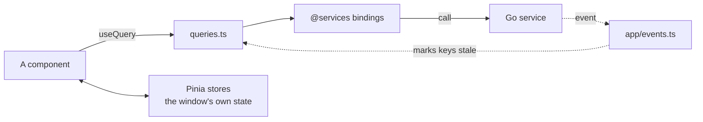

# frontend/src

[Architecture](../../docs/ARCHITECTURE.md) › Frontend

The Vue app that every PMT window runs. It shows what Go returns and handles interaction: the facts, paths and checks
all come from the [services](../../docs/ARCHITECTURE.md#the-services), and the app draws them as they are.

It is Vue 3 with `<script setup>` and TypeScript, [Nuxt UI](https://ui.nuxt.com/) for components, Pinia for state and
[Pinia Colada](https://pinia-colada.esm.dev/) for reading Go. The editor is Monaco, the explorer `@pierre/trees`, the
Atlas's canvas drawn by Vue Flow and laid out by ELK's layered layout, and the Terminal xterm.js.

## Folders

| Folder       | What it holds                                                                                                                                                                       |
| ------------ | ----------------------------------------------------------------------------------------------------------------------------------------------------------------------------------- |
| `main.ts`    | The bootstrap: plugins, the one error handler, Monaco's setup, the mount.                                                                                                           |
| `app/`       | The frame every page sits in: the top bar, the status bar, the command palette, the agent pane, Settings, and the tables the whole app reads (pages, commands, events, the router). |
| `pages/`     | One folder per page: `library`, `wizard`, `newmod`, `ide`, `atlas`, `health`, `patch`, `publish`.                                                                                   |
| `ui/`        | Components more than one page uses, such as the hover card, a source link or the load order.                                                                                        |
| `stores/`    | The Pinia stores.                                                                                                                                                                   |
| `queries.ts` | Every query that reads Go, and the keys that events and mutations refresh.                                                                                                          |
| `lib/`       | Plain functions: confirmations, toasts and error reports, the sentences the UI writes from facts, placeholders.                                                                     |
| `styles/`    | `themes.css`, the one palette, and Nuxt UI's and the articles' styles.                                                                                                              |
| `assets/`    | Fonts, game icons and the logo.                                                                                                                                                     |

## Reading Go

Every call into Go goes through the generated bindings, imported from `@services/<service>/service`. Their types
come from `@services/<service>/models`. Run `task common:generate:bindings` after a Go method or payload changes, and
never edit `frontend/bindings/` by hand.

A page reads Go through a query from `queries.ts`: one query per Go method, each with a key. Pinia Colada caches the
answer, shares it between components and fetches it again when its key goes stale. `loadQuery` reads one outside a
component. A query that needs the open workspace is enabled by the workspace store's `isOpen`.

Go's events arrive in `app/events.ts`. It is one table: each event, and the query keys it makes stale. So when a mod's
file changes on disk, or Settings writes `config:changed`, every page that shows that data refreshes without code of
its own.

## State

Data from Go lives in the query cache, not in stores. A store holds what belongs to the window itself: the editor's
groups and tabs, the search being typed, the shells, the windows and what passes between them. `stores/workspace.ts`
holds the active workspace's id and what every page reads of the open workspace.

## Agents

The agent pane and the editor's tab completion speak the Agent Client Protocol to an agent's program over a stream that
Go carries. [The editor](#the-editor) holds the review of an agent's edits and the tab completion. The rest:

- `stores/agent.ts`: the window's chats with agents. It refuses, for every agent, a permission request to change a
  file PMT keeps read-only (the game's, an external mod's), with a notice in the chat. A request to change a file
  outside the workspace is always asked, names the whole path, and offers no "allow always". So is a shell command
  that names a read-only folder, since no agent's path rule covers its shell. A prompt written while
  a turn runs goes at once to an agent that steers, and joins the session's queue for any other: the queue's oldest
  prompt is sent when a turn ends normally, and a stopped or failed turn leaves the queue as it is. A subagent's
  updates, which come on its session's stream under the subagent's own id, build a thread of the subagent's. A plan
  document is kept for the session and never shown in the transcript; a Markdown file in the agent's plans folder
  is a plan too, and never a change to review. A request to start on a plan is always asked and its answer never
  kept. A turn that ends leaves its record in the transcript: how long it took, the tokens and the cost the agent
  reports, the files it changed and the problems it added to them. The page names each turn by an id, under which
  Go keeps the files' texts from before it, so one turn's changes can be undone. Retry sends the last prompt again.
  Each agent has two sets of kept choices, Chat and Quick: a new
  session starts on Chat, and a quick session on Quick. `run` has the agent do one job in a session no list shows,
  on its Quick choices: the editor's inline ask (Ctrl+I), whose session may change that one file, and the commit
  message's draft, whose session may change none. Such a session is refused everything else it asks.
- `stores/agentThread.ts`: a thread, which a session and a subagent each have: the transcript's entries, the
  terminals and the checklists, and how an agent's updates build them. Terminal output comes in base64 and is
  decoded here.
- `stores/agentWork.ts`: what a session has running and has written beside its transcript: its subagents, its
  background commands, its plan documents and the prompts the agent suggests next.
- `stores/agentRequests.ts`: what an agent asks the user: a permission, a link to open, a form to fill in, and how
  each answer is sent back.
- `stores/edits.ts`: the edits an agent's tool calls make to files, which it hands to Go to review.
- `stores/completion.ts`: the window's one connection to the agent that completes code in the editor. It starts with the
  window's first open file while an installed agent offers completion and the setting is on, and holds whether the
  agent is ready, needs the user to sign in, or failed, which Settings shows.
- `lib/stream.ts`: opens the stream to an agent's program, which the chats and the completion connection both use.
- `app/agent/AgentPane.vue`: the pane, with its sessions menu and the files under review.
- `app/agent/AgentSession.vue`: one chat: its states, its prompt box, and the request to start on a plan, which the
  prompt box holds.
- `app/agent/AgentTranscript.vue`: a thread's transcript, a session's or a subagent's.
- `app/agent/AgentWork.vue`: the row above the prompt box and its tray: the checklist, the subagents and the
  background commands.
- `app/agent/AgentPlan.vue`: the session's plan documents, pinned in one row, with a picker, Open and Show changes.
- `app/agent/AgentSetting.vue`: one of an agent's settings as a panel: what it is, each choice with a line, the one
  in force marked, and in red a choice with which the agent asks PMT nothing. The prompt box's model, effort and mode
  pickers and its panel of other settings are made of it. Plan is a switch of the box's own, whichever setting the
  agent keeps it in.
- `app/agent/AgentUsage.vue`: the ring in the prompt box and its panel of the context window and the plan's usage.
- `ui/AgentSignIn.vue`: the ways to sign in to an agent, a button each, which the pane and Settings show.
- `ui/AgentLink.vue`: a link an agent asks to open, with its host marked, and the choice to open or decline it.
- `ui/LineCounts.vue`: the lines a change adds and removes, in the pane, the chat and the editor.

## Pages and commands

`app/pages.ts` is the catalog of pages: each page's title, icon, help and whether it needs a workspace. The router
makes one lazily loaded route per page, and the top bar shows the catalog's tabs.

`app/commands.ts` is the table of every command: its id, its label, its shortcut and a `when` that says whether it
applies now. The command palette, the menus and the shortcuts all read it, so a command is written once.

## Windows

The main window and every pop-out run this same app; a window's URL says what it shows, such as `page:<route>`,
`editor:<n>`, `terminal` or `wiki`. Windows talk over broadcast channels (`stores/windows.ts`), which is how a tab
moves from one window to another. Opening, showing or closing another window goes through the app service, since
Wails' runtime acts only on the window that calls it.

## The editor

`pages/ide/editor/` sets up Monaco once and holds what the editor is made of:

- `monaco.ts`: the Paradox languages, their providers, the themes and the options.
- `grammars.ts`: Monarch grammars that color shapes only; the meaning comes from Go's semantic tokens on top. A mod's
  descriptor is the exception: Go colors nothing in it, so its grammar colors its keys and values.
- `providers.ts`: Monaco's providers, each handing the lsp service's answer to Monaco.
- `models.ts`: the open files as Monaco models, which follow their files on disk and show Go's problems. A model is
  made already in Go's colors, fetched beside its text: Monaco asks a provider for colors only 100 ms or more after an
  editor shows a model, so a file would open bare. `lib/syntax.ts`'s `paintModel` sets them, through Monaco's own
  modules for a model's coloring, which `env.d.ts` gives types. The compare (`ui/CompareView.vue`) paints its two
  sides the same way before it makes its editor.
- `completion.ts`: tab completion. It tells the completion agent of the open files and shows its suggestions as Monaco's
  inline completions, which PMT's own ghost text gives way to.
- `review.ts`: an agent's edits to a file, shown as the file against its text from before them, with Keep and Undo for
  each change and for the file.
- `hover.ts`: PMT's hover card, in place of Monaco's own.
- `tabs.ts`, `conflicts.ts`, `changes.ts`: how a tab shows each format, merge conflicts, and the lines changed since
  the last commit.

## Look

- **Nuxt UI first.** A component that Nuxt UI has is used through its own props, such as `:items` for menus, tabs
  and selects, rather than built from `v-if` and `v-model`. Table filters live in `UTable`'s column state.
- **One palette.** `styles/themes.css` is the only place colors are set: a block of tokens for each `data-theme`, a
  dark and a light one per family, bridged to Nuxt UI's `--ui-*` variables. Code is colored by twelve `--syn-<category>`
  tokens, which `lib/syntax.ts` maps each token type to; Go gives every key, value and piece of markup its type. A
  theme may draw one of them in bold (`--syn-<category>-weight`).
- **Dense where content fills the screen.** Editors, diffs and merges get the space; path and config chrome stays
  compact.

## Checks

`task check:frontend` runs the type check (`npm run check`, `.vue` files included), eslint with prettier (`npm run
lint`) and vitest (`npm test`). `task check` runs it with the Go checks.
