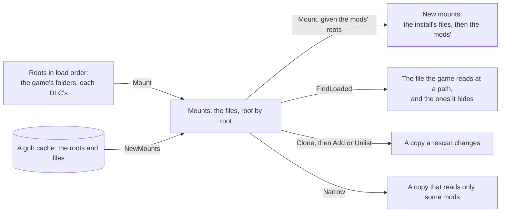
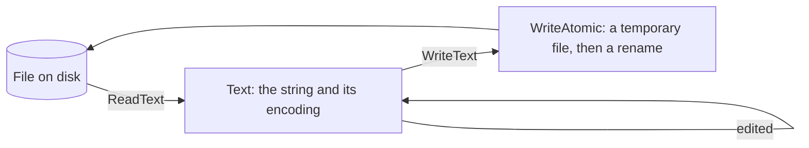

# files

[Architecture](../../docs/ARCHITECTURE.md) › [Engine](../../docs/ARCHITECTURE.md#the-engine) › files

The files package lists the files of an install, a mod or a dump folder, tells what format each one is, and decides
which of them the game reads. It also reads and writes a file's text in its own encoding, reads a table's rows, compares
and joins paths, unpacks a zip and applies ignore rules. The formats, the stage folders, the rules of the mounts, the
table syntax and what it does with input that breaks them are its package doc, in [files.go](files.go).

It knows no game. Which folders a game reads are [game](../game/README.md)'s rows, what each one holds are
[lang](../lang/README.md)'s, and a root
carries what the game mounts below it: its stage folders, and a mod's `replace_path` folders.

**Uses** nothing else of PMT · **Used by** most of the engine and most services.

The [index](../index/README.md) holds the mounts of what it scanned. A mods' index mounts the mods' roots on the
install's mounts, so a file's position means the same in both:

A file's text is read and written whole, in the encoding it was stored in:

## Evidence

Measured on the three installs, over the roots `Game.ListInstallRoots` gives:

| | CK3 | Vic3 | EU5 |
|---|---|---|---|
| roots: the install's folders and its DLCs | 33 | 12 | 8 |
| roots with stage folders | 0 | 0 | 8 |
| files the mounts list | 52,641 | 28,207 | 58,637 |
| stage folders written in another letter case | – | – | 0 |
| table files | 2 | 1 | 2 |
| their lines | 14,545 | 242 | 4,609 |
| rows `ListRows` reads | 13,625 | 242 | 4,609 |
| comment rows | 918 | 0 | 0 |
| rows with an empty first column | 2 | 0 | 0 |

- EU5's `clausewitz` folder holds `loading_screen` and `main_menu`, its `jomini` and `game` folders all three stages,
  and each DLC one to three of them. The only files outside a stage are each DLC's own `checksum_manifest.txt`,
  `.dlc.json` and `thumbnail.dds`, which are the game's and so are mounted.
- The table files are `map_data/definition.csv` and `map_data/adjacencies.csv` in CK3, `map_data/adjacencies.csv` in
  Vic3, and `in_game/map_data/adjacencies.csv` and `in_game/map_data/ports.csv` in EU5.

## Files

| file | what it holds |
|---|---|
| `files.go` | The package doc, formats and how a file gets one, roots and files, stages, the walk, and ignore rules. |
| `mounts.go` | The mounts: the files of a list of roots, which one the game reads at a path, why it does not read another (`Hiding`), and their load order. |
| `contents.go` | Text and its encodings, atomic writes, gob caches, a table's rows and unzipping. |
| `paths.go` | Keys, relative paths and slugs, and whether a path is a file or a folder. |

## Terms

- **Root**: one folder laid out like the game's own: the game's folder, a DLC's or a mod's.
- **File**: one file below a root: its path, key, rel, origin, stage and format.
- **Rel**: a file's path from its root, with forward slashes.
- **Key**: the path cleaned, lower-cased and with forward slashes. It is what two paths are compared by.
- **Origin**: whose a root is: `OriginVanilla`, or a mod's id.
- **Stage**: one of the folders a game mounts below each root, in its order, such as EU5's `in_game`. A path means the
  same in each.
- **Mounts**: the files of a list of roots in load order, and which one the game reads at each path.
- **Group**: the files at one path from a stage, in load order. The game reads the last of them.
- **Load order**: the order the game reads roots, stages and files in.
- **Format**: the class of a file, told by its extension and its folder.
- **Text**: a file's text, with its encoding.
- **Encoding**: how a text file was stored: UTF-8, UTF-8 with a byte order mark, or Windows-1252.
- **Row**: one row of a table file, named by its first column.
- **Slug**: a user's text made into a file or folder name: lower case, ASCII only, words joined by `_`.
- **Ignore**: a list of ignore rules with gitignore's meaning.
