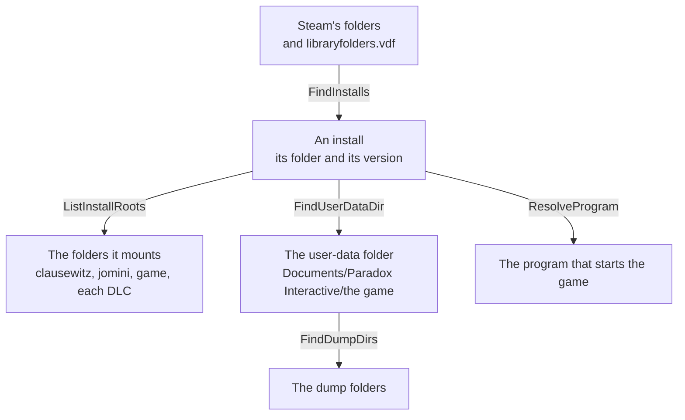

# game

[Architecture](../../docs/ARCHITECTURE.md) › [Engine](../../docs/ARCHITECTURE.md#the-engine) › game

The game package holds the games PMT supports and finds them on this machine. For each game it holds its names and
Steam id, how its mods are laid out, how it is started, and the guide that tells a modder which copy of a file or a
definition the game keeps. It also finds a game's installs and their versions, the folders an install mounts, its
user-data and dump folders, its Workshop folders and the program that starts it. The rules it applies to installs,
and what it does with input that breaks them, are its package doc, in [game.go](game.go).

It holds nothing of the script language. The language's rules are [lang](../lang/README.md)'s rows, and a fact one
feature reads sits beside the function that reads it.

**Uses** [files](../files/README.md) · **Used by** [lang](../lang/README.md), [schema](../schema/README.md) and
[schema/gen](../schema/gen/), [index](../index/README.md), [workspace](../../services/workspace/README.md),
[lsp](../../services/lsp/README.md), [draw](../../services/draw/README.md),
[health](../../services/health/README.md), [steam](../../services/steam/README.md),
[wiki](../../services/wiki/README.md).

## Files

| file | what it holds |
|---|---|
| `game.go` | The package doc, the `Game` type, the three games' rows, `LookupGame` and `ListGames`. |
| `install.go` | Finding an install, its version, the folders it mounts, its user-data, dump and Workshop folders, and the program that starts it. |

## Terms

- **Game**: one supported game, with the facts about it that are not about its script language.
- **Stage**: one of the folders a game loads at its different stages, such as EU5's `in_game`, in the order the game
  mounts them.
- **Install**: one copy of a game on this machine, found in a Steam library.
- **User data**: the game's folder under Documents, where its mods, dumps and logs are written.
- **Dump folders**: the folders under the user data that the game writes its dump files to.
- **Program**: how a game is started on one system: its executable, and the flags for debug mode.
- **Guide**: the sentences that tell a modder how a game picks which copy of a file or a definition it keeps.
- **Example**: three definitions the game ships in one database, which the app shows where it explains how a mod
  changes the game.
