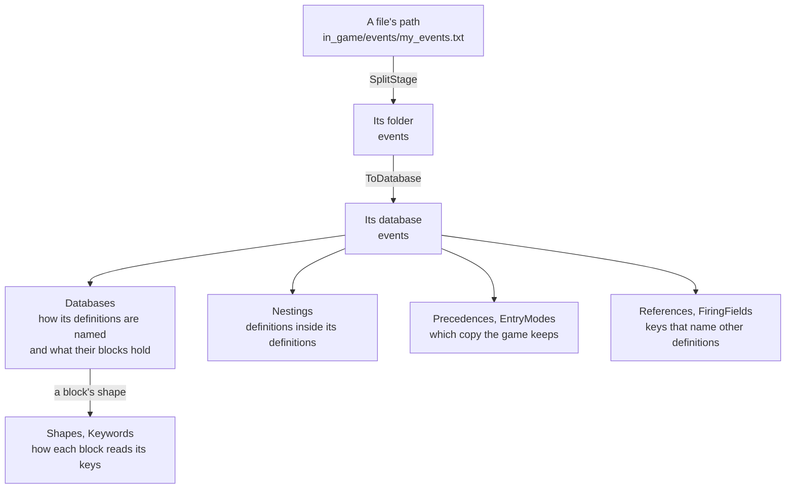

# game

[Architecture](../../ARCHITECTURE.md) › [Engine](../../ARCHITECTURE.md#the-engine) › game

Every fact PMT knows about the three games, as tables of rows. It covers where each game keeps its files, what each
folder holds, which copy of a definition the game keeps, and how a block of script reads its keys. It also says where
a game is installed on this machine.

This is the only package that knows one game from another. The parser ([jomini](../jomini/README.md)), the language
model ([schema](../schema/README.md)) and the [index](../index/README.md) are shared by all three games. When a game
does something its own way, they look it up here instead of testing which game it is.

**Uses** [files](../files/README.md), [jomini](../jomini/README.md) · **Used by** [schema](../schema/README.md) and
[schema/gen](../schema/gen/), [index](../index/README.md), [workspace](../../services/workspace/README.md),
[lsp](../../services/lsp/README.md), [draw](../../services/draw/README.md), [graph](../../services/graph/README.md),
[health](../../services/health/README.md), [steam](../../services/steam/README.md),
[wiki](../../services/wiki/README.md), [mcp](../../services/mcp/README.md), [search](../../services/search/).

## How a row works

A table is a Go slice or map of rows written out as literals. No function builds a row.

- **Games.** A row says which games it holds for in `Games`, and an empty list means all three. A game's own rows are
  written before the shared ones, and a lookup takes the first row that fits.
- **Sources.** The comment on a row says where the fact comes from: a file of the install and its line, a line of
  the dumps, a message in the game's executable, or a wiki page. Nothing reads it when the app runs. It is there so
  a reader can check the row against the game.
- **Fixed values.** A column that takes one of a few fixed values, such as `Keeps` (first, last, highest or merged),
  lists them in its comment.
- **One value per game.** A fact that is a single value for each game is a field of that game's row in `game.go`,
  not a table. Examples are its Steam app id, its mod descriptor, its stage folders, the forms its error log names a
  line in, and the text Health shows on how it picks a copy.

## From a file to its rows

Every file of a mod or the game goes through the same lookups. Take an event file.

1. **The stage.** EU5 keeps its files under three stage folders: `in_game`, `main_menu` and `loading_screen`.
   `SplitStage` takes the stage off the path. CK3 and Vic3 have no stages.
2. **The database.** The folder names the database. `ToDatabase` drops `common/` and the extension, so `events` is
   `events` and `common/traits` is `traits`. `FindDatabase` gives the folder's row in `Databases`, where it has one.
   The events row says the folder holds events and gives the order their blocks run in. CK3's also says `scope =`
   sets an event's root scope. A folder with no row is still a database, whose top-level keys name its definitions.
3. **Definitions inside definitions.** `Nestings` lists databases written inside another database's definitions.
   CK3's titles hold titles, each key starting with its tier (`[ekdcb]_*`). An activity holds its phases.
4. **The copy the game keeps.** `LookupPrecedence` gives the first row of `Precedences` that holds for the database.
   CK3 events keep the copy with the highest `id_override_priority`. Vic3 and EU5 events keep the first one loaded.
   With no row, the last copy by file name wins. In Vic3 and EU5, a mod changes a copy already loaded by writing an
   entry mode before its name, such as `REPLACE:` (`EntryModes`).
5. **What names what.** `References` are key paths whose values name other definitions. An on_action's `on_actions`
   list names on_actions, and a customizable localization's `text/localization_key` names a localization key.
   `FiringFields` are the fields whose value fires an event, an on_action or a decision.
6. **How each block reads.** Every block has a shape: fields, triggers, effects, a value, modifiers and a few more.
   `Shapes` gives each shape its rules for reading a key, tried in order. `Keywords` are the language's own keys,
   such as `limit`, `every_*`, `random_list` and a value block's `add`. Each has a fixed shape and the line a hover
   card shows.

The [schema](../schema/README.md) reads these rows to build a game's databases and to walk each file. The
[index](../index/README.md) uses each database's precedence to pick the copy the game keeps.

Files other than script are rows too. CK3's `map_data/definition.csv` is a table whose first column names a province.
EU5's `map_data/definitions.txt` nests its geography five deep, one database per level, from continent to province.

## What a row may claim

Most of what PMT knows about a game comes from the game itself, not from this package. The commands, scopes and data
types are what the game's dumps declare, read by the [schema](../schema/README.md). The schema also learns from the
docs the install ships beside its script, the wiki and the game's own files. `Source` ranks those sources.

A row says how to read the game. It never makes a problem on its own: only a claim from the dumps, the docs, the wiki
or a definition in the files is firm enough for that (`CanAccuse`). There is one exception. A row of
`DumpCorrections` fixes a dump line that contradicts its own text, and it wins over the dump.

## The Visual view's rules

`gui.go` and `coat.go` hold the rules for GUI files and coats of arms that all three games share, in the rows `GUI` and
`Coat`. They say which keys name widgets, how each built-in widget type draws, which data calls the Visual view
answers and how a coat's textures are colored. What one game does beyond them is on its own row (`Game.GUI`,
`Game.Coat`), such as the color form its coats are written in. The [draw](../../services/draw/README.md) service reads
them.

## Installs

`install.go` finds a game on this machine. `FindInstalls` looks through Steam's library folders. `LoadVersion` reads
the game's version from the launcher's settings. Without them it reads the log the game writes at each start, if the
game has started since its last update, and else Steam's build number. The file also finds the game's user-data and
dump folders and the program that starts it in debug mode.

## Adding a fact

1. Find the table that asks the question. If none does, a new field on the nearest row type beats a new function.
2. Write the row as a literal, with `Games` set unless it holds for all three.
3. Cite the source in the row's comment: the install's file and line, a dump line, an executable message or a wiki
   page and section.
4. Check it on all three installs with `task test:gate`, with `PMT_TEST_INSTALL_CK3`, `PMT_TEST_INSTALL_VIC3` and
   `PMT_TEST_INSTALL_EU5` set to the install roots.

## Files

| file | what it holds |
|---|---|
| `game.go` | The three games' rows, `Source`, and the lookups on a game, such as `LookupGame` and `SplitStage`. |
| `databases.go` | The database tables, such as `Databases`, `Nestings`, `Precedences` and `References`. |
| `language.go` | The language's own rules, such as `Shapes`, `Keywords` and the names script saves and reads back. |
| `gui.go` | The rules for GUI files and the Visual view. |
| `coat.go` | The rules for coats of arms. |
| `install.go` | Finding an install, its version, its user-data and dump folders, and the program that starts it. |

## Terms

- **Row**: one literal entry of a table, holding one fact for the games it names.
- **Game**: one supported game, with the facts that are a single value for it.
- **Stage**: one of EU5's three top folders, under which its files sit.
- **Database**: the definitions of one folder or file, named by the folder without `common/`.
- **Definition**: one named block of a database, such as one event or one trait.
- **Nesting**: a database whose definitions are written inside another database's definitions.
- **Callable**: a database whose definitions script calls by name, such as scripted effects.
- **Precedence**: how definitions of one name combine, and which copy the game keeps.
- **Entry mode**: a prefix before a definition's name, such as `REPLACE:`, that changes a copy already loaded.
- **Reference**: a key path whose values name other definitions.
- **Shape**: what a block holds, which decides how its keys are read.
- **Keyword**: a key of the language itself, with a fixed shape and a line for the hover card.
- **Source**: where a fact the schema learned came from, ranked.
