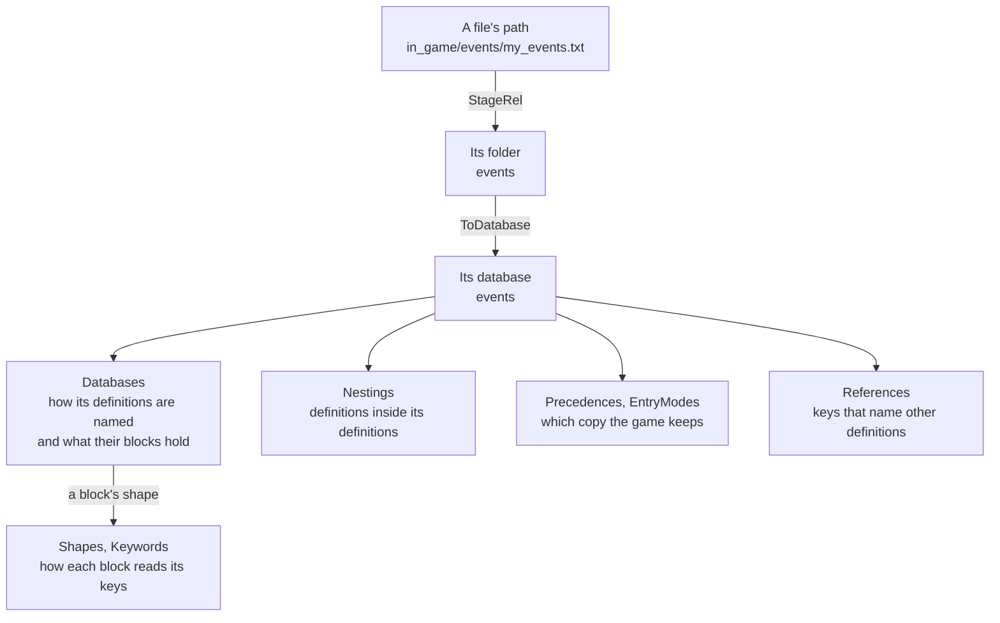

# game

[Architecture](../../docs/ARCHITECTURE.md) › [Engine](../../docs/ARCHITECTURE.md#the-engine) › game

The game package holds facts about the three games, as tables of rows: what each folder holds, which copy of a
definition the game keeps, how a block of script reads its keys, and how GUI files and coats of arms are drawn. It
also finds a game's installs on this machine. The rules it applies to its rows, to the databases, to the language and
to installs, and what it does with input that breaks them, are its package doc, in [game.go](game.go).

It holds the rows that several packages read. A table that one package reads is that package's, beside the function
that reads it. The parser ([jomini](../jomini/README.md)), the language model ([schema](../schema/README.md)) and the
[index](../index/README.md) are shared by all three games.

**Uses** [files](../files/README.md), [jomini](../jomini/README.md) · **Used by** [schema](../schema/README.md) and
[schema/gen](../schema/gen/), [index](../index/README.md), [workspace](../../services/workspace/README.md),
[lsp](../../services/lsp/README.md), [draw](../../services/draw/README.md), [graph](../../services/graph/README.md),
[health](../../services/health/README.md), [steam](../../services/steam/README.md),
[wiki](../../services/wiki/README.md), [mcp](../../services/mcp/README.md), [search](../../services/search/).

Every file of a mod or the game goes through the same lookups. Take an event file.

## Files

| file | what it holds |
|---|---|
| `game.go` | The package doc, the three games' rows, `Source`, and the lookups on a game, such as `LookupGame` and `FindLocReplacement`. |
| `databases.go` | The database tables, such as `Databases`, `Nestings`, `Precedences`, `References` and `DatabaseFields`, and the words their rows take, such as `Keep` and `ModePlace`. |
| `language.go` | The language's own rules, such as `Shapes` and their key rules, `Keywords`, and the names script saves and reads back. |
| `gui.go` | The rules for GUI files and the Visual view. |
| `coat.go` | The rules for coats of arms. |
| `install.go` | Finding an install, its version, the folders it mounts, its user-data, dump and Workshop folders, and the program that starts it. |

## Terms

- **Row**: one literal entry of a table, holding one fact for the games it names.
- **Game**: one supported game, with the facts that are a single value for it.
- **Stage**: one of EU5's three top folders, under which its files sit.
- **Database**: the definitions of one folder or file, named by the folder without `common/`.
- **Definition**: one named block of a database, such as one event or one trait.
- **Nesting**: a database whose definitions are written inside another database's definitions.
- **Callable**: a database whose definitions script calls by name, such as scripted effects.
- **Precedence**: how definitions of one name combine, and which copy the game keeps.
- **Entry mode**: a prefix before a definition's name, such as `REPLACE:`, that changes a copy already loaded.
- **Reference**: a key path whose values name other definitions.
- **Shape**: what a block holds, which decides how its keys are read.
- **Key rule**: one way a block reads a key, such as a call, a command or a field. A shape tries its rules in order.
- **Database field**: one field of a database's definitions with what no dump states about it, such as the weight
  that an on_action's `random_events` entry is written under.
- **Keyword**: a fixed word of the script language, such as `if`, `limit` or `add`, with the blocks it is written
  in and what its own block holds. A command or a field of one database is no keyword.
- **Declaration**: what the dumps declare a command as: an effect, a trigger or a link.
- **Source**: where a fact the schema learned came from, ranked.
