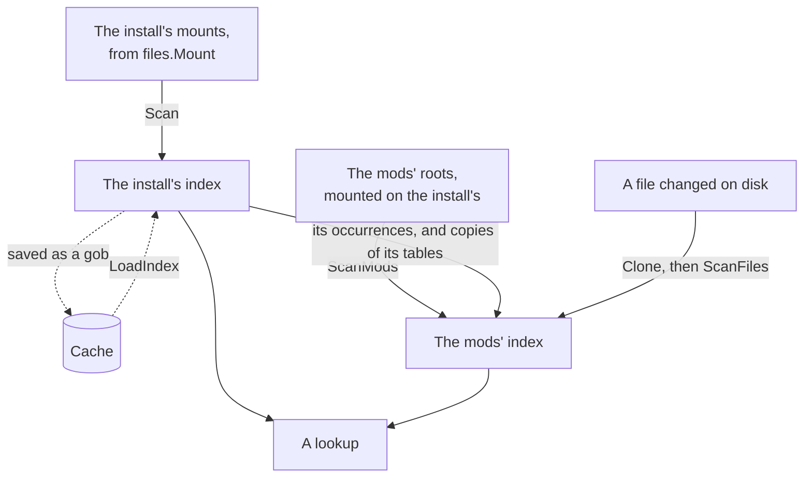

# index

[Architecture](../../docs/ARCHITECTURE.md) › [Engine](../../docs/ARCHITECTURE.md#the-engine) › index

The index records what a scan found in the files of an install or of a workspace's mods: every definition, reference
and localization message, with lookups by name. It decides which definition the game keeps when several compete, and it
lists what fires what. The rules it applies to the scan, to which copy the game keeps and to what fires what, and what
it does with input that breaks them, are its package doc, in [index.go](index.go).

What a database is and how it matches names is the [schema](../schema/README.md)'s. Which file the game reads at a path
is decided by the mounts of [files](../files/README.md), which an index embeds, so their `Files`, `FindLoaded` and
`IsLoaded` are the index's own.

**Uses** [files](../files/README.md), [game](../game/README.md), [jomini](../jomini/README.md),
[loc](../loc/README.md), [schema](../schema/README.md), [texture](../texture/README.md) · **Used by** the
[workspace](../../services/workspace/README.md) service, which builds and holds it, and the services that read it:
[lsp](../../services/lsp/README.md), [draw](../../services/draw/README.md), [graph](../../services/graph/README.md),
[health](../../services/health/README.md), [wiki](../../services/wiki/README.md),
[steam](../../services/steam/README.md) and [search](../../services/search/).

## Two indexes

An open workspace has two indexes, and the mods' stands on the install's:

## Evidence

Measured on the three installs: the names each install defines, outside the localization, by why the game keeps the
copy `FindKept` returns.

| | CK3 | Vic3 | EU5 |
|---|---|---|---|
| names | 230,387 | 94,697 | 182,585 |
| a lone copy | 228,751 | 93,837 | 167,432 |
| every copy merges | 1,297 | 644 | 14,750 |
| the last by file name | 239 | 134 | 381 |
| the first by file name | 1 | 2 | 19 |
| lower in the load order | 0 | 0 | 1 |
| a file at the same path hides the copy that would win | 79 | 80 | 0 |
| an entry mode | 0 | 0 | 0 |
| open: copies share the highest priority | 20 | 0 | 0 |
| open: an entry mode where the database takes none | 0 | 0 | 2 |
| files the game does not read, all shadowed | 103 | 117 | 84 |

- In EU5, 16 of the first copies have copies merged in by `INJECT:`, 22 in all, which the DLCs write into the game's
  genes, government reforms and laws. No install writes an entry mode that creates a definition or takes another
  copy's place, so those rules come from the Vic3 and EU5 wikis alone.
- No install has a `replace_path`, so no copy wins by `replace` and no file is dropped.

## Files

| file | what it holds |
|---|---|
| `index.go` | The package doc, and the index and its parts: occurrences, tables, sites and postings, and what a site points at. |
| `scan.go` | Scanning an install, scanning the mods on top of it, rescanning changed files, and loading the cache. |
| `lookup.go` | Lookups by name: what a reference resolves to, what uses a name, what a database defines. |
| `combine.go` | What the game keeps: the winning definition of a name, found by [game](../game/README.md)'s rule over the copies in files the game reads, and kept for each name with several copies until the next scan. |
| `translation.go` | The game's localization in a second language, scanned once on an install's index and cached by language, and the message the game shows for a key. |
| `problems.go` | The problems of a walked file that need every file: a name nothing defines, a text written twice or missing, a required key no copy writes, an entry mode with nothing to act on, a priority tie and an unknown data call. `ListProblems` returns them with the ones the walk recorded. |
| `fires.go` | What fires what, and the rule that marks a reference as firing, with the fields it lists. |

## Terms

- **Index**: what a scan found in one list of files, with the postings that answer lookups by name.
- **Occurrence**: the stored form of one definition, reference or message.
- **Site**: a handle to one occurrence: a file's position and the occurrence's position in it.
- **Role**: what an occurrence does with its name: defines it, refers to it or localizes it.
- **Table**: the interned texts of one kind, each given one ordinal.
- **Posting**: one group of occurrences: those of one role in one database.
- **Winner**: the definition the game keeps when several share a name, and why. The reason and the cause are
  [game](../game/README.md)'s.
- **Unsettled**: the reason of a winner where no source says which copy the game keeps.
- **Fire**: one firing: a source, a target, the reference that names the target, and the scripted effects between.
