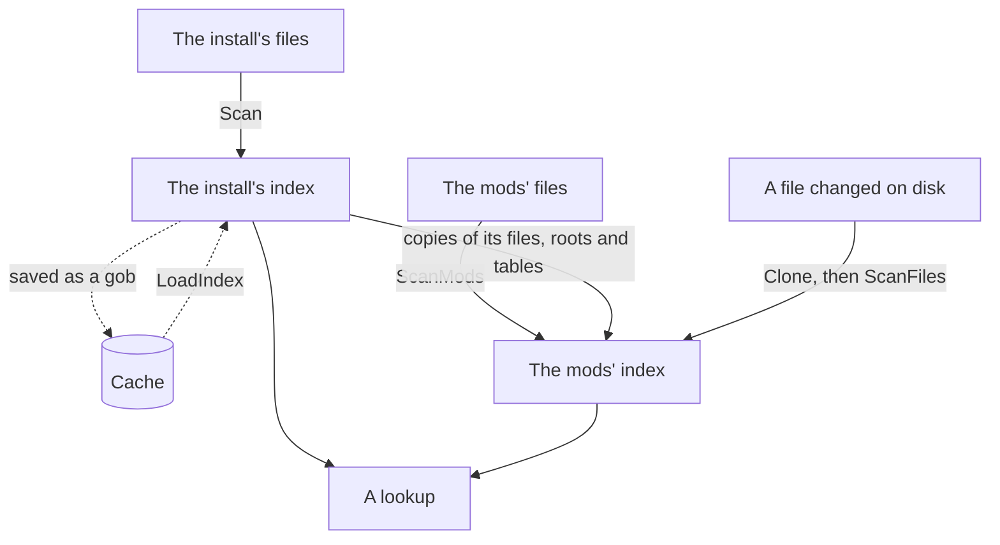

# index

[Architecture](../../docs/ARCHITECTURE.md) › [Engine](../../docs/ARCHITECTURE.md#the-engine) › index

The index records what a scan found in the files of an install or of a workspace's mods: every definition, reference
and localization message, with lookups by name. It decides which file and which definition the game keeps when several
compete, and it lists what fires what.

It stores nothing per statement but those three. Hover, completion and the checks walk the file again when asked; the
index only says where a name is defined and used. What a database is and how it matches names is the
[schema](../schema/README.md)'s, and the rules the index applies are rows in [game](../game/README.md)'s tables.

**Uses** [files](../files/README.md), [game](../game/README.md), [jomini](../jomini/README.md),
[loc](../loc/README.md), [schema](../schema/README.md), [texture](../texture/README.md) · **Used by** the
[workspace](../../services/workspace/README.md) service, which builds and holds it, and the services that read it:
[lsp](../../services/lsp/README.md), [draw](../../services/draw/README.md), [graph](../../services/graph/README.md),
[health](../../services/health/README.md), [wiki](../../services/wiki/README.md),
[steam](../../services/steam/README.md) and [search](../../services/search/).

## Two indexes

An open workspace has two indexes, and the mods' stands on the install's:

- The install's index is scanned once for each version of the install and its dumps, and cached.
- The mods' index starts with copies of the install's files, roots and tables, so a file's position and an ordinal mean
  the same in both, and a `Site` names one file in either. It scans and posts only the mods' own files.
- A lookup reads the install's postings first and the mods' after them, so a result is in load order.
- `ScanFiles` scans changed files again and refuses a file of the install. A file deleted since the scan keeps its
  position, which a new file at the same path takes again; `IsListed` tells a listed file from a deleted one. `Clone`
  copies what `ScanFiles` writes, so a rescan changes a copy while readers go on reading the original.
- `Narrow` returns a copy of the mods' index that answers for the install and the given mods only.

## What it stores

An `Occurrence` is the stored form of one definition, reference or message, small enough to keep for every file of the
game. Its `Role` says which of the three it is. Its database, name, entry mode and language are ordinals into the
index's four `Table`s, and `Table.Intern` gives a text its one ordinal.

`Occurrences` holds a list per file, in the order `Files` lists the files, each in source order with a definition before
what it holds. So the references inside a definition follow it without a break. `Texts` runs beside it and holds each
message's text.

A `Site` is a handle to one occurrence: a file's position and the occurrence's position in it. The index stores no
source, so a site's text comes from the file's tree, which the workspace keeps.

A `Posting` is one group of occurrences, those of one role in one database. The index lists each posting's sites by
name, and that is what a lookup reads.

## The scan

`Scan` builds the install's index and `ScanMods` the mods'. Each runs over the files in parallel on `files.Workers`
goroutines.

- A script, GUI, asset, font or GFX file is walked once by `schema.Walk` with a visitor that turns each statement's
  definition and references into occurrences.
- A localization file is read by `loc.Parse`. Each message is an occurrence, followed by what its text refers to: keys,
  text formats and icons, the names its data calls refer to, and a game concept that a call names in the concept
  format.
- A table file of a database named by its first column gives a definition for each row.

A file is built against tables of its own so that building takes no lock, and its ordinals move into the index's tables
afterwards. Scanning the mods also gives the schema the scripted definitions they declare.

The game's own files keep the texts of their base-language messages only, since another language's text can be read from
its file when asked. The mods keep every language's texts. A database whose names match without regard to case is listed
in `Caseless`, and its names are stored in lower case; `ToCaseless` writes a name as the index stores it.

`ListFiles` lists the files under a list of roots, in root order. A file under a root that sits inside another root is
listed once, under the inner one, as `FindRoot` finds it for any path.

## Lookups

`Resolve` returns the definitions that a reference names, in load order. A local definition never counts; `ResolveLocal`
lets the definitions local to the reference's own file count too. A reference in `game.AnyCall`, a call that may name
any callable database, stands for one reference per callable database, as `ListCallees` lists them. `ListUses` returns
the references to a name, and for a callable database the `game.AnyCall` references to it as well. `IsUsedByGame` asks
only whether the game's own files make such a reference, from the install's postings, without building that list.

A localization key is defined by its messages, so its role is `RoleLocalizes` where every other database's is
`RoleDefines`.

## What the game keeps

Two questions decide what the game reads. `combine.go` answers each in one place.

**The file at a path.** `FindLoaded` returns the file the game reads for a path from a root: the last one in load order.
It also returns the files that one hides, the dropped ones among them.

- A mod's `replace_path` drops the game's files in exactly the folder it names, not in its subfolders. No source says
  whether it also drops an earlier mod's files there, so `FindLoaded` keeps them, and a name such a drop would decide is
  unsettled.
- A stage folder (the game's `StageRoots`, in the order it mounts them) is not part of the path, so the same path in two
  stages is one path. In a game with stages, a mod's file outside a stage folder is never read: it is not loaded, hides
  no file and defines nothing.
- `IsLoaded` asks whether the game reads a file at all, and `ResolveTexture` finds the image file a written texture path
  names among the files the game reads.

**The definition of a name.** `FindWinner` decides which of several definitions of one name the game keeps, by the
database's `game.Precedence`. Only copies in files the game reads take part. They are put in load order first: by their
files, where a folder's files come before its subfolders' (Vic3's `game.log` and the EU5 wiki say so; no CK3 source
says otherwise) and names compare byte by byte with case, or by their roots where the precedence says the playset
decides. Then:

- A database whose precedence names entry modes keeps the first plain definition. Where the database keeps every copy,
  a later plain one joins it. The entry modes act in a pass after every plain copy, the kinds in the order of
  `game.EntryModes` and the modes of one kind in file order (the wikis' Mod compatibility and Processing order
  pages). A mode acts on what stands: one that replaces takes its
  place, one that adds joins it, and one with nothing to act on does nothing unless it creates. The precedence's
  `Injects` says what a mode that adds does. Where it is unsettled, a mode that adds leaves the winner unsettled.
- A copy written with an entry mode in a database that takes none makes the winner unsettled: no source says what the
  game does with it. EU5's coats of arms are such a database: their row keeps the last copy, as the EU5 wiki's Flag
  modding page says.
- Otherwise the first or the last by file name wins, the lower root's where the playset decides, the one with the
  highest override priority, or all of them merge, as the precedence's `Keeps` says. Copies that share the highest
  priority are unsettled: the game logs an error and keeps one, and no source says which.
- Where some copies sit in files the game does not read, the reason is `replace` if the copies a `replace_path` dropped
  would change the winner, and `path` if the copies a file at the same path hid would.

A `Winner` is the kept definition, the `Reason` it wins, what leaves an unsettled one open (`Cause`) and the definitions
merged into it. A lone copy has no reason. Where the reason is `unsettled`, `Site` is one of the copies in question, for
the features that need one to show.

`ResolveSite` is the one place a copy's own reason is decided. The lsp service's sites and hover cards both read it. It
gives the winner's reason to the winner, `injected` or `combined` to a copy merged into it, and `unsettled` to every
loaded copy where the winner is unsettled. A copy in a file the game does not read is never kept: its reason is
`shadowed` where a file at the same path later in the load order replaces its file, or `dropped` where a mod's
`replace_path` names its folder, and `FindHider` gives the origin of that mod too. `Reasons` holds each reason in
words, written once, as templates the contest's facts fill.

`FindKept` finds the winner of a name in a database, and `ListKept` the winner of every name.

## Fires

A `Fire` is one firing: one definition fires another through the reference that names it (`Use`), passing through the
scripted effects in `Via`. `ListFires` returns what a definition fires, and `ListFiredBy` what fires it. What is fired
is an event, an on_action or a decision, the databases in `Schema.FireDatabases`. What fires can be a definition of any
database, such as a character interaction or a journal entry.

A reference fires what it names only where the scan marks it `Firing`. The walker's context at the reference decides:

- In effect script it fires. That is an effect, or the arguments of one: `trigger_event = { id = … }`, a scripted
  effect's parameters. An effect is a command the dumps declare as an effect where it is written, or a call of a
  scripted effect. A decision fires only through an effect the game's `DecisionEffects` names (CK3's
  `execute_decision`).
- In an on_action's own lists it fires: `events`, `random_events`, `on_actions`, `fallback` and the rest.
- In the fields a game's `FiringFields` lists it fires. The schema reads them as a definition's own fields, though the
  game runs what they name, such as CK3's council tasks' `monthly_on_action`.
- As a scope link (`decision:x = { … }`) it never fires, nor inside a trigger block, nor in a preview, a block that is
  shown in the tooltip and never run. Nor does it fire anywhere else: a GUI file, a localization file, or a
  definition's other fields and lists.

Both directions read that mark and nothing else, so they agree, and a definition that fires itself is listed both ways.
With the follow flag set, a firing through a scripted effect (`Schema.Effects`) is followed into it, and scripted
effects that call each other end the walk. Only the definition the game keeps is called by name. Where the winner is
unsettled, every copy in a file the game reads fires and is fired, since no source says which one runs.

## The cache

`LoadIndex` loads the install's index from its gob file. The gob holds the exported fields only, so the load builds the
tables' lookups, the paths and the postings again. The workspace service saves the index beside the schema.

## Files

| file | what it holds |
|---|---|
| `index.go` | The index and its parts: occurrences, tables, sites and postings, and what a site or a path points at. |
| `scan.go` | Scanning an install, scanning the mods on top of it, rescanning changed files, and loading the cache. |
| `lookup.go` | Lookups by name: what a reference resolves to, what uses a name, what a database defines. |
| `combine.go` | What the game keeps: the loaded file at a path, the winning definition of a name, and the reason. |
| `fires.go` | What fires what, and the rule that marks a reference as firing. |

## Terms

- **Index**: what a scan found in one list of files, with the postings that answer lookups by name.
- **Occurrence**: the stored form of one definition, reference or message.
- **Site**: a handle to one occurrence: a file's position and the occurrence's position in it.
- **Role**: what an occurrence does with its name: defines it, refers to it or localizes it.
- **Table**: the interned texts of one kind, each given one ordinal.
- **Posting**: one group of occurrences: those of one role in one database.
- **Winner**: the definition the game keeps when several share a name, and why.
- **Reason**: why the game keeps a copy, why it does not read one, or that no source says which it keeps.
- **Cause**: what leaves an unsettled choice open.
- **Unsettled**: the reason of a winner where no source says which copy the game keeps.
- **Fire**: one firing: a source, a target, the reference that names the target, and the scripted effects between.
- **Load order**: the order the game reads roots, stages and files in.
