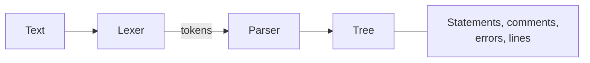

# jomini

[Architecture](../../docs/ARCHITECTURE.md) › [Engine](../../docs/ARCHITECTURE.md#the-engine) › jomini

The jomini package parses Paradox script, GUI and asset files into a flat tree. It also tells what shape a written word
has: a number, a date, a parameter, a color or a data call. It answers only what the text says, such as where each
statement starts and ends and what its parts are.

What a key means is the [schema](../schema/README.md)'s question, and what a game reads is [game](../game/README.md)'s.
This package never imports `game`.

**Uses** nothing else of PMT · **Used by** the rest of the engine ([loc](../loc/README.md), [game](../game/README.md),
[schema](../schema/README.md), [index](../index/README.md)) and the services that read script.



## The tree

A `Tree` is the parse of one text. Its statements are one flat slice in document order, and a block's children sit right
after it. Statement 0 is the file itself. A statement knows its `Parent` and its `Last`, one past its last descendant,
so its children are the statements between it and `Last`.

```text
a = { b = 1 c = 2 } d = 3

0  the file    children 1, 4
1  a = { … }   Last 4, children 2, 3
2  b = 1       Last 3
3  c = 2       Last 4
4  d = 3       Last 5
```

Every part of a statement is a `Span` into the source, never a copied string: its key, operator, tag, value and block,
and the whole statement. A scalar's value keeps its quotes. A block runs from its opening brace to its closing one. A
bare value in a list has a value and no key.

The tree also keeps the comments as spans, the parse errors and the line index. A line ends at `\n`, `\r\n` or a lone
`\r`. Every offset is a UTF-8 byte offset, and a `Position` counts its column in bytes too. Monaco's lines and UTF-16
columns are `lsp`'s, which converts at its edge.

`FindStatement` returns the innermost statement that covers an offset. `LookupStatement` returns the one that starts at
an offset, which is how an edit names a block. Where several children have a key, `FindChild` takes the last one.

## The parse

`Parse` never fails. A malformed text gives the statements it could parse, and each problem is an `Error` on the tree
with a code: `unclosed-block`, `unexpected-brace`, `unclosed-string` or `missing-value`. A block that is never closed
runs to the end of the text. A closing brace at the file's level closes nothing and is reported. [loc](../loc/README.md)
reports its own problems as the same `Error`.

`NewTree` gives the tree of a text before any script is read from it, which is all a localization file needs.

The lexer splits the text into scalars, operators, braces and comments:

- A quoted string is one scalar, a backslash escaping the character after it.
- A `[ … ]` inside a word is part of that word, spaces and all. It ends at its closing `]` or at the end of the line.
- A `#` comment runs to the end of its line.
- The operators are `=`, `==`, `!=`, `<`, `>`, `<=`, `>=` and `?=`.

A tagged block such as `rgb { … }` is one value with a tag, and so is `list "x"`.

## The shapes of a word

- **Parameter.** `$NAME$`, with or without a `|default`, anywhere in a word.
- **Constant.** `@name`, or an expression `@[…]`. `Tree.ResolveNumber` works out the number a value stands for: a
  number, a constant the file declared earlier, or an expression of numbers, constants, the four operators and
  brackets.
- **Dotted chain.** `SplitChain` splits `scope:x.var:y.z` into its links, keeping a dot inside brackets or quotes.
- **Prefixed name.** `SplitPrefixed` splits `prefix:name`.
- **Number key.** A key written as a number or a date. `NumberKey` (`<number>`) stands for it in a key path.
- **Key path.** `MatchKeyPath` asks whether the keys that lead to a statement fit a path of segments, each a glob,
  `<number>` or `**` for any depth.

## Colors

`Colors` lists the ways script writes a color, each a `Color`: an `rgb` block, a block with no tag, `hsv`, `hsv360` and
`hex`. A part of rgb, or of a block with no tag, is out of 255, or out of 1 when red, green and blue are each at most 1.
A fourth part is the alpha. A hex block holds one number: six hex digits for red, green and blue, or eight with the
alpha last, written with or without `0x` (CK3 writes `hex{ 50779b }`, EU5 `hex{ 0xffbcb6b1 }`).

`ColorParts` gives a block's parts as written, and `ParseColor` turns a tag and its parts into an `RGBA`; `ToColor`
reads a statement's color block that way. `EncodeColor` writes a color back the way an existing block wrote its own:
in the same scale, with an alpha only where that block had one, and a hex number with its digits and its `0x` as they
were. A `ColorForm` is how to write a color where there is no block to copy: a tag and an example's parts, which give
the scale.

## Data calls

A `Call` is one data call as a GUI file or a localization text writes it between brackets, such as
`Root.GetCharacter.GetName`. It is a list of `Step`s, each with its arguments and any cast written before it, and the
suffix a localization call writes after `|`. An `Argument` is a quoted text, a number or a nested call.

Every span is in the file's own offsets, so the parser takes the offset where its text starts. `SubstituteCall` fills in
a macro's parameters with the arguments written for them. Which function a step calls, and what it returns, is the
schema's.

## Edits

An `Edit` replaces a span with a text, so an empty span inserts and an empty text deletes. `DiffEdits` gives the
smallest list that turns one text into another, and replaces the whole text where either one is not valid UTF-8.
`Tree.BuildInsertion` adds lines as the last statements of a block, indented the way the file indents, with a tab where
the file has no indentation of its own.

## Files

| file | what it holds |
|---|---|
| `tree.go` | The tree: spans, positions, errors, the line index, statements and the lookups over them. |
| `parse.go` | The lexer and the parser. |
| `shapes.go` | The shapes of a word, dates, dotted chains, key paths, and constants with the numbers they resolve to. |
| `colors.go` | The color blocks script writes: reading them, and writing a color back. |
| `call.go` | Data calls and filling in a macro's call. |
| `edit.go` | Edits to a text, the diff between two texts, and inserting lines into a block. |

## Terms

- **Tree**: one parse of one text.
- **Statement**: one statement: `key op value`, a bare value inside a list, or a block with or without a tag.
- **Span**: a half-open range of bytes in a text.
- **Lines**: the line index of a text.
- **Position**: a line and a column, both from zero, the column in UTF-8 bytes.
- **Error**: one problem a parse found, with its code and its span.
- **Edit**: a span and the text that replaces it.
- **Date**: a date as the game writes one, `year.month.day`.
- **Color**: one way script writes a color, such as an rgb block or a hex number.
- **RGBA**: a color as red, green, blue and alpha channels, each from 0 to 1.
- **ColorForm**: how a color is written where there is no block to copy.
- **Call**: one data call, its steps and its suffix.
- **Step**: one step of a call, with its arguments and its cast.
- **Argument**: one argument of a step: a quoted text, a number or a nested call.
- **Cast**: the type a step is cast to, written in parentheses before it, such as `(int_bool)`.
