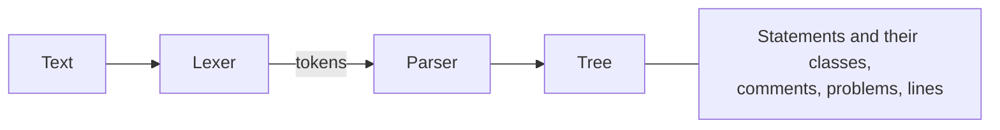

# jomini

[Architecture](../../docs/ARCHITECTURE.md) › [Engine](../../docs/ARCHITECTURE.md#the-engine) › jomini

The jomini package parses Paradox script, GUI and asset files into a flat tree, and gives each key, tag and value its
class: a word, a number, a date, a chain of links, a parameter, a constant, a data call and so on. It also reads colors
and data calls, and writes a tree's text again in an even layout. The rules it reads by, and what it does with a text
that breaks them, are its package doc in [tree.go](tree.go).

What a key means is the [schema](../schema/README.md)'s question, and what a game reads is [game](../game/README.md)'s.
This package never imports `game`.

**Uses** nothing else of PMT · **Used by** the rest of the engine ([loc](../loc/README.md), [game](../game/README.md),
[schema](../schema/README.md), [index](../index/README.md)) and the services that read script.

## Evidence

Measured on the three installs, over every script, GUI, GFX and asset file under `game`, `jomini` and `clausewitz`:

| | CK3 | Vic3 | EU5 |
|---|---|---|---|
| files read | 7,500 | 6,133 | 7,342 |
| commas that separate values | 1,784 in 30 files | 1,698 in 32 files | 1,956 in 24 files |
| semicolons that separate values | 88 in 23 files | 77 in 21 files | 82 in 14 files |
| numbers written with the f of a C float | 25 in 10 files | 18 in 4 files | 25 in 4 files |
| blocks opened deeper than 1,000 levels | 0 | 0 | 0 |

- Most of the commas are in the license texts and font notices the games keep as .txt files beside their script:
  CK3's `game/licenses/software` holds 600 of them, and EU5's `game/loading_screen/fonts` 641. In script a comma
  separates the names of a list, as in CK3's defines:
  `ACCESSORY_PREFIXES_BLOCK_0 = { "female_clothing", "male_clothing", "female_clothes", … }`.
- A semicolon ends a line of Vic3's and EU5's defines (`LENS_TOOLBAR_ITEM_WIDTH = 100;`,
  `SIDEMENU_VERTICAL_OFFSET = 10.0f;`), of CK3's map environment (`map_objects_sunny_sun_elevation = 0.4;`), and of a
  few GUI and asset lines (EU5's `spacing = 8;` and `state = { name = "idle" };`).
- The f of a C float is in the defines of all three games (CK3's `DISBAND_FADE_LENGTH = 3.0f`) and in CK3's GUI
  (`glow_texture_downscale = 5.5f`).
- No shipped file nests a block that deep. The limit keeps a mod's file from overflowing the parser's stack.

## Files

| file | what it holds |
|---|---|
| `tree.go` | The package doc, and the tree: spans, positions, problems, the line index, statements and the lookups over them. |
| `parse.go` | The lexer and the parser. |
| `shapes.go` | The class of a written word, the links of a chain, the parameters of a text, dates, key paths, and constants with the numbers they stand for. |
| `colors.go` | The color blocks script writes: reading them, and writing a color back. |
| `call.go` | Data calls and filling in a macro's call. |
| `edit.go` | Edits to a text, the diff between two texts, writing a tree's text again in an even layout, and inserting lines into a block. |

## Terms

- **Tree**: one parse of one text.
- **Statement**: one statement: `key op value`, a value alone inside a block, or a block with or without a tag.
- **Class**: what a key, a tag or a value is written as, inside any quotes: an identifier, a number, a chain and so on.
- **Lead**: the value written alone just before a statement in its block, such as `template` in `template x { }`.
- **Link**: one link of a chain, such as `scope:x` in `scope:x.father`, with its prefix and name or its argument.
- **Parameter**: a `$NAME$` or `$NAME|default$` written in a text.
- **Span**: a half-open range of bytes in a text.
- **Lines**: the line index of a text.
- **Position**: a line and a column, both from zero, the column in UTF-8 bytes.
- **Problem**: one problem found in a text, with its code and its span.
- **Edit**: a span and the text that replaces it.
- **Date**: a date as the game writes one, `year.month.day`.
- **Color**: one way script writes a color, such as an rgb block or a hex number.
- **RGBA**: a color as red, green, blue and alpha channels, each from 0 to 1.
- **ColorForm**: how a color is written where there is no block to copy.
- **Call**: one data call, its steps and its suffix.
- **Step**: one step of a call, with its arguments and its cast.
- **Argument**: one argument of a step: a quoted text, a number or a nested call.
- **Cast**: the type a step is cast to, written in parentheses before it, such as `(int_bool)`.
