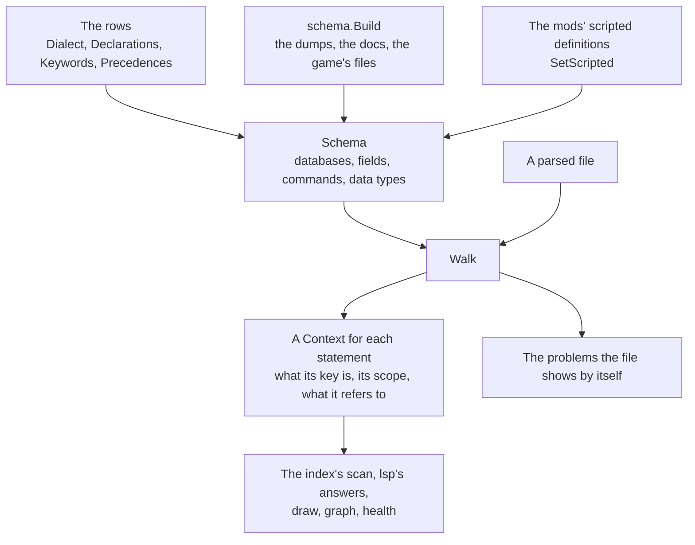

# lang

[Architecture](../../docs/ARCHITECTURE.md) › [Engine](../../docs/ARCHITECTURE.md#the-engine) › lang

The lang package is the script language of one game version. It holds three things. The first is the language's
fixed rules, as tables of rows: its keywords, what each kind of block holds, where each database's definitions are
written and which copy of a name the game keeps. The second is the model of what is learned about one game version,
`Schema`: which databases exist, what each key takes and which commands run in which scope. The third is the one walk
that reads a file against both. The rules it applies to its rows, to the databases, to scripted definitions and to
the walk, and what it does with input that breaks them, are its package doc, in [model.go](model.go).

`Schema` is the only description of the language, and every feature that reads script uses the walk's result.
Building a `Schema` from the dumps, the docs and the game's files is [schema](../schema/README.md)'s. Parsing is
[jomini](../jomini/README.md)'s. Where a name is defined is the [index](../index/README.md)'s. What the editor shows
of it is [lsp](../../services/lsp/README.md)'s.

**Uses** [files](../files/README.md), [game](../game/README.md), [jomini](../jomini/README.md),
[loc](../loc/README.md) · **Used by** [schema](../schema/README.md), [index](../index/README.md),
[workspace](../../services/workspace/README.md), [lsp](../../services/lsp/README.md),
[draw](../../services/draw/README.md), [graph](../../services/graph/README.md),
[health](../../services/health/README.md), [mcp](../../services/mcp/README.md),
[wiki](../../services/wiki/README.md).

## From rows to a walk

## Files

| file | what it holds |
|---|---|
| `model.go` | The package doc and the model: `Source`, `Claim`, `Field`, `Definition`, `Database`, `Schema` and the lookups on it. |
| `keywords.go` | Each game's `Dialect`, the `Keywords`, the kinds of block (`Shape`), the databases the dumps fill and the names script saves. |
| `declarations.go` | The databases' declarations: one `Declaration` for each database that needs one, with its nestings, the keys that name other definitions, and the localization keys of its definitions' texts. |
| `keep.go` | Which copy of a name the game keeps when several files define it (`Precedence`, `FindWinner`), and the reasons in words. |
| `gui.go` | The fixed keys and names of GUI files and of coats of arms. |
| `commands.go` | The lookups of what the dumps declare: effects, triggers, links and scope types, and a chain of links such as `root.father`. |
| `datacalls.go` | The data calls written in localization and GUI text, followed through the data types the dumps declare. |
| `scripted.go` | What files declare for script to call by name: scripted definitions with their parameters, modifier types and event namespaces, and of several copies of one name the one the game keeps. |
| `walk.go` | The walk: `Walk`, `Context`, what each key is, the scope a statement runs in, and the problems a file shows by itself. |
| `definitions.go` | What a statement defines, found during the walk. |
| `values.go` | What a statement's value refers to, and whether it fits what its key takes. |

## Terms

- **Row**: one literal entry of a table, holding one fact for the games it names.
- **Dialect**: the facts of the script language that differ from game to game, for one game.
- **Schema**: the language of one game version.
- **Source**: where a fact about the language came from, ranked.
- **Claim**: one fact about a field, with the source that says it.
- **Database**: the definitions of one folder or file, named by the folder without `common/`.
- **Definition**: one named thing of a database: a block a file writes, or an effect, a trigger, a link or a scope
  type the dumps list.
- **Declaration**: what is known about a database before any file is read.
- **Nesting**: a database whose definitions are written inside another database's definitions.
- **Field**: one key that may be written in a definition, with what it takes.
- **Expected**, **ValueType**: what a field's value must be.
- **Requirement**: whether a field must be written.
- **Vanilla**: what the game's own files write at a field, counted.
- **Shape**: what a block holds, which decides how its keys are read.
- **Keyword**: a fixed word of the script language, such as `if`, `limit` or `add`. A command or a field of one
  database is no keyword.
- **Precedence**: which copy of a name the game keeps, and how copies combine.
- **Winner**, **Reason**, **Cause**: the copy the game keeps among the copies in load order, why, and what leaves
  the choice open.
- **Entry mode**: a word before a definition's name, such as `REPLACE:`, that changes a copy already loaded.
- **ScriptedCopy**: one copy of a scripted definition as a file declares it.
- **DataType**, **DataFunction**: one type of the data binding language, and one of its functions.
- **Context**: everything the walk decided about one statement.
- **Copy**: one name that one statement defines in a database.
- **Reference**: a name that a key or a value refers to in a database.
- **Saved**: one scope a definition has saved under a name.
- **Category**: what a key or a value is, which the editor colors by.
- **Problem**: one thing the walk found wrong in a file.
