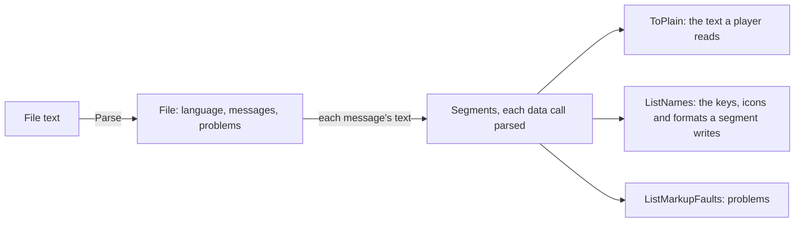
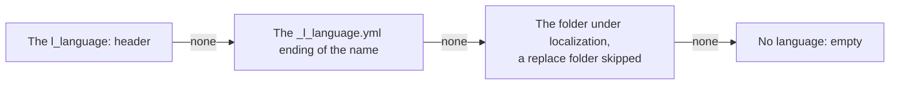

# loc

[Architecture](../../docs/ARCHITECTURE.md) › [Engine](../../docs/ARCHITECTURE.md#the-engine) › loc

The loc package reads and writes localization files. It parses a file into its messages, decides the file's language,
splits a message's text into its markup, and gives the plain text a player sees. The format it reads, the language
rule, the markups and what it does with a file that breaks them are its package doc, in [loc.go](loc.go).

It knows no game and no index: what a key names, and which message the game keeps, are the
[index](../index/README.md)'s. It shares [jomini](../jomini/README.md)'s spans, line index and problems, so a
localization file and a script file are read with the same offsets.

**Uses** [jomini](../jomini/README.md) · **Used by** [lang](../lang/README.md), [schema](../schema/README.md), [index](../index/README.md) and the
services that read localization.

A file's language is decided by the first of three that names one:

## Evidence

Measured on the three installs, over every localization file:

| | CK3 | Vic3 | EU5 |
|---|---|---|---|
| files | 11,567 | 2,308 | 7,794 |
| messages | 2,800,474 | 1,242,935 | 2,909,393 |
| messages with no version | 2,627,743 | 1,228,168 | 2,909,180 |
| messages whose text holds a quote | 18,600 | 8,407 | 1,845 |
| of them, with a quote no backslash escapes | 9,004 | 1,939 | 25 |
| problems Parse reports | 0 | 0 | 0 |
| files whose language the header gives | 11,557 | 2,308 | 7,794 |
| files whose language the name or the folder gives | 10 | 0 | 0 |
| headers after a file's first | 18 | 20 | 10 |
| headers with a comment after them | 0 | 0 | 1 |
| `localisation` folders | 0 | 0 | 0 |

- The games write a quote inside a message's text with or without a backslash before it, so a text is read to the
  last quote on its line, not to the first.
- The ten CK3 files with no header are empty: nine of the `pam_discovery_events_l_<language>.yml` files take their
  language from their name, and `game/localization/french/dlc/fp2/dlc_fp2_triggers.yml` from its folder.
- Every file is for one of the eleven languages the games keep, and every header names its language in lower case.

## Files

| file | what it holds |
|---|---|
| `loc.go` | The package doc, messages and files, the parser, the language rule and the writer. |
| `markup.go` | Splitting a message's text into markup with each data call parsed, the plain text, the names and the markup faults. |

## Terms

- **File**: one parsed localization file.
- **Message**: one line of a localization file: a key, its version and its text, split into segments.
- **Language**: the language a file is for, as the game names it without its `l_`; as a type, that name's folder and its
  name in English.
- **Segment**: one piece of a message's text, with its spans, and its parsed call where it is a data call.
- **Markup**: what a segment is: text, key, call, format, icon or break.
