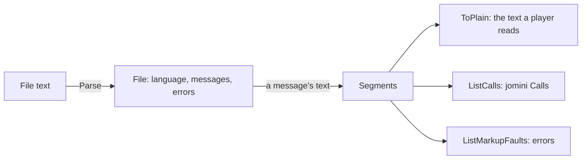
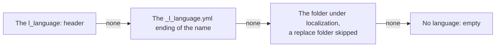

# loc

[Architecture](../../docs/ARCHITECTURE.md) › [Engine](../../docs/ARCHITECTURE.md#the-engine) › loc

The loc package reads and writes localization files. It parses a file into its messages, decides the file's language,
splits a message's text into its markup, and gives the plain text a player sees.

It shares [jomini](../jomini/README.md)'s spans, line index and errors, so a localization file and a script file are
read with the same offsets. It knows no game and no index: what a key names, and which message the game keeps, are the
[index](../index/README.md)'s.

**Uses** [jomini](../jomini/README.md) · **Used by** [schema](../schema/README.md), [index](../index/README.md) and the
services that read localization.

## The file

A `File` is one parsed localization file. A `Message` is one line of it: a key, its version and its text, with the span
of the whole message, of the key and of the text without its quotes. `ParseMessage` reads one line, given where the line
starts in its file, so that the spans come out in the file's offsets.

`Parse` never fails:

- A line above the header is an error, `loc-content-before-header`, and is not read.
- A line that is neither a header, a comment nor a message is `malformed-line`.
- A message with no closing quote is `loc-unterminated-value`, and its text runs to the end of its line.

## The language

A file's language is decided by the first of three that says:

Each is read without regard to case.

- `ToLanguageRel` gives the path of the file that holds the same messages in another language, setting the language in
  the folder and in the name where the file has them.
- `ToLanguageKey` writes a language as the game does, `l_english`.
- `DescribeLanguage` gives a folder's name in English, such as Simplified Chinese for `simp_chinese`, or the folder
  itself for a language it does not know. `IsLanguage` tells a language's folder from the others the games keep
  beside them, such as `jomini` and `modifiers`.

## Markup

`Segments` splits a message's text into its pieces, each a `Segment` with its `Markup` and its spans in the file. The
markups are:

- plain text;
- `$key$`, another message's text or a value the game fills in;
- `[call]`, a data call;
- `#format … #!`, a text format and its end;
- `@icon!`, an icon;
- `\n`, a break.

A segment's `Text` is the piece without its markers, and its `TextSpan` is where that text sits. A format's segment is
followed by the segments of any markup written inside its name.

A segment's `Kind` is empty as parsed. Other packages set it to say what kind of value a data call shows, number or
text, and then the segment's `Text` holds a sample of that value instead of the call.

`ListCalls` parses the call segments into [jomini](../jomini/README.md) `Call`s. `ListMarkupFaults` reports two
mistakes in the plain text: a `[` that starts a call but is never closed, and a format ended with `#.` or `#,` where
the game ends one with `#!`.

## The writer

`Encode` writes the text of a localization file for one language: the header, then its messages. `EncodeMessages`
writes the messages alone, in the layout the game reads. `EncodeAddition` writes what adds messages at the end of a
file's text, with a line break first where the text lacks a final one, in the text's own line ending.

## Files

| file | what it holds |
|---|---|
| `loc.go` | Messages and files, the parser, the language rule and the writer. |
| `markup.go` | Splitting a message's text into markup, the plain text, the data calls and the markup faults. |

## Terms

- **File**: one parsed localization file.
- **Message**: one line of a localization file: a key, its version and its text.
- **Language**: the language a file is for, as the game names it without its `l_`; as a type, that name's folder and its
  name in English.
- **Segment**: one piece of a message's text, with its spans.
- **Markup**: what a segment is: text, key, call, format, icon or break.
