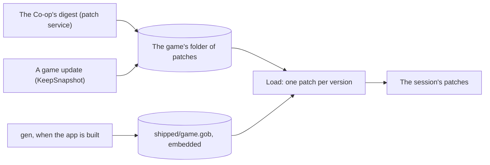

# patch

[Architecture](../../docs/ARCHITECTURE.md) › [The engine](../../docs/ARCHITECTURE.md#the-engine) › patch

The patch package holds what each version of a game changed, as plain data, and everything PMT keeps to know it. It
knows no workspace and no network: the [patch service](../../services/patch/README.md) fetches the Co-ops' digests
into it, the [workspace](../../services/workspace/README.md) loads a game's patches into its session, and
[lsp](../../services/lsp/README.md) asks it what a mod's range of patches did to a name or a file. The rules it
applies, and what it reads past, are in the package doc.

**Uses** [files](../files/README.md), [game](../game/README.md), [index](../index/README.md),
[jomini](../jomini/README.md), [lang](../lang/README.md), [schema](../schema/README.md)

## Where a patch comes from

`Load` merges the three sources (`Merge`): per version the digest's patch wins over the shipped history's, which wins
over PMT's own, and each part the winner lacks comes from the next that has it.

## The folder of patches

`ResolveDir` is one folder of the app's cache for each game. Only this package knows its files:

| file | what it holds | written by |
|---|---|---|
| `digest.gob`, `sha.txt` | the digest's patches and the commit they were read from; the file's time is the last ask of GitHub | `SaveDigest`, `MarkAsked` |
| `dumps-<version>.gob` | the digest's dumps of a version an install is on, which the schema uses where the install's own are stale | `SaveDigest` |
| `local.gob` | the patches PMT compared itself | `KeepSnapshot` |
| `snapshots/<version>.gob` | the `Snapshot` of each version an install is on | `KeepSnapshot` |

## Snapshots

Whenever a workspace's open builds the schema or the install's index, it keeps a `Snapshot` of the version: the names
the install's files define, the hash of each game file the index scan read, and the install's own dumps where they
are not older than the install. `KeepSnapshot` first compares it with the snapshot of the newest older version
(`CompareSnapshots`) and saves the result as PMT's own patch. So the dumps wait for the user to run `script_docs`
after an update, while the names and the files need none. `gen` makes the shipped history with the same comparison.

## Files

| file | what it holds |
|---|---|
| `patch.go` | The package doc, `Patch` and its parts, the merge of the sources, the ranges, and what a range's patches did to a key, a name or a file. |
| `folder.go` | The folder of patches, the digest's files in it, and the shipped history. |
| `snapshot.go` | `Snapshot`, the comparison of two, and keeping one for each version. |

## Terms

- **Patch**: what one version of a game changed against its base: its dump changes, definition changes, key renames,
  game files and articles. A local patch is one PMT compared itself.
- **Base**: the version a patch is compared against: the latest earlier version that is not an open beta.
- **History**: the patches the app ships for a game (`LoadHistory`), embedded from `shipped/<game>.gob` and written by
  the `gen` command of [schema](../schema/README.md). For Crusader Kings III it also holds the dump changes of the
  versions from 1.0.3 to 1.10.2, read once from OldEnt's repository of dumps; nothing in the code adds to those.
  Versions between that and the first `gen` saw are not in it.
- **Range**: the patches after a start version, up to an end version (`ListRange`). A mod's range starts at
  `ResolveStart`: the end itself where the supported version matches it (the mod is made for the game as it is),
  else the oldest version its supported version matches, else the base of the patch that spans it where the patches
  know none it matches (a mod made for `1.13.2` starts at `1.13.0` where the patch of `1.13.3` is compared against
  `1.13.0`; a mod made for a version in a gap of the history, as `1.17.*` for Crusader Kings III, has none), else the
  mod's base version where the supported version is blank or cannot be judged (`1.13*`), else "" for none. Open betas
  count only where the range ends at one.
- **MatchVersion**: whether a mod made for a supported version runs on a game version, and whether that can be judged.
- **KeyRename**: a key a patch gave a new key, with its replacement.
- **GameFile**: a file of the game that a patch added, changed or removed. A patch lists its game files sorted by
  path, so a file is searched (`FindFile`), not scanned.
- **Article**: one titled part of a digest's written notes, as a document the pages show, with the folders and keys
  it names.
- **Snapshot**: what PMT keeps of one version of a game for the next to be compared with.
