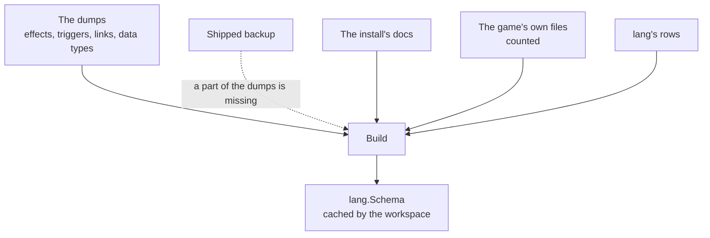

# schema

[Architecture](../../docs/ARCHITECTURE.md) › [Engine](../../docs/ARCHITECTURE.md#the-engine) › schema

The schema package builds the model of one game version's script language, a
[lang](../lang/README.md)`.Schema`. It reads three things: the files the game writes when asked to dump its language,
the doc files the install ships, and the game's own script files. The rules it applies to the dumps, the docs and the
count of the game's files, and what it does with input that breaks them, are its package doc, in
[schema.go](schema.go).

It only builds. The model itself, the language's fixed rules and the walk over a file are
[lang](../lang/README.md)'s, and the workspace caches what `Build` returns.

**Uses** [files](../files/README.md), [game](../game/README.md), [jomini](../jomini/README.md),
[lang](../lang/README.md), [loc](../loc/README.md) · **Used by**
[workspace](../../services/workspace/README.md), [wiki](../../services/wiki/README.md) and [gen](gen/).

## From sources to a schema

## Files

| file | what it holds |
|---|---|
| `schema.go` | The package doc, `Build`, and the databases made from the game's folders and from lang's declarations. |
| `dumps.go` | The reader of the dump files, the shipped backup filling what they lack, and the dumps' corrections. |
| `commands.go` | The commands, their keys and the links built from the dumps. |
| `docs.go` | The reader of the doc files: which files are docs, and the hover text, type, default and values they give each field. |
| `vanilla.go` | The count of the game's own files, and what the counts show about each field, each link and each star key. |
| `shipped.go` | The backup of each game's dumps that the app ships, embedded from `shipped/*.gob`. |

## Terms

- **Dumps**: everything the dump files of one game declare, as read from the files.
- **DumpCommand**: one effect, trigger or link as its dump file lists it.
- **Shipped backup**: the dumps of each game kept in the app, used where an install's own dump files are missing.
- **Doc**: a file the game ships beside its script that describes a database's fields, such as an `.info` file.
- **Count**: what the game's own files write at each field, added up over every file.
- **Star key**: a command the dumps list once for each definition of a database, such as `has_relation_*`.
