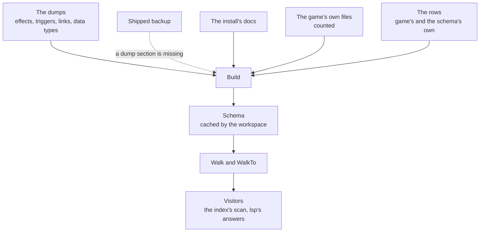

# schema

[Architecture](../../docs/ARCHITECTURE.md) › [Engine](../../docs/ARCHITECTURE.md#the-engine) › schema

The schema is the language of one game version: which databases exist, what each key takes and which commands run in
which scope. It is built from the game's dumps, the docs the install ships and the game's own files. It also owns the
one walk over a file, and every reader of script is a visitor on it. The rules it applies to the dumps, the docs, the
count of the game's files, scripted definitions and the walk, and what it does with input that breaks them, are its
package doc, in [schema.go](schema.go).

`Schema` is the only description of the language. The rules that no source states are rows: those several packages
read are [game](../game/README.md)'s, and those only the schema reads sit beside the functions that read them. Parsing
is [jomini](../jomini/README.md)'s. Where a name is defined is the [index](../index/README.md)'s. What the editor shows
of it is [lsp](../../services/lsp/README.md)'s.

**Uses** [files](../files/README.md), [game](../game/README.md), [jomini](../jomini/README.md),
[loc](../loc/README.md) · **Used by** [index](../index/README.md), [workspace](../../services/workspace/README.md),
[lsp](../../services/lsp/README.md), [draw](../../services/draw/README.md), [graph](../../services/graph/README.md),
[health](../../services/health/README.md), [mcp](../../services/mcp/README.md),
[wiki](../../services/wiki/README.md) and [gen](gen/).

## From sources to a walk

## Files

| file | what it holds |
|---|---|
| `schema.go` | The package doc, the types, `Build` and the databases: their folders, their data types' phrases, nested names and what a field's value must be. |
| `datacalls.go` | The data calls: the type each step leads to, macros, data contexts and the names a call's arguments hold. |
| `commands.go` | The lookups of what the dumps declare: the effects, the triggers, the links, the patterns that make commands, a chain of links and the types of scope. |
| `dumps.go` | The dumps reader, and the commands, arguments and prefixes built from the dumps. |
| `docs.go` | The docs reader: which files are docs, and the blurbs, types, requirements and defaults they state. |
| `vanilla.go` | The count of the game's own files, the claims it supports and the command patterns it finds. |
| `scripted.go` | The scripted definitions, modifier types and event namespaces that files declare, the mods' included, and of the copies of each scripted definition the one the game keeps. |
| `definitions.go` | What a statement defines, found during a walk. |
| `walk.go` | The walk: `Walk`, `WalkDeclarations`, `Context`, what each key is (a keyword, or the first thing its block's shape takes that has it, by `shapeRows`), and the shape of its block. |
| `values.go` | What a statement's value refers to: by its class, its field's claim, the place it is written in, and as a formula's number. Also each reference's verdict, `Inferred`. |
| `shipped.go` | The shipped backup of each game's dumps, embedded from `shipped/*.gob`. |

## Terms

- **Schema**: the language of one game version.
- **Database**: one database of the game, with the tree of fields its definitions write and its rows.
- **Field**: one key that may be written in a definition, with what it takes.
- **Claim**: one fact about a field, with the source that states it.
- **Claims**: every fact the sources state about one field.
- **Requirement**: whether a field must be written: optional, always, or only under a condition the docs state.
- **Expected**: what a field's value must be.
- **ValueType**: the type of value a field takes.
- **Vanilla**: what the game's own files write at a field, counted.
- **Definition**: one key a database declares outside the index: an effect, a trigger, a link or a scope type of the
  dumps, a pattern that makes commands, or the copy of a scripted definition that the game keeps.
- **ScriptedCopy**: one copy of a scripted definition as a file declares it, with where its file comes in the load
  order.
- **ScopeType**: one type of scope as the dumps list it, with whether triggers and effects run in it.
- **DataType**: one type of the data binding language, with its functions.
- **DataFunction**: one function of a data type.
- **OnAction**: one on_action the dumps declare, with its scope and whether the game calls it from its own code.
- **Example**: one place the game's own files write a command or call a data function.
- **SourceState**: where one source's data came from and how fresh it is.
- **Dumps**: everything the dumps declare.
- **DumpCommand**: one effect, trigger or link as its dump lists it.
- **Context**: everything the walk has decided at the statement it is on.
- **Visitor**: what the walk calls at each statement it enters and leaves.
- **Copy**: one copy of a key, a name a statement defines, with the facts that decide which copy the game keeps.
- **Reference**: a name a key or a value refers to, in a database.
- **Saved**: one scope the definition saved, with its type.
- **Category**: the color category of a key or a value.
