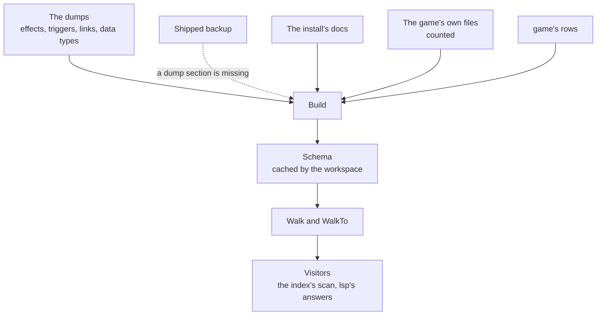

# schema

[Architecture](../../docs/ARCHITECTURE.md) › [Engine](../../docs/ARCHITECTURE.md#the-engine) › schema

The schema is the language of one game version: which databases exist, what each key takes and which commands run in
which scope. It is built from the game's dumps, the docs the install ships and the game's own files. It also owns the
one walk over a file, and every reader of script is a visitor on it.

`Schema` is the only description of the language. The rules that no source states are [game](../game/README.md)'s
rows, which the schema copies onto its databases and the walk reads directly. Parsing is
[jomini](../jomini/README.md)'s. Where a name is defined is the [index](../index/README.md)'s. What the editor shows
of it is [lsp](../../services/lsp/README.md)'s.

**Uses** [files](../files/README.md), [game](../game/README.md), [jomini](../jomini/README.md),
[loc](../loc/README.md) · **Used by** [index](../index/README.md), [workspace](../../services/workspace/README.md),
[lsp](../../services/lsp/README.md), [draw](../../services/draw/README.md), [graph](../../services/graph/README.md),
[health](../../services/health/README.md), [mcp](../../services/mcp/README.md),
[wiki](../../services/wiki/README.md) and [gen](gen/).

## From sources to a walk

`Build` fills the schema in this order: the databases from the folders and the rows, the dumps, the docs, the count of
the game's own files, and last a blurb for any field that has none. The workspace builds a schema once for each version
of an install and its dumps, and caches it as a gob file.

## Sources

Every fact the schema learns comes with a `game.Source`. A lower source outranks a higher one: the rows, the dumps, the
game's executable, its logs, the docs, the wiki, its own files, and inferred last.

- Only the dumps, the docs, the wiki and what a definition in the files says its name or a parameter takes can accuse
  a mod (`Source.CanAccuse`).
- A fact learned from the game's own files completes a hover card, marked as inferred. It never fails a verdict.
  A reference that only such a fact makes is `Reference.Inferred`.

## Databases, fields and commands

- A `Database` is one database of the game: the tree of fields its definitions may write, and the `game` rows that
  govern it. One is built for each folder a script file belongs to, each folder or file a row names, each nesting, each
  start setup and each GUI declaration. A nested database is named by its parent's name, a dot and its own.
- A `Field` is one key a definition may write, with what it takes and the fields inside it. Its children are keyed by
  the key as written, or by a pattern: `<number>` for any number and `<any>` for any key.
- `Expected` is what a field's value must be: a type, and where it needs one, a database, a scope or a list of choices.
- A `Command` is one effect, trigger or link the dumps declare: the scopes it runs in, the scope a link leads to and
  the keys it takes. A command declared as both an effect and a trigger keeps each one's keys, and a `Union` of the two
  for a block that allows either.
- A nesting that writes a separator names its definitions by their holder's name, the separator and their own key.
  A define `X` in the `NAI` group is `NAI|X`, as script reads it (`JoinNested`, `SplitNested`).

## Claims

A field's facts are its `Claims`: its value, shape, requirement, default, blurb and the database its block's keys name.
Each is a `Claim`, one value with the source that states it. A higher-ranked source replaces a lower one.

The dumps, the docs and the wiki state what they can. The count of the game's own files (`CountVanilla`) states the
rest, field by field, and only where nothing else does:

- **Shape.** The shape the keys written in a field's blocks tell. If the keys disagree, the shape is unknown.
- **Value.** A stated value is kept, except a reference with no database. Where vanilla writes a reference, it is the
  database that defines every value written there. A field written only as scalars gets the first type all its values
  fit, such as a target where they are all scopes or links; one always written as a block is a color or a block.
- **Keys.** Where every key that only vanilla writes in a block is a definition of one database, the block's keys name
  that database, as a culture's opinions name cultures. Those keys fold into `<any>`, and the walk reads such a key as
  a reference. A command's own block keeps its keys apart, except where a `game.CommandKeys` row says they name a
  database, as `stress_impact`'s keys name traits.

A reference that vanilla alone shows is inferred, so a name nothing defines is no problem. A number takes a script
value too where vanilla names one there.

## The dumps

`ReadDumps` reads the console dumps under an install's folders: the effects, triggers and links, the modifiers, the
on_actions, the event scopes, the customizable localizations and the data types. `FindDumpsAt` gives the time of the
newest one without reading any.

- **A missing section** comes from the shipped backup, one section at a time. A dump that cannot be read as text, such
  as one over 32 MiB or in UTF-16, counts as missing. `Schema.Dumps` says whether they came from the install, the
  backup or neither, when they were written and whether they are older than the install.
- **Corrections.** A `game.DumpCorrections` row fixes a dump line that contradicts its own text. It wins over the
  dump.
- **Arguments.** A command's arguments are the keys of the usage blocks written under its name, and of the lines of
  its prose that open with `key = value`. A statement in `[ ]` or `< >` is optional, and `[a|b]` gives choices. A
  placeholder such as `<triggers>` gives the block that shape. A trigger's Traits line says what its value takes.
- **Prefixes.** A link that needs data is a prefix, written with a name after a colon. Its database is the one that
  defines every name the game's files write after it.

The shipped backup holds, for each game, what its dumps declare. It is the only game data the app embeds, and it holds
no game text and no built schema. The program in [gen](gen/) writes it from an install, with
`go generate ./internal/schema`.

## The docs

A doc is an `.info`, `.md` or readme file, or a text file named as one, in a database's folder or below one. The reader
takes it line by line, by pattern, since prose is no valid script. A doc's example gives fields, and the comments beside
it state a blurb, a type, a requirement, a default and choices. It states no scope. A later doc fills only what an
earlier one left out. A file of data, with more script lines than prose, is skipped.

## The count of the game's own files

`CountVanilla` walks every script, GUI, asset, font and GFX file of the install and reads every localization file for
its message keys. The DLC folder is left out. It runs in two passes.

1. The `declarer` reads the files that declare what script and GUI files call by name: scripted definitions with the
   parameters their bodies write, widget types, modifier types and the event namespaces events files declare. A later
   key under a call then counts as a call. What the game's parameters name is settled after the second pass, since
   the prefixes' databases and many claims come from it.
2. The `counter` counts what the files write, on `files.Workers` workers, each with fields of its own that are added
   together after. It counts the keys under each database's definitions, each value, the shapes a block's keys tell,
   the names after each prefix, how often each command is written and where each command and data function is
   written.

`resolveCounts` turns the counts into the claims above, the prefixes' databases, each command's count and examples,
and its command patterns. A `CommandPattern` is a family of commands the dumps declare once for each definition of a database,
as `has_relation_*` is for the scripted relations. The walk reads a key a pattern makes as the command of one of the
game's own definitions.

## Scripted definitions and modifier types

A `ScriptedDefinition` is a scripted effect, trigger, value or list, with the parameters its body writes and the names
it saves. A modifier type's definition says whether its name takes yes or no, or a number. The `declarer` reads both
from the game's files, and the event namespaces too. `SetScripted` reads them from the workspace's mods, in place of
what those files declared before, so a call to a mod's scripted definition is a known call. A call finds the game's
definition first, and a mod's never takes the place of a command the dumps declare.

Each parameter is a field the definition declares (`SourceDefinitions`), so a key in a call reads as its argument,
never as a link or a command of that name. A parameter also takes the database its body names, so the argument's
value refers to a definition there:

- A parameter written whole after a link prefix, as a key or a value (`building_type:$building_type$`), takes the
  prefix's database, as the definition states it.
- A parameter written whole as the value of a key with a field of its own takes what that field claims, with the
  field's source. A link's key and an argument of a call are left out.
- A parameter passed on whole to a call of another scripted definition takes what that one's argument takes, the
  same way it takes the link a name is saved under (`resolveRelays`).

A parameter keeps the first database it gets.

## The walk

`Walk` goes through a file's tree once and calls a `Visitor` at every statement it enters and leaves. At each one it
decides what the schema and the rows say: the field, the scope, the shape, the definition and the references. It fills
one `Context` for each depth and reuses it, so a visitor copies what it keeps. `WalkTo` is `Walk` limited to the
statements that cover one offset. It still reads the statements before that offset silently, to learn what they saved.
Nothing else in the app walks a file.

Each statement is resolved in one of two ways.

- **It defines a name** (`definitions.go`): a constant, a nested definition, a GUI declaration, a top block of an asset
  file, a name an events file declares inline, or a script definition named as its database's row says.
- **Its key fits a rule.** The block's shape lists its key rules in order (`game.Shapes[…].Rules`), and the first one
  the key fits wins. The rule says where the block's fields come from, what decides its shape and how its scope
  follows. A keyword of the language (`game.Keywords`) adjusts what the rule gave.

Some decisions the walk makes:

- **Commands.** A command fits only where the block's shape allows what it is declared as, so an effect never fits in a
  trigger block. A key written with an argument in parentheses, as `aptitude(court_jester_court_position)`, is read as
  the command, and its argument fills the command's `ArgumentKey`.
- **Scopes.** A link or a command that leads to a scope moves the scope there and pushes the old one onto `Previous`. A
  definition's root scope is the one its row names, else its event type's, or the dumps' for an on_action. Where a
  database gives its blocks a run order, the walk reads them silently in that order first, so each block starts with
  the scopes the earlier ones saved.
- **References.** The references a statement makes are found here and nowhere else: the names its key calls, the
  names after a link's prefixes, the database its field claims, and the names in a data call or a macro's expansion.
  A value shaped like an event id names an event where its field claims events, or claims nothing and an events file
  of the game or the mods declares its namespace.

A data call's steps are read by the dumps' data types. `ResolveCallTypes` and `FindFunction` follow a call from a GUI
block's data context, `ResolveMacro` expands the game's data binding macros, and `ListCallReferences` gives the names
the call's quoted arguments hold.

## Files

| file | what it holds |
|---|---|
| `schema.go` | The types, `Build`, the databases, and the lookups: commands, links, patterns and data calls. |
| `dumps.go` | The dumps reader, and the commands, arguments and prefixes built from the dumps. |
| `docs.go` | The docs reader: which files are docs, and the blurbs, types and defaults they state. |
| `vanilla.go` | The count of the game's own files, and the claims it supports. |
| `scripted.go` | The scripted definitions and modifier types that files declare, the mods' included. |
| `definitions.go` | What a statement defines, found during a walk. |
| `walk.go` | The walk: `Walk`, `WalkTo`, `Visitor`, `Context`, and the references a statement makes. |
| `shipped.go` | The shipped backup of each game's dumps, embedded from `shipped/*.gob`. |

## Terms

- **Schema**: the language of one game version.
- **Database**: one database of the game, with the tree of fields its definitions write and its rows.
- **Field**: one key that may be written in a definition, with what it takes.
- **Claim**: one fact about a field, with the source that states it.
- **Claims**: every fact the sources state about one field.
- **Expected**: what a field's value must be.
- **ValueType**: the type of value a field takes.
- **Vanilla**: what the game's own files write at a field, counted.
- **Command**: one effect, trigger or link the dumps declare.
- **CommandPattern**: a family of commands the dumps declare once for each definition of a database.
- **ScopeType**: one type of scope, with whether triggers and effects run in it.
- **DataType**: one type of the data binding language, with its functions.
- **DataFunction**: one function of a data type.
- **Modifier**: one modifier the dumps declare.
- **OnAction**: one on_action the dumps declare, with its scope and whether the game calls it from its own code.
- **ScriptedDefinition**: a scripted effect, trigger, value or list the game or a mod defines, with the parameters it
  takes.
- **Example**: one place the game's own files write a command or call a data function.
- **SourceState**: where one source's data came from and how fresh it is.
- **Dumps**: everything the dumps declare.
- **DumpCommand**: one effect, trigger or link as its dump lists it.
- **Context**: everything the walk has decided at the statement it is on.
- **Visitor**: what the walk calls at each statement it enters and leaves.
- **Definition**: a name a statement defines, with the facts that decide which definition the game keeps.
- **Reference**: a name a key or a value refers to, in a database.
- **Saved**: one scope the definition saved, with its type.
- **Category**: the color category of a key or a value.
