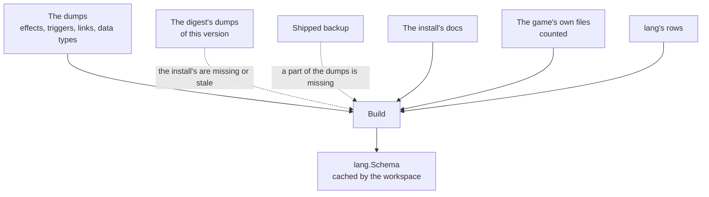

# schema

[Architecture](../../docs/ARCHITECTURE.md) › [Engine](../../docs/ARCHITECTURE.md#the-engine) › schema

The schema package builds the model of one game version's script language, a
[lang](../lang/README.md)`.Schema`. It reads three things: the files the game writes when asked to dump its language,
the doc files the install ships, and the game's own script files. The rules it applies to the dumps, the docs and the
count of the game's files, and what it does with input that breaks them, are its package doc, in
[schema.go](schema.go).

It only builds. The model itself, the language's fixed rules and the walk over a file are
[lang](../lang/README.md)'s, and the workspace caches what `Build` returns.

**Uses** [files](../files/README.md), [game](../game/README.md), [jomini](../jomini/README.md),
[lang](../lang/README.md), [loc](../loc/README.md) · **Used by**
[workspace](../../services/workspace/README.md), [wiki](../../services/wiki/README.md) and [gen](gen/).

## From sources to a schema

## Files

| file | what it holds |
|---|---|
| `schema.go` | The package doc, `Build`, and the databases made from the game's folders and from lang's declarations. |
| `dumps.go` | The reader of the dump files, the shipped backup filling what they lack, and the dumps' corrections. |
| `commands.go` | The commands, their keys and the links built from the dumps. |
| `comparison.go` | `KeyChange`, and the comparison of two versions by key: the keys of their dumps and the names their files define that a patch added, removed or changed. |
| `docs.go` | The reader of the doc files: which files are docs, and the hover text, type, default and values they give each field. |
| `vanilla.go` | The count of the game's own files, and what the counts show about each field, each link and each star key. |
| `shipped.go` | The backup of each game's dumps that the app ships, embedded from `shipped/*.gob`. |

## Terms

- **Dumps**: everything the dump files of one game declare, as read from the files.
- **DumpCommand**: one effect, trigger or link as its dump file lists it.
- **A line that is not UTF-8**: measured on the three installs and the two digests, every one is in `effects.log` or
  `triggers.log`. Victoria 3's install has 331 and its digest 1,418, each right under an entry's heading where the
  description would be, and none is text. Crusader Kings III's install has one, the first line of
  `create_divergent_culture`, with a dash of Windows-1252. Europa Universalis V has none. Why Victoria 3 writes them
  is not known, nor whether any such line happens to be UTF-8: that one would stay as the description.
- **Shipped backup**: the dumps of each game kept in the app, used where an install's own dump files are missing.
- **Digest's dumps**: the dumps of the install's version that a game's digest holds. `Build` takes them as `digest`
  and uses them where the install's own dump files are missing or older than the install's last update, then fills
  what is still missing from the shipped backup. `SourceState.Origin` is then `digest`. `Build` also returns the
  install's own dumps when it used them and they are not older than the install, for the workspace to keep.
- **Dumps' version**: `Dumps.Version`, the game version the dumps were written for, "" where it is not known. The
  digest's dumps carry their version folder's, the install's own dumps the `version` `Build` is given, and the shipped
  backup's is the install's version that `gen` wrote it from. `SourceState.Current` is whether the dumps `Build` used
  describe that version: the install's own that are not older than the install, or any whose version is the install's.
- **gen**: the command that writes the shipped backups, and beside each the game's shipped history of patches
  (`internal/patch/shipped/<game>.gob`, which [patch](../patch/README.md) embeds). When it writes a newer backup it
  compares the one before with the new dumps, and the defined names and file hashes it kept of the version before with
  the install's (`patch.CompareSnapshots`), and adds that patch to the history. What it kept is the snapshot
  `gen/state/<game>.gob`, which the app neither embeds nor reads, and which stays on the machine that runs gen, out of
  git: a run on another machine finds none and adds a patch of the dumps' changes alone.
- **Doc**: a file the game ships beside its script that describes a database's fields, such as an `.info` file.
- **Count**: what the game's own files write at each field, added up over every file.
- **Star key**: a command the dumps list once for each definition of a database, such as `has_relation_*`.
- **Comparison**: `Compare` gives the status of each key two maps do not hold alike, and every comparison of two
  versions runs on it. `CompareDumps` compares two versions' dumps. A key that fits a star key of the installed
  schema is the star key, so the generated region keys of `every_country_in_*` are no change in themselves. A kind
  of entry one version lists none of, or writes in another form, is left out. `CompareKeys` compares the names two
  versions' files define (`index.Index.ListDefinedKeys`): added, removed, or changed where both versions have a
  hash of the name's text and the two differ.
- **Key change**: one key that a patch added, removed or changed. A key of the dumps is changed when a fact of its
  entry differs: its sentence, scopes, target or traits for a command, and the facts of a scope type, an on_action or
  a data function. A function of a data type is in the database `lang.DataFunctions`.
- **Status**: what a patch did to a key or a file: added, removed or changed.
