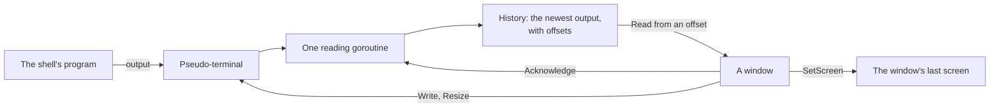

# terminal

[Architecture](../../docs/ARCHITECTURE.md) › [Engine](../../docs/ARCHITECTURE.md#the-engine) › terminal

The terminal package runs shells under the system's own pseudo-terminal: Windows' pseudo console (ConPTY), or a Linux
pty. It keeps each shell's recent output and the screen a window last drew, so that another window can take a shell
over.

It uses `golang.org/x/sys` for the system calls and no terminal library: the calls are few, and each library tried
crashed on a second close, left a reader blocked, or pulled in far more than it gave. It knows no workspace and no
Wails. The [terminal service](../../services/terminal/README.md) holds the running shells and streams them to the
windows.

**Uses** [files](../files/README.md), in its Windows half · **Used by** the [terminal
service](../../services/terminal/README.md) and [mcp](../../services/mcp/README.md), which shares the `Variable` type.

## A shell's life

A `Shell` is filled in and then started, as an `exec.Cmd` is. No exported field changes after `Start`.

- **Output.** One goroutine reads the pseudo-terminal for as long as it is open. It keeps the newest 4 MiB with the
  offset of every byte the shell has written. `Read` returns the output past an offset, waiting until there is some, and
  skips what the history no longer holds.
- **Pace.** A window tells the shell with `Acknowledge` how far it has drawn the output. While the output runs more than
  512 KiB past the furthest a window has drawn, the goroutine stops reading, so the program waits on its own writes. A
  shell that is closing is read on, since a pseudo console does not close until its output is read.
- **Input and size.** `Write` sends bytes as typed, and `Resize` changes the size. Both, and `Close`, take one lock,
  so a resize never reaches a closed console.
- **The end.** `Close` runs once and ends the program; on Windows it ends every process the program started too. The
  program's own exit closes the console as well. `Wait` returns once the output is read to its end.
- **The screen.** `SetScreen` keeps the screen a window serialized and the offset of the output it holds. `Screen`
  returns it with the shell's current size. A window that starts to show the shell draws that screen, then the output
  past its offset. A screen older than the history comes back empty, at the history's start.

## Windows

The pseudo console is `CreatePseudoConsole` over two pipes, and the program starts with the console as a process
attribute. `STARTF_USESTDHANDLES` is set, or the program writes to PMT's own handles rather than to the console.

A console starts on the system's code page. Right after the program starts, PMT attaches to its console for a moment and
sets both code pages to UTF-8, so that UTF-8 output such as git's prints right. A process that has a console of its own,
as a dev build has, cannot attach, so a dev build keeps the system's code page.

`ListPrograms` gives these shells, where they are installed:

- PowerShell 7: `pwsh` on the PATH, else the install folder its install key names. It is PMT's pick.
- Windows PowerShell, in the system folder.
- Git Bash: `bin\bash.exe` in Git for Windows' install folder, found from the folder of `git` on the PATH, else from its
  install key. It starts as `bash --login -i`, so the user's profile and prompt apply.
- WSL: `wsl.exe`, listed while WSL has a default distribution. Without one, `wsl.exe` only offers to install WSL.

## Linux

The pty is `/dev/ptmx`, unlocked, with its other side as the program's three standard files. The program leads a session
of its own with the pty as its controlling terminal. Every ioctl goes through `SyscallConn`, which keeps the file
non-blocking, so that `Close` wakes a reader that is waiting.

`ListPrograms` gives `$SHELL`, then each shell `/etc/shells` lists, then `sh`, each file once.

## The environment

Every shell gets PMT's own environment, with these over it:

- `COLORTERM=truecolor`.
- On Linux, `TERM=xterm-256color`.
- On Windows, `CLAUDE_CODE_ALT_SCREEN_FULL_REPAINT=1`, Claude Code's documented fix for the fragments a pseudo console
  leaves on its full screen.

`ListEnvironment` lists them, each with a help text.

## Files

| file | what it holds |
|---|---|
| `terminal.go` | The shell: its output history, pace, screen and close, the shared environment, and the types. |
| `terminal_windows.go`, `terminal_linux.go` | The pseudo-terminal of each system, and the shells that system has. |

## Terms

- **Shell**: one program running under a pseudo-terminal, with the output it has written.
- **Screen**: what a window drew of a shell: the text that redraws it, the offset of the output it shows and the shell's
  size.
- **Program**: a shell this system has, with the arguments it starts with.
- **Variable**: one environment variable that every shell is given.
