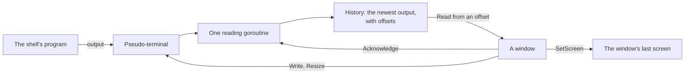

# terminal

[Architecture](../../docs/ARCHITECTURE.md) › [Engine](../../docs/ARCHITECTURE.md#the-engine) › terminal

The terminal package runs shells under the system's own pseudo-terminal: Windows' pseudo console (ConPTY), or a Linux
pty. It keeps each shell's recent output and the screen a window last drew, so that another window can take a shell
over. A shell's life, each system's pseudo-terminal and shells, the environment every shell gets, and what it does with
input that breaks them are its package doc, in [terminal.go](terminal.go).

It uses `golang.org/x/sys` for the system calls and no terminal library: the calls are few, and each library tried
crashed on a second close, left a reader blocked, or pulled in far more than it gave. It knows no workspace and no
Wails. The [terminal service](../../services/terminal/README.md) holds the running shells and streams them to the
windows.

**Uses** [files](../files/README.md), in its Windows half · **Used by** the [terminal
service](../../services/terminal/README.md) and [mcp](../../services/mcp/README.md), which shares the `Variable` type.

## Files

| file | what it holds |
|---|---|
| `terminal.go` | The package doc, the types, the shell's output, pace, screen and close, and the environment. |
| `terminal_windows.go` | The Windows pseudo console, and the shells Windows has. |
| `terminal_linux.go` | The Linux pty, and the shells Linux has. |

## Terms

- **Shell**: one program running under a pseudo-terminal, with the output it has written.
- **History**: the newest 4 MiB of a shell's output, which a window that starts to show the shell reads from.
- **Offset**: the place of a byte in all the output a shell has written, counting from 0.
- **Screen**: what a window drew of a shell: the text that redraws it, the offset of the output it shows and the shell's
  size.
- **Program**: a shell this system has, with the arguments it starts with.
- **Variable**: one environment variable that every shell is given.
