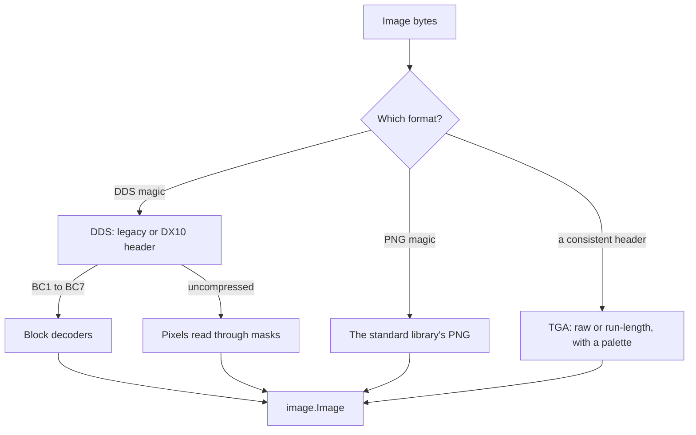

# texture

[Architecture](../../docs/ARCHITECTURE.md) › [Engine](../../docs/ARCHITECTURE.md#the-engine) › texture

The texture package decodes DDS, TGA and PNG images to pixels, writes pictures as DDS files, and reads an image's header
without decoding it. It also finds the image file that a path written in script names.

No maintained Go decoder reads the DDS and TGA formats the games ship, so the decoders are this package's own, and so is
the encoder. PNG is the standard library's. The package knows no workspace: the lookup of a written path is a function
its caller passes.

**Uses** nothing else of PMT · **Used by** the [index](../index/README.md) and the services
[workspace](../../services/workspace/README.md), [lsp](../../services/lsp/README.md) and
[draw](../../services/draw/README.md).

## Headers and pixels

`ReadHeader` reads only the start of a file and adds the file's size in bytes. The bytes say the format, whatever the
extension. It reads a JPEG's header too, from the start of the file, since a JPEG keeps its size past its first
bytes. A JPEG is never decoded.

`Decode` takes an image's bytes and one mip level: 0 is the whole image, and each level after it is half the size of the
one before. A DDS opens with its magic and a PNG with its own. A TGA has no magic, so it is the bytes with a consistent
header: a known image type and pixel depth and a nonzero size. Only a DDS has more than one level.

`Decode` refuses:

- an image past Direct3D's limit on a side;
- a level the image does not have;
- an image whose data ends before its last pixel;
- a DDS pixel format it does not decode. The error names the format.

## Writing a DDS

`EncodeDDS` writes a picture as a DDS in one of two forms: uncompressed B8G8R8A8, which is exact, or BC3, a quarter of
the size. The games read either, and mix the two in one folder, so the choice decides a picture's size and sharpness,
never whether it shows.

With mipmaps, every level down to one pixel follows the picture. Each level is half the one before, a pixel
the average of the four it covers, its colors mixed in linear light and its alpha as it is.

A BC3 block is an alpha block, then a color block in BC1's four-color mode:

- The alpha block keeps the block's highest and lowest alpha and each pixel's nearest value between them.
- The color block starts from the block's two pixels farthest apart, takes each pixel's nearest palette color, and fits
  the two colors to those once by least squares.

Both palettes are the decoder's own, so a block decodes to the colors it was fitted to. PMT writes no BC1 and no BC7.

## Resolving a written path

`Resolve` tries a path as written, then with each other image extension the game accepts, `.dds`, `.png` and `.tga` in
that order. A leading slash is ignored. The lookup function the caller passes says whether a relative path exists in the
workspace and where, so the game's own rule for which file is read stays the index's, in `index.ResolveTexture`.

## Files

| file | what it holds |
|---|---|
| `texture.go` | Headers, the entry points that read and decode an image, and the lookup of a written path. |
| `dds.go` | The DDS container and its block decoders for BC1 to BC5, and uncompressed pixels. |
| `bptc.go` | The BC6H and BC7 block decoders, with their modes, partitions and anchors as tables. |
| `tga.go` | The TGA decoder. |
| `encode.go` | The DDS encoder: mip levels, uncompressed pixels and BC3 blocks. |

## Terms

- **Header**: what an image file says about itself before its pixels: its format, its size, its mip levels and its block
  compression.
- **Mip level**: one of a DDS's smaller copies of its image, each half the size of the one before.
- **Compression**: the block compression of a DDS, BC1 to BC7, or none.
