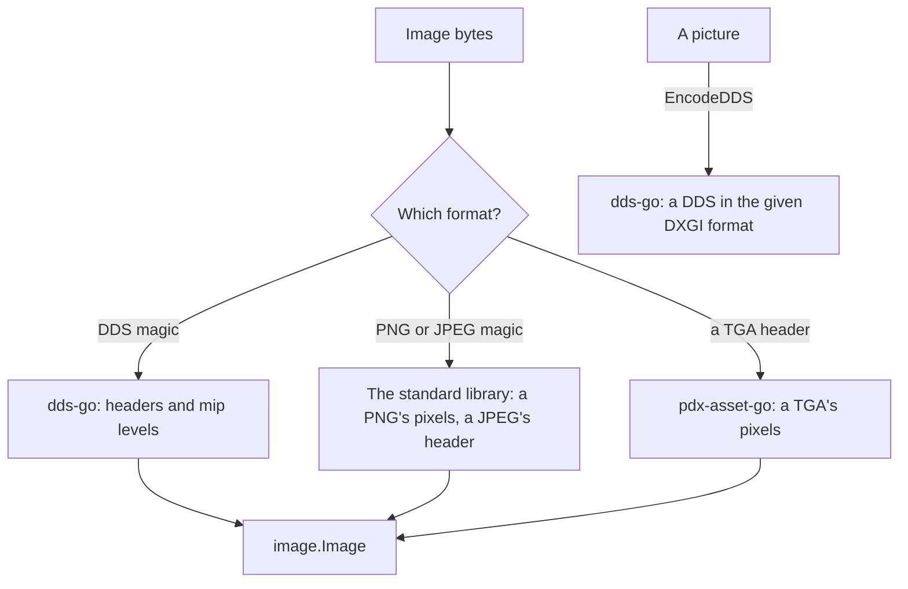

# texture

[Architecture](../../docs/ARCHITECTURE.md) › [Engine](../../docs/ARCHITECTURE.md#the-engine) › texture

The texture package reads the images the games ship and writes pictures as DDS files. What it reads, the rules it
applies and what it refuses are in its package doc, in [texture.go](texture.go).

[dds-go](https://github.com/kaiser-chris/dds-go) reads and writes DDS, the `texture` package of
[pdx-asset-go](https://github.com/kaiser-chris/pdx-asset-go) reads TGA, and the standard library reads PNG and a
JPEG's header. The package knows no workspace: the lookup of a written path is a function its caller passes, so which
file the game reads stays the index's, in its `ResolveTexture`.

**Uses** nothing else of PMT · **Used by** the [index](../index/README.md) and the services
[workspace](../../services/workspace/README.md), [lsp](../../services/lsp/README.md) and
[draw](../../services/draw/README.md).

## Files

| file | what it holds |
|---|---|
| `texture.go` | An image's header, decoding one of its levels, writing a picture as a DDS, and the lookup of a written path. |

## Terms

- **Header**: what an image file says about itself before its pixels: its format, its size, its mip levels and its
  DXGI format.
- **Mip level**: one of a DDS's smaller copies of its image, each half the size of the one before.
- **DXGI format**: how a DDS stores its pixels, by Direct3D's number and name, such as 98 and `BC7_UNORM`. A legacy DDS
  whose pixels only bit masks describe has none.

## The games' images

Measured on the three installs. The empty DDS files and the TGAs of palette indices are the files PMT refuses; every
other DDS and TGA the games ship opens. The PNG named `.dds` opens as a PNG.

| | CK3 | Victoria 3 | EU5 |
|---|---|---|---|
| DDS files | 21,264 | 12,554 | 28,611 |
| empty | 2 | 1 | 8 |
| a PNG | 1 | 0 | 0 |
| no DXGI format, only bit masks | 274 | 5 | 60 |
| TGA files | 21 | 17 | 28 |
| of palette indices | 0 | 0 | 5 |

The DDS files the games ship, by DXGI format. BC3, B8G8R8A8, BC1 and BC7, the four Save as DDS offers, hold over 99%
of each game's files that have one.

| DXGI format | CK3 | Victoria 3 | EU5 |
|---|---|---|---|
| BC3_UNORM | 11,540 | 6,118 | 19,517 |
| B8G8R8A8_UNORM | 7,076 | 5,349 | 1,463 |
| BC1_UNORM | 2,136 | 903 | 2,540 |
| BC7_UNORM | 200 | 61 | 4,983 |
| BC7_UNORM_SRGB | 7 | 59 | 2 |
| B8G8R8X8_UNORM | 1 | 29 | 3 |
| BC2_UNORM | 20 | 19 | 18 |
| R8G8B8A8_UNORM | 5 | 7 | 1 |
| B8G8R8A8_UNORM_SRGB | 0 | 0 | 13 |
| R16G16B16A16_FLOAT | 1 | 0 | 3 |
| BC4_UNORM | 1 | 0 | 0 |
| BC3_UNORM_SRGB | 0 | 1 | 0 |
| BC6H_UF16 | 0 | 1 | 0 |
| R16_FLOAT | 0 | 1 | 0 |

The float formats show their light clamped to 0 to 1, as dds-go decodes them to eight bits.
