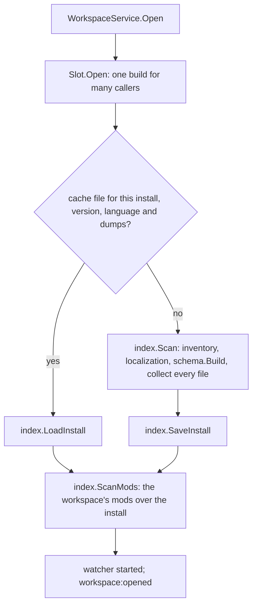

# services — the backend

The Go half of Paradox Modding Tools. The files in this folder are the Wails services the frontend calls; everything
they use is under `internal/`. This page is the map: the packages and the one rule that orders them, the services, the
events, and where a change goes. Each package's design is in its own README.

## The packages

A package imports only the packages above it in this table, and `services/*.go` imports from any of them. Nothing
under the engine knows about the editor, the pages, the services or the Workshop.

| layer | package | its one job |
|---|---|---|
| leaves | [`game`](internal/game/README.md) | What is true of each game: its identity, its language rules as rows, its file layout, where it installs and keeps its data. The only package that tells the games apart. |
| | [`jomini`](internal/jomini/README.md) | Parse Paradox script text into a syntax tree, and read the shapes of its words (names, dates, numbers, `prefix:name`, `$NAME$`, `[data.calls]`). Knows no game and no file. |
| | [`loc`](internal/loc/README.md) | Parse the localization dialect: a file's entries with their line index, the one rule for a file's language, the markup of a text (`Segments`: `$key$`, `[call]`, `#format`, `@icon!`), the plain text a player reads, and the writer of a loc file. |
| | [`appdata`](internal/appdata/README.md) | PMT's own files on this machine: the app and cache folders, the atomic write, the app's JSON files, the stored form of a cache. |
| files | [`inventory`](internal/inventory/README.md) | Every file of an install, a mod or a dump folder: the roots that mirror the game layout, each file's format and origin, its text read and written with the encoding it was stored in, how paths are compared and joined, the walk, the ignore rules, the ordered worker pool. |
| | [`texture`](internal/texture/README.md) | Decode a DDS or TGA to pixels, read an image's header, and resolve a path written in script to the image it names. |
| | [`modfiles`](internal/modfiles/README.md) | A mod's own Paradox files: its descriptor, its thumbnail, the skeleton of a new mod. |
| | [`wiki`](internal/wiki/README.md) | The community wiki: fetch pages, sanitize them, store them, look up the pages for a file or a topic, and give the engine the script examples a page holds. |
| | [`steam`](internal/steam/README.md) | The Workshop: publish and download through the game's own Steam library in a second process, the files a mod keeps for its page, its description format, the upload's file set, the compare with Steam. |
| engine | [`schema`](internal/schema/README.md) | What the sources state about one game version's language, in trust order, and the one walker every reader of script uses. Carries the backup dump schemas embedded in the app, and their generator. |
| | [`index`](internal/index/README.md) | What a scan found: each file's definitions, references and localization entries; resolution in load order; the scan and its cache. It interprets no word. |
| workspace | [`workspace`](internal/workspace/README.md) | A workspace open in the editor: the install's schema and index, the mods' index over it, the open buffers, the watcher, one lock, and the one open at a time. |
| | [`lsp`](internal/lsp/README.md) | The editor's requests over one open file: hover, completion, definition, references, symbols, diagnostics, edits, colors. |
| | [`pages`](internal/pages/README.md) | The Go side of each page, answered from the open workspace: the Health report, the event graph and its detail, the text search. |
| | [`draw`](internal/draw/README.md) | What the visual editors draw: a GUI entry resolved from the index into a list of widgets, each with its type's row (`game/gui-rules.go`), its properties as written, its textures, its text and what it is shown on, and a coat of arms into layers on its field (`game/coa-rules.go`), both over one element, which the page turns into a DOM the browser lays out; nothing about the game's state is simulated and nothing is measured in Go. One render memo (`Render`) keeps the last GUI entry. |

The saved record of a workspace is `services.Workspace`; the open one is `workspace.Session`. `internal/testdata/` holds
the fixture installs the tests read.

## What the engine keeps

- **Each fact once, from ranked sources:** the registry, the dumps, vanilla, the docs, the wiki. A claim keeps the
  highest-ranked source that states it.
- **Nothing is guessed.** A diagnostic accuses only on a claim a declared source states, fresh, that vanilla does not
  contradict (`schema.MayAccuse`). What nothing declares stays unknown, and unknown is quiet.
- **Mods are never authorities.** They give definitions and references only.
- **Durable.** A game update or a stale dump never brings false findings: features grow quieter, and the app says when
  its data is stale.
- **The rules are data.** What Paradox script is lives in `internal/game/lang-rules.go`, a row each, never a branch for
  one case.
- **Walk once, parse once.** A file is parsed once per text and walked by the one walker (`schema.WalkFile`).

## Services

| Service | File | What the frontend calls it for |
|---|---|---|
| App | `appservice.go` | the version, update checks, the settings map, reset; the file also holds `config.json` (`ConfigFile`) for the other services |
| Workspace | `workspaceservice.go` | installs, workspaces, mods and their load order, the IDE's roots; `Open` and `State` of the open workspace |
| File | `fileservice.go` | the IDE's file system: read, write (atomic), list, rename, delete; the route the page reads an image or a font file by |
| Log | `logservice.go` | the app log (`pmt.log`), the frontend's log lines, crash detection |
| Ide | `ideservice.go` | every editor request, one method each, forwarded to `lsp` |
| Draw | `drawservice.go` | a file's Visual view: the last GUI render held across requests (`draw.Render`), a GUI entry as a list (`List`), a coat (`Coat`) and the coats a feed shows (`Coats`), an element's properties, the designer's lists (`Colors`, `Textures`, `Frames`), a new coat's file (`CoatFile`) |
| Health | `healthservice.go` | the Health page: three calls into `pages` |
| EventGraph | `eventgraphservice.go` | the event graph, one event's detail and the root search: three calls into `pages` |
| Search | `searchservice.go` | the IDE's text and file search and replace: three calls into `pages` |
| Wiki | `wikiservice.go` | the IDE's Wiki pane and Patch Notes |
| Git | `gitservice.go` | the IDE's source control: the git installed on this machine, per mod repository |
| Release | `releaseservice.go` | the Publish page: descriptor, description, Workshop extras, Steam publish and compare |
| Window | `windowservice.go` | the app's other windows: open, show, close, and the `window:*` events they tell each other by |

A service is a shell: it reaches the open workspace through Workspace (`openWorkspace`), your saved data through
`ConfigFile` (`read`, `mutate`), calls one function in the package named for the job, and returns. After changing a
service method or a payload type, run `task common:generate:bindings`; never edit `frontend/bindings/` by hand.

## Events

Go tells the frontend about state with events; each service declares its own beside their payloads.

| Event | Sent when |
|---|---|
| `workspace:opened`, `workspace:failed`, `workspace:closed` | a workspace is open with its index built, could not be opened, or closed |
| `install:scanning`, `install:scanned` | an install's scan reports a stage, and finishes |
| `config:changed` | `config.json` was written; the data names its section |
| `fs:changed` | a file of the open workspace changed on disk |
| `wiki:updated`, `wiki:progress` | a wiki refresh finished, and each page it fetches |
| `search:hits` | one file's hits of a text search |
| `git:output` | a git command source control ran |
| `steam:progress` | a Workshop upload's progress |
| `window:*` | the windows telling each other what they hold and handing tabs on (`windowservice.go`) |

## Opening a workspace

Only one workspace is open at a time (`workspace.Slot`); opening one closes the one open, since an install's index is
most of its memory.

Each stage of a scan reports on `install:scanning`. The cache file's name holds every input, so a game patch, a new
dump or a new app build is another file and the next open scans again by itself.

## Where to change what

| To change | Edit |
|---|---|
| how a key reads in a kind of block, a scope rule, a name rule | a row in `internal/game/lang-rules.go` |
| a game's folders, nested entries, entry modes | that game's `Layout` in `internal/game/lang-rules.go` |
| a game's identity, install or dump folders | `internal/game/game.go` |
| what a doc or dump phrase means | `docPhrases` in `internal/schema/docs.go`; the dump labels in `internal/schema/dumps.go` |
| a diagnostic | `internal/lsp/diagnostics.go` (`Codes`) |
| what a hover card says | `internal/lsp/hover.go` (its facts), `internal/lsp/wording.go` (its words); drawn by `frontend/src/ui/HoverCard.vue` |
| how a GUI window lays out | how each built-in type draws, `GUITypes` in `internal/game/gui-rules.go`, with the other GUI rows: which blocks are a widget's skin, chrome, attachment or held content (`WidgetSlots`), where a window is laid out (`GUIHolders`), the state it opens in (`GUIOpeningStates`), the calls the preview answers (`GUIAnswered`); what each property means in CSS, the `PROPERTIES` and `HOLDS` tables in `frontend/src/draw/picture.ts`, which the browser lays out |
| a Health section | `internal/pages/health.go` (the cards and which code each lists) and `health_*.go`; its page is `frontend/src/pages/health/` and `frontend/src/composables/useHealth.ts` |
| what the event graph or a search answers | `internal/pages/graph.go`, `graph_detail.go`, `search.go` |
| a window event | declared in `windowservice.go`, answered where the table at the head of `frontend/src/stores/windows.ts` says |
| a theme token | `frontend/src/styles/themes.css` |
| a new frontend call | a service method, then `task common:generate:bindings` |

## Tests

Each package has one test file, `<package>_test.go`; the fixtures are small installs under `internal/testdata/`.

| Task | Runs |
|---|---|
| `task test` | every package, `-short` |
| `task test:race` | the same under the race detector (what CI runs) |
| `task test:gate` | the gates over real installs; set `PMT_TEST_INSTALL_CK3`, `_VIC3`, `_EU5` to each game's root |
| `task test:sweep` | not a gate: every mod in a game's mod folder opened, with the findings printed |
| `task check` | everything a commit must pass, Go and frontend |

## Further reading

The frontend's shape and conventions are [`frontend/src/README.md`](../frontend/src/README.md). Building and running
the app: [`CONTRIBUTING.md`](../CONTRIBUTING.md).

## Who answers what

Each question the backend answers is to have one owner. The second column is who answers it today (some questions
have no single answerer yet); the third is the one owner it will have once the overhaul in progress reaches it. A
row's second column is rewritten as its part lands.

| question | owner today | owner after the ReArchitecture |
|---|---|---|
| What does this word name: a definition or a reference, which database, or a call by which word? | `occurrencesOf` and 9 helpers in `schema` | the key's or value's record (`schema.WalkFile`); judging (`index`) for what a reference resolves to |
| Which command, link or operator is this key, and by which rule is it read? | `Enter`, `keyEnter`, `keyFacts`, `fits` | the walk's reading of a key (`Schema.Enter`); its record says which command, link, operator, construct or field |
| Is this statement an entry, of which database, under what name? | `entryAt` and 11 helpers | the entry's record (the walk's `entryAt`) |
| What scope does this run in? | `scopeOf`, `Follow`, `commandScope`, `EntryScope`, `RunsScript` | the block's record (the walk); judging for a scripted entry's scope from its callers |
| What does a block hold (its shape)? | `blockOf`, `holdsOf`, `commandShape` | the block's record (the walk's `blockOf`) |
| What does a value take, and is this one valid? | `ValuePosition` + claims | the claim on the value's record; one matcher of a value to a type, used by the verdict that a value has the type its key takes, and by completion |
| Is this word shaped as a name, an event id, a number, a date, `prefix:name`, a constant, a `$PARAM$`? | `jomini` shapes.go | `jomini`, one function per shape a key or a value is written in |
| Which case does a lookup use? | no one place: each table matches case its own way | each table's one lookup, which matches case by the game's rule for that table, measured |
| Is this block a color, and which color? | `blockColor`, `game.ColorOf` | one function over `jomini.ColorParts` and `game.ColorOf`: whether a block is a color, and which |
| What does a data call's step name, and what type does it lead to? | `CallLeadsTo`, `CallStep` | `schema`'s typing of a data call (`CallLeadsTo`, `TypeDatabase`), the datacontext honored |
| Is this a parameter of a scripted entry? | the walk's `parameterDefinitions` | the key's or value's record (the walk's parameters of a scripted entry) |
| Is this a date, and what does it mean? | `dateFact` | `jomini.ParseDate` |
| What category/color is this word in the editor? | `lsp.Tokens` (4 categories) plus the editor's grammars (10) | the category on the key's or value's record; the grammars paint shapes only |
| What is under the cursor, and what block/entry holds it? | `walkTo`, `scalarAt`, `blockAt`, `within` | the file's records, searched by range |
| What markup does a localization text hold: `$key$`, `[call]`, `#format`, `@icon!`, `\n`? | `loc.Segments`; `Plain`, `Interpolations` and `Concepts` read it | `loc`'s segments of a value |
| Which value does a block give a key: the first or the last written, in which case? | `jomini.KeyValue`, by the `Match` the caller passes | one `jomini` function, by the game's rule (measured) |
| Which statement does a comment belong to? | `jomini.Attach` | `jomini.Attach`; the docs parser its own |
| Does this name resolve, and to which definitions? | `index.Resolve` | `index.Resolve` |
| Which definition does the game keep; is the name contested? | `index.Winner` | `index.Winner`, over one `game` row per database: which definition it keeps and by which order, its entry modes, its merges, its override priority |
| Where is this name used? | `uses` | the index's uses of a name |
| Where is a definition's statement, and its text? | `Session.Statement` | the entry's record (its statement's range); its tree from the file's one parse, its text flattened by one function |
| Is this an event; what does it fire, what fires it? | `workspace.Fires`/`FiredBy` | an event is a record of the events database, by its declared namespace; `index` `Fires` and `FiredBy` of the kept definitions |
| Loc: does the key exist, its text, the entry's title, the file's language? | `Session.Loc`, `Session.Title`; `loc.Language` for the file's language | `workspace` `Loc` and `Title`; `loc`'s one rule for a file's language |
| What is a database's entry called on screen? | `game.KindName` | `game.KindName`, renamed for what it holds |
| Which database by folder, purpose or word? | `schema.folder`, `DatabaseNamed` | `schema`'s one rule from a folder, a purpose, a written name or a class name to a database |
| Where is this file: its root, origin, rel and database; is it loaded? | `Session.Locate`, `PlaceOf` | `workspace.Locate` (the place) |
| The key two paths are compared by | `inventory.PathKey` | `appdata.PathKey`, carried on every place |
| Which file wins at a path; who ships the same path? | `index.Loaded` | `index.Loaded` |
| What is wrong with a file, and on which card does a finding go? | `lsp.Diagnose` | `lsp.Diagnose` over the records' failed verdicts and the parse errors; one Go table of each code's card; the frontend's one formatter per code |
| What kind is this file: format, editor language, view, icon, image, binary? | `inventory.Classify` | `inventory.Classify`; how a file is shown, the frontend's one table keyed by Go's format and database |
| Is this file read only? | `IdeRoot.ReadOnly` | `workspace.Locate` (the place's read only) |
| What is a file's text (encoding, BOM, line ends), and how is text written back? | `inventory.LoadText` and `SaveText` (`TextOf` and `Text.Bytes` for bytes that never touch the disk); `appdata.LoadJSON` and `SaveJSON` for the app's own files | `inventory`'s reader and writer of a file's text; `appdata`'s pair for the app's own JSON |
| Where do a text's lines break, and what is a position: line, byte column, UTF-16 column? | the line index kept on `jomini.Result` and `loc.Result` (`Lines`, `LineText`); `editor/columns.ts` | the line index on the parse (Go); `editor/columns.ts` (the frontend) |
| Which files are under a folder: dot folders, links, ignored and binary files? | `inventory.Walk` over `Children`, one hidden-name rule; `IgnoreRules` and `Rules.Covers` for Steam and search | `inventory.Walk`, with one matcher of ignore patterns |
| What safe file or folder name does a new thing get? | `inventory.Slug` | one function for every file or folder name PMT makes |
| Is this file an image, of which format and size? | `texture.Info` (one header read, shared with `Decode`); `texture.Resolve` for a written path | `texture` |
| What does a mod's descriptor say (listing fields, thumbnail, ignore rules); is a folder a mod? | `modfiles.LoadDescriptor` | `modfiles`: the descriptor loaded once a request; the ignore text in the config, the file only for Export and Import |
| What is a mod's state on Steam, and what will an upload change? | `SteamCompare`, `ListingSummary`, `sentDescription` | the release package's one payload per question (on Steam, its version, what an upload changes and sends), one field per fact; one frontend formatter per sentence |
| What is the install's state: found, scanned when, which version? | `WorkspaceState`, `GameInstall` | one field per fact (when the install was scanned, its version) on the workspace's state; one formatter for the install line |
| Change a workspace or a mod: add, move, remove, reorder, recolor | `WorkspaceService` | one `WorkspaceService` method per change, each announcing its event; one frontend mutation per method |
| Go to a workspace; which page does it open on? | `workspaceHomeRoute` | one function for a workspace's home route |
| Which entries does a file draw, and which is drawn? | draw's `entryRows`/`windowDatabase`; the draw store's `ENTRY_GROUPS`/`entriesOf` | `draw`: the entries a file draws (a table sent once); the entry record at the caret |
| Edit a drawn coat's script: add, move or remove a block, write a value | the draw store's text operations | `draw`: a coat's edits computed from its parse as text edits |
| What does the event graph show: reach, steps, hidden kinds, defaults? | Go's graph; `useEventGraph` | `pages`: the event graph, its reach, steps, hidden databases and defaults |
| What do Health's cards count, and which card does a word belong to? | Go's `HealthReport` | `pages`: Health's cards, counts and each finding's card |
| Walk a file with the schema | `schema.WalkFile` | `schema.WalkFile`, once per file text; a game file at scan: one counting pass, then one walk for its records, after a pass over the declaring files' top statements |
| Walk or descend a parse tree without the schema | `jomini.Walk` | `jomini.Walk` for what needs the parse alone (folding); everything else uses the records |
| Read and parse a file's text | `Session.Parsed`, through `inventory.LoadText` and one `jomini.Parse` that keeps its tokens | `workspace.Parsed`, one parse per text, through the one text reader |
| Logic inside the Wails services | no one place: release listing and compare, git parsing, settings and places sit in the services | none: each service a shell over its package |
| Split script text into tokens | the `jomini` lexer, once per parse (the tokens kept on the `Result`); the docs parser's tokenizer | `jomini`; the docs parser's tokenizer |
| Convert between Markdown, BBCode, HTML and text | steam's `bbcode.go` | `steam`'s converters for Markdown and BBCode; one HTML-to-text in `wiki` |
| Fetch over HTTP and keep a cache | the wiki client | one HTTP client (user agent, throttle, size cap) for the wiki and Steam; one cache folder with one cleanup; the wiki's memory copy is the cache |
| Compare two version strings | wiki's `versionParts` | one function that orders two versions |
| Copy to the clipboard | no one place: the Wails clipboard and VueUse's | the Wails clipboard |
