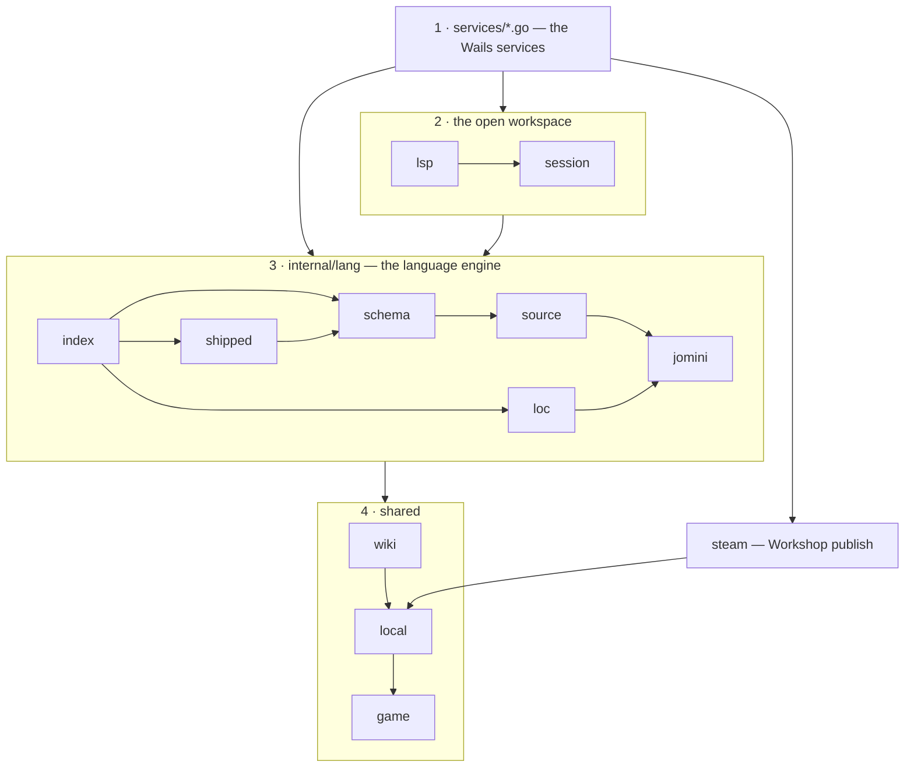
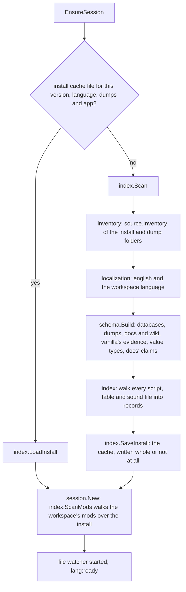
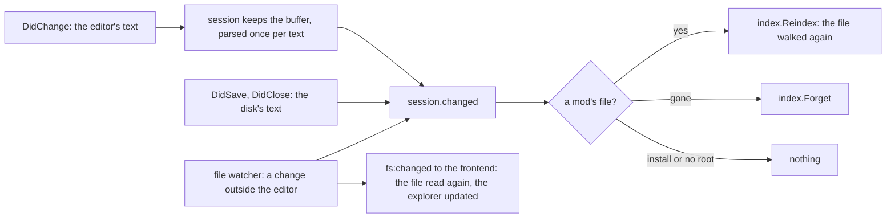

# services — the backend

The Go half of Paradox Modding Tools. The files in this folder are the Wails services the frontend
calls; everything they use is under `internal/`. This page is the map: what each package is, how
they connect, and what runs on each path. Each engine package keeps its design in its own README.

## Layout

The backend has four parts, and the folders follow them:

1. **The Wails services**, the files in this folder: the only code the frontend calls.
2. **The open workspace**, `internal/session` and `internal/lsp`: the workspace you have open, and
   the editor's requests on it.
3. **The language engine**, `internal/lang/`: reads an install, its dumps and your mods, and says
   what every word is.
4. **Shared packages**, `internal/game`, `local`, `wiki` and `steam`: the game table, this machine's
   files, the wiki, the Workshop.

```
services/
├── *service.go          1. the Wails services (see "Services")
└── internal/
    ├── session/         2. one workspace open in the editor: install and mods indexes, open files
    ├── lsp/             2. the editor's requests: hover, completion, navigation, diagnostics, edits
    ├── lang/            3. the language engine (its README: the pipeline and its rules)
    │   ├── jomini/          the parser: syntax tree, names, dates, numbers, BOM; knows no game
    │   ├── loc/             the localization dialect: entries, $key$, the language of a file
    │   ├── source/          every file of an install, mod or dump folder, by format; reads nothing
    │   ├── schema/          what the sources state, in one tree of positions, and the walker
    │   ├── shipped/         backup dump schemas for users missing a dump file, and their generator
    │   └── index/           definitions, references, loc entries; load order; the scan and its cache
    ├── game/            4. the only game-aware package
    │   ├── lang-rules.go    Paradox script's language rules as tables, and each game's file Layout
    │   └── game.go          each game's identity, install and version detection, user-data folders
    ├── local/           4. this machine's files: app folders, the atomic write, a mod's descriptor
    ├── wiki/            4. wiki guides and patch notes: fetch, sanitize, store, look up
    └── steam/           4. Steam Workshop publish (a second process) and the Workshop files
```

## How the parts depend on each other

Each part uses only the parts below it; nothing in the engine knows about the editor, the services or
the Workshop. Inside the engine, the packages build on each other from the parser up.



Every part may also use `game` (the game table) and `local` (this machine's files). `game` and
`jomini` use nothing of ours. `schema` reads the rules in `game/lang-rules.go` and the wiki's stored
pages; it parses only what it is handed. `go list -deps ./services/...` gives every import.

## Services

| Part | Service | File | What the frontend calls it for |
|---|---|---|---|
| The app and your data | App | `appservice.go` | the version, update checks, the settings map, reset; it holds `config.json` for the other services |
| | Workspace | `workspaceservice.go` | installs, workspaces, mods and their load order, the IDE's roots |
| | File | `fileservice.go` | the IDE's file system: read, write (atomic), list, rename, delete |
| | Log | `logservice.go` | the app log (`pmt.log`), the frontend's log lines, crash detection |
| The open workspace | Session | `sessionservice.go` | `EnsureSession` (open a workspace, scanning if needed), the language health |
| | Ide | `ideservice.go` | every editor request, one method each, forwarded to `lsp` |
| Pages and tools | Health | `healthservice.go` | the Health page |
| | EventGraph | `eventgraphservice.go` | the event graph and one event's detail |
| | Wiki | `wikiservice.go` | the IDE's Wiki pane and Patch Notes |
| | Search | `searchservice.go` | the IDE's text and file search, and replace (`search:hits` per file) |
| | Git | `gitservice.go` | the IDE's source control: the git installed on this machine, per mod repository (`gitservice_windows.go` hides git's console) |
| | Release | `releaseservice.go` | the Publish page: descriptor, description, Workshop extras, Steam publish |

Ide, Health, EventGraph and Wiki reach the open workspace through Session (`live`); Session,
Workspace, Ide, Release and Log read or change your saved data through App (`read`, `mutate`); Git
reads a workspace's mods through App to find their repositories. File and Search stand alone: they
work on paths the frontend hands them.

Go tells the frontend about state with events (`emit` in `sessionservice.go`): `lang:ready`,
`lang:failed`, `lang:scan-progress`, `lang:cache-updated`, `lang:calendar-changed`, `fs:changed`,
`wiki:updated`, `search:hits` and `git:output`. After changing a service method or a payload type, run
`task common:generate:bindings`; never edit `frontend/bindings/` by hand.

## Opening a workspace

Only one workspace is live at a time; opening one closes the others, since an install's index is
most of a session's memory.



Each stage reports on `lang:scan-progress`. The cache file's name holds every input, so a game
patch, a new dump or a new app build is another file and the next session scans again by itself.

## An editor request

Every request is one walk of the open file, stopped at the cursor or run whole.

```mermaid
sequenceDiagram
  participant M as the editor (ide/monacoEditor.ts)
  participant I as IdeService
  participant L as lsp
  participant S as session
  participant W as index.Walk / schema.Read
  M->>I: Hover(workspace, path, line, col)
  I->>L: lsp.Hover(session, ...)
  L->>S: RLock; the open buffer's parse
  L->>W: walk to the cursor
  W-->>L: each statement's Step: position, command, scope, block kind
  L->>S: resolve names across the install and mods indexes
  L-->>M: the card's payload (the frontend templates the text)
```

Completion, definition, references, signature help and diagnostics follow the same path. A
diagnostic accuses only what a declared source states and vanilla does not contradict
(`schema.Speaks`).

## An edit, a save, a change on disk



The install's index never changes from the editor; only the mods' index does. The Health page
refetches when it is shown again.

## The pages

- **Health** (`GetHealth`): which mod's definition the game keeps where two origins define
  a name (contests and overrides), what a winning definition depends on or affects, references
  nothing defines, missing and untranslated localization, and the editor's own findings per file.
- **Event graph** (`GetEventGraph`, `GetEventDetail`): events and on_actions and what fires them,
  from the references `session.Fires` and `session.FiredBy` follow.
- **The Wiki pane and Patch Notes**: `wiki.Refresh` stores each game's pages; `PagesFor` picks the
  tabs for the open file.
- **Publish**: `steam` runs the upload in a second copy of the app (`steam.Serve`, from
  `services.ServeSteamPublish`), which loads the game's own copy of Steam's library.
- **Source control** (Git): status, log, a commit's files, a file's text at a revision, stage,
  unstage, discard, `StageText` (one block), commit, branches, checkout, fetch, pull, push and
  merge, each run of git told on `git:output`.

## Where to change what

| To change | Edit |
|---|---|
| how a key reads in a kind of block, a scope rule, a name rule | a row in `internal/game/lang-rules.go` |
| a game's folders, nested entries, entry modes | that game's `Layout` in `lang-rules.go` |
| a game's identity, install or dump folders | `internal/game/game.go` |
| what a doc or dump phrase means | the phrase catalogue in `internal/lang/schema/template.go` |
| how a dump file is read | the label table in `internal/lang/schema/dumps.go` |
| a diagnostic | `internal/lsp/diagnostics.go` (`Codes`, the judge) |
| a hover card's wording | `internal/lsp/hover.go` (`takes`, `writes`, `held`) |
| a Health section | `healthservice.go` |
| a new frontend call | a service method, then `task common:generate:bindings` |

A rule is a row, never a branch for one case. The engine infers nothing a table or a declared
source does not give it.

## Tests

Each package has one test file, `<package>_test.go`. The fixtures are small installs under
`internal/lang/testdata/`.

| Task | Runs |
|---|---|
| `task test` | every package, `-short` |
| `task test:race` | the same under the race detector (what CI runs) |
| `task test:gate` | the gates over real installs; set `PMT_TEST_INSTALL_CK3`, `_VIC3`, `_EU5` to each game's root |
| `task test:sweep` | not a gate: every mod in a game's mod folder opened, with the findings printed |

## Further reading

- [`internal/lang/README.md`](internal/lang/README.md): the engine's pipeline and its rules.
- [`internal/lang/schema/README.md`](internal/lang/schema/README.md),
  [`index/README.md`](internal/lang/index/README.md),
  [`shipped/README.md`](internal/lang/shipped/README.md),
  [`internal/game/README.md`](internal/game/README.md): each package's design.
- [`GLOSSARY.md`](../GLOSSARY.md): the terms. [`GAME-SYNTAX.md`](../GAME-SYNTAX.md): measured facts
  about each game's script.
- [`docs/content/develop.md`](../docs/content/develop.md): building and running the app.
