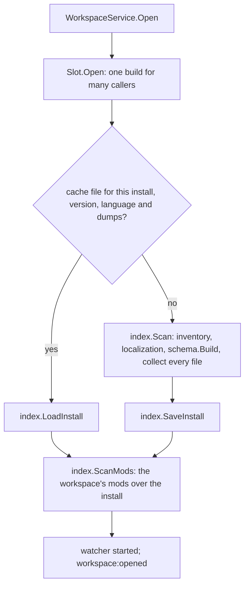

# services — the backend

The Go half of Paradox Modding Tools. The files in this folder are the Wails services the frontend calls; everything
they use is under `internal/`. This page is the map: the packages and the one rule that orders them, the services, the
events, and where a change goes. Each package's design is in its own README.

## The packages

A package imports only the packages above it in this table, and `services/*.go` imports from any of them. Nothing
under the engine knows about the editor, the pages, the services or the Workshop.

| layer | package | its one job |
|---|---|---|
| leaves | [`game`](internal/game/README.md) | What is true of each game: its identity, its language rules as rows, its file layout, where it installs and keeps its data. The only package that tells the games apart. |
| | [`jomini`](internal/jomini/README.md) | Parse Paradox script text into a syntax tree, and read the shapes of its words (names, dates, numbers, `prefix:name`, `$NAME$`, `[data.calls]`). Knows no game and no file. |
| | [`loc`](internal/loc/README.md) | Parse the localization dialect: entries, `$key$`, the language of a file. |
| | [`appdata`](internal/appdata/README.md) | PMT's own files on this machine: the app and cache folders, the atomic write, the stored form of a cache. |
| files | [`inventory`](internal/inventory/README.md) | Every file of an install, a mod or a dump folder: the roots that mirror the game layout, each file's format and origin, its text read with the right encoding, the walk, the ordered worker pool. |
| | [`texture`](internal/texture/README.md) | Decode a DDS or TGA to pixels and read an image's header. |
| | [`modfiles`](internal/modfiles/README.md) | A mod's own Paradox files: its descriptor, its thumbnail, the skeleton of a new mod. |
| | [`wiki`](internal/wiki/README.md) | The community wiki: fetch pages, sanitize them, store them, look up the pages for a file or a topic, and give the engine the script examples a page holds. |
| | [`steam`](internal/steam/README.md) | The Workshop: publish and download through the game's own Steam library in a second process, the files a mod keeps for its page, its description format, the upload's file set, the compare with Steam. |
| engine | [`schema`](internal/schema/README.md) | What the sources state about one game version's language, in trust order, and the one walker every reader of script uses. Carries the backup dump schemas embedded in the app, and their generator. |
| | [`index`](internal/index/README.md) | What a scan found: each file's definitions, references and localization entries; resolution in load order; the scan and its cache. It interprets no word. |
| workspace | [`workspace`](internal/workspace/README.md) | A workspace open in the editor: the install's schema and index, the mods' index over it, the open buffers, the watcher, one lock, and the one open at a time. |
| | [`lsp`](internal/lsp/README.md) | The editor's requests over one open file: hover, completion, definition, references, symbols, diagnostics, edits. |
| | [`pages`](internal/pages/README.md) | The Go side of each page, answered from the open workspace: the Health report, the event graph and its detail, the text search. |
| | [`draw`](internal/draw/README.md) | What the visual editors draw: a GUI file's window resolved from the index into one flat list of elements, parts and fonts, which the page draws and computes nothing over: a structural preview, where nothing about the game's state is simulated. |

The saved record of a workspace is `services.Workspace`; the open one is `workspace.Session`. `internal/testdata/` holds
the fixture installs the tests read.

## What the engine keeps

- **Each fact once, from ranked sources:** the registry, the dumps, vanilla, the docs, the wiki. A claim keeps the
  highest-ranked source that states it.
- **Nothing is guessed.** A diagnostic accuses only on a claim a declared source states, fresh, that vanilla does not
  contradict (`schema.MayAccuse`). What nothing declares stays unknown, and unknown is quiet.
- **Mods are never authorities.** They give definitions and references only.
- **Durable.** A game update or a stale dump never brings false findings: features grow quieter, and the app says when
  its data is stale.
- **The rules are data.** What Paradox script is lives in `internal/game/lang-rules.go`, a row each, never a branch for
  one case.
- **Walk once, parse once.** A file is parsed once per text and walked by the one walker (`schema.WalkFile`).

## Services

| Service | File | What the frontend calls it for |
|---|---|---|
| App | `appservice.go` | the version, update checks, the settings map, reset; the file also holds `config.json` (`ConfigFile`) for the other services |
| Workspace | `workspaceservice.go` | installs, workspaces, mods and their load order, the IDE's roots; `Open` and `State` of the open workspace |
| File | `fileservice.go` | the IDE's file system: read, write (atomic), list, rename, delete; the route the page reads an image or a font file by |
| Log | `logservice.go` | the app log (`pmt.log`), the frontend's log lines, crash detection |
| Ide | `ideservice.go` | every editor request, one method each, forwarded to `lsp` |
| Draw | `drawservice.go` | a GUI file's Visual view: what it can draw, an entry as a list, a part's properties |
| Health | `healthservice.go` | the Health page: three calls into `pages` |
| EventGraph | `eventgraphservice.go` | the event graph, one event's detail and the root search: three calls into `pages` |
| Search | `searchservice.go` | the IDE's text and file search and replace: three calls into `pages` |
| Wiki | `wikiservice.go` | the IDE's Wiki pane and Patch Notes |
| Git | `gitservice.go` | the IDE's source control: the git installed on this machine, per mod repository |
| Release | `releaseservice.go` | the Publish page: descriptor, description, Workshop extras, Steam publish and compare |
| Window | `windowservice.go` | the app's other windows: open, show, close, and the `window:*` events they tell each other by |

A service is a shell: it reaches the open workspace through Workspace (`openWorkspace`), your saved data through
`ConfigFile` (`read`, `mutate`), calls one function in the package named for the job, and returns. After changing a
service method or a payload type, run `task common:generate:bindings`; never edit `frontend/bindings/` by hand.

## Events

Go tells the frontend about state with events; each service declares its own beside their payloads.

| Event | Sent when |
|---|---|
| `workspace:opened`, `workspace:failed`, `workspace:closed` | a workspace is open with its index built, could not be opened, or closed |
| `install:scanning`, `install:scanned` | an install's scan reports a stage, and finishes |
| `config:changed` | `config.json` was written; the data names its section |
| `fs:changed` | a file of the open workspace changed on disk |
| `wiki:updated`, `wiki:progress` | a wiki refresh finished, and each page it fetches |
| `search:hits` | one file's hits of a text search |
| `git:output` | a git command source control ran |
| `steam:progress` | a Workshop upload's progress |
| `window:*` | the windows telling each other what they hold and handing tabs on (`windowservice.go`) |

## Opening a workspace

Only one workspace is open at a time (`workspace.Slot`); opening one closes the one open, since an install's index is
most of its memory.

Each stage of a scan reports on `install:scanning`. The cache file's name holds every input, so a game patch, a new
dump or a new app build is another file and the next open scans again by itself.

## Where to change what

| To change | Edit |
|---|---|
| how a key reads in a kind of block, a scope rule, a name rule | a row in `internal/game/lang-rules.go` |
| a game's folders, nested entries, entry modes | that game's `Layout` in `internal/game/lang-rules.go` |
| a game's identity, install or dump folders | `internal/game/game.go` |
| what a doc or dump phrase means | `docPhrases` in `internal/schema/docs.go`; the dump labels in `internal/schema/dumps.go` |
| a diagnostic | `internal/lsp/diagnostics.go` (`Codes`) |
| what a hover card says | `internal/lsp/hover.go` (its facts), `internal/lsp/wording.go` (its words); drawn by `frontend/src/ui/HoverCard.vue` |
| how a GUI window lays out | `LayoutClasses`, `Sizings` and `LayoutPolicies` in `internal/game/lang-rules.go`; how a class places its children in `internal/draw/gui_layout.go`; the state a window opens in, `OpeningState` and `StateControls` |
| a Health section | `internal/pages/health.go` (the cards and which code each lists) and `health_*.go`; its page is `frontend/src/pages/health/` and `frontend/src/composables/useHealth.ts` |
| what the event graph or a search answers | `internal/pages/graph.go`, `graph_detail.go`, `search.go` |
| a window event | declared in `windowservice.go`, answered where the table at the head of `frontend/src/stores/windows.ts` says |
| a theme token | `frontend/src/styles/themes.css` |
| a new frontend call | a service method, then `task common:generate:bindings` |

## Tests

Each package has one test file, `<package>_test.go`; the fixtures are small installs under `internal/testdata/`.

| Task | Runs |
|---|---|
| `task test` | every package, `-short` |
| `task test:race` | the same under the race detector (what CI runs) |
| `task test:gate` | the gates over real installs; set `PMT_TEST_INSTALL_CK3`, `_VIC3`, `_EU5` to each game's root |
| `task test:sweep` | not a gate: every mod in a game's mod folder opened, with the findings printed |
| `task check` | everything a commit must pass, Go and frontend |

## Further reading

[`GLOSSARY.md`](../GLOSSARY.md) holds the terms and [`GAME-SYNTAX.md`](../GAME-SYNTAX.md) what each game's script
does, measured. The frontend's shape and conventions are [`frontend/src/README.md`](../frontend/src/README.md).
Building and running the app: [`docs/content/develop.md`](../docs/content/develop.md).
