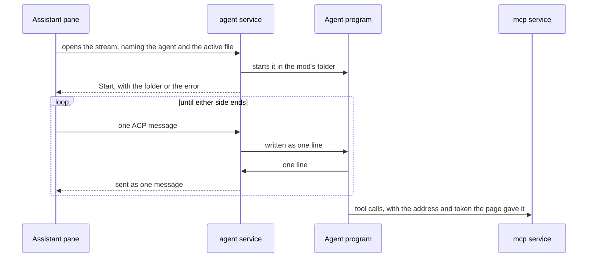

# agent

[Architecture](../../docs/ARCHITECTURE.md) › [Services](../../docs/ARCHITECTURE.md#the-services) › agent

The agent service starts the coding agents the assistant pane chats with. It lists them, installs them from the ACP
registry with npm on Node, and pipes each running agent to the window that chats with it.

Go holds none of the Agent Client Protocol (ACP). The page speaks it, so Go only starts the program, carries its lines
both ways and ends it. The page is the assistant pane and its session view (see the
[frontend](../../frontend/src/README.md)). The tools an agent calls back are [mcp](../mcp/README.md)'s.

**Uses** [app](../app/README.md), [files](../../internal/files/README.md), [mcp](../mcp/README.md),
[workspace](../workspace/README.md) · **Used by** [steam](../steam/README.md), which leaves the agents' instruction files
out of an upload.

## The agents

`agents` is the table of the agents PMT offers: Claude, GitHub Copilot and Codex. A row has the registry's id, the
command that registers PMT's tools with that agent outside PMT, and the instruction files and folders it reads in a mod.

The user's own agents are kept in `config.json` as the `agents` section: a name, a program and its arguments.
`ListAgents` returns both kinds. An agent PMT offers also gets the registry's version and description, its register
command with PMT's address and token filled in, and, once it is installed and a Node is new enough, the program and
arguments that start it: the package's script run by Node, with the arguments the registry gives.

## Installing

Everything is kept under `agents/` in PMT's cache folder, so Reset data removes it.

- **The registry** is fetched from the ACP project at most once a day and saved as `registry.json`. With no network the
  last copy is used.
- **An agent** goes in `<id>@<version>/`, installed with npm at the registry's version. Its other versions are removed.
  The program it runs is the one script its package declares.
- **Node** is the system's if it is version 22 or newer, else the copy in `node/`, else none. `InstallNode` downloads
  that copy: the newest long-term release from nodejs.org, checked against the sums nodejs.org publishes. It is a zip
  on Windows and a gzipped tar on Linux.
- **Uninstalling** an agent (`UninstallAgent`) deletes every `<id>@<version>/` it has. Settings offers it only while
  none of the agent's sessions runs, since Windows refuses to delete a running program's files.
- **One install per agent at a time.** Two npm runs in one folder delete each other's files, so a second is refused.
  `ListAgents` gives a running install's start time as `Installing`, and `agent:changed` marks its start and end.

npm runs on the Node the agents use, so its install scripts do too. That Node is also first on the PATH of every agent
program.

## The stream

Each chat opens the Wails stream `agent`. No port is opened. The window's first message names the agent and the active
file. Go starts the program in the folder of the mod that holds that file, else the first mod whose folder exists, else
the home folder (`workspace.ResolveFolder`, the same rule the Terminal uses), then answers with a `Start`: that folder
and the workspace's other mod folders, or the error that kept the agent from starting.

After that each message is one JSON-RPC message. The page's go to the agent's input as one line, and each line the agent
writes comes back as one message. What it writes to its error output goes to PMT's log under its id.

The program runs in a group of its own: a job object on Windows, a process group on Linux. Closing the stream ends the
program and everything it started, and the program's own end closes the stream.

## Files

| file | what it holds |
|---|---|
| `agent.go` | The service: the agents table, the user's own agents, the registry, and installing Node and the agents. |
| `process.go` | The stream a window opens to an agent, and the agent's running program. |
| `process_windows.go`, `process_linux.go` | The group that holds an agent's programs, so they end together. |

## Events

| event | data | sent when |
|---|---|---|
| `agent:changed` | the agent's id | npm starts or ends installing the agent |

## Terms

- **Agent**: one agent as Settings and the assistant pane list it: its record, with what the registry and PMT's folder
  say of it.
- **Node**: the Node that PMT's agents run on, and the system's own version.
- **Start**: Go's first message on an agent's stream, the folder the agent started in or the error.
