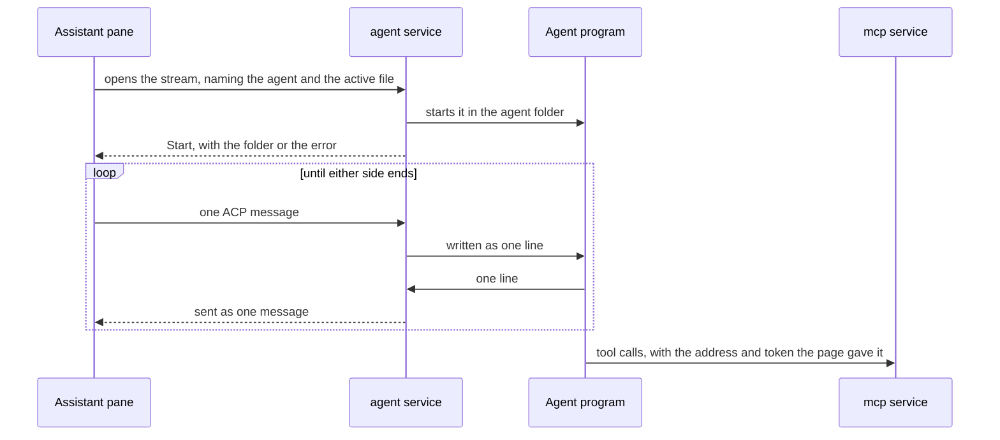

# agent

[Architecture](../../docs/ARCHITECTURE.md) › [Services](../../docs/ARCHITECTURE.md#the-services) › agent

The agent service starts the coding agents the assistant pane chats with and the one that completes code as you type.
It lists them, installs them with npm on Node, from the ACP registry or from an npm package a row names, and pipes each
running agent to the window that talks to it.

Go holds none of the Agent Client Protocol (ACP). The page speaks it, so Go only starts the program, carries its lines
both ways and ends it. The page is the assistant pane and its session view (see the
[frontend](../../frontend/src/README.md)). The tools an agent calls back are [mcp](../mcp/README.md)'s.

**Uses** [app](../app/README.md), [files](../../internal/files/README.md), [mcp](../mcp/README.md),
[workspace](../workspace/README.md) · **Used by** [steam](../steam/README.md), which leaves the agents' instruction files
out of an upload.

## The agents

`agents` is the table of the agents PMT offers: Claude, GitHub Copilot CLI, GitHub Copilot and Codex. A row has the
registry's id, the command that registers PMT's tools with that agent outside PMT, and the instruction files and
folders it reads in a mod. A row's `Skeletons` are the skills, commands and subagents PMT makes for the agent in the
agent folder, each a path and a first text with `%s` for the name; only Claude's are known. Claude's row has
`Guards`: its sessions are given the read-only folders as deny rules of
Claude's own (see [The stream](#the-stream)). It also has `Steers`: Claude takes a prompt sent while its turn runs
into that turn, so the pane sends it at once. The other agents do not, so the pane holds such a prompt until the turn
ends. Measured with a second `session/prompt` seven seconds into a turn: claude-acp 0.107.2 answered both prompts with
one reply that obeyed both; GitHub Copilot's CLI 1.0.112 answered the first `cancelled` and ran its command again;
codex-acp 2.8.0 held the second prompt and answered it as a turn of its own once the first ended. The CLI's
row also has `Instructions`, the summary of the instructions PMT's tool server
gives: the CLI drops those, so the pane adds the summary to a session's first prompt, after the user's text.

Codex's row has `StartMode` and `Bypasses`. Codex has no file tool and takes no deny rules: every write is a shell
command. Measured with codex-acp 2.8.0: in its default mode, Auto review (`agent`), its own reviewer approved a
write to a folder outside its own and PMT was asked nothing, and Full access (`agent-full-access`) asks nothing by
design; in Workspace access (`workspace-write`) the same command came as a permission request. So a session of Codex
starts in Workspace access, and the pane has the user confirm either of the other two.

Two rows are Copilot's, both named GitHub Copilot. The CLI's row, `github-copilot-cli`, is the registry's and is
Copilot's chat. The server's row, `copilot-language-server`, is Copilot's tab completion, and names its own parts, so
no code names Copilot:

- its npm package, `Package`, its script within the package, `Script`, and its arguments, `Args` (`--acp`);
- `Completion`, which says it answers tab completion only, so the pane never offers it for a chat;
- `Env`, the environment it starts with (`GITHUB_COPILOT_ACP_USE_CLI=0`, so it starts no CLI);
- `Chat`, the CLI's row, which only makes Settings draw the two rows as one Copilot card with two parts, each
  installed and uninstalled on its own. The other fields are the table's and are not sent to the page.

The user's own agents are kept in `config.json` as the `agents` section: a name, a program and its arguments.
`ListAgents` returns both kinds. An agent PMT offers also gets the version and description of the registry, or of npm
for a row with a `Package`, its register command with PMT's address and token filled in, and, once it is installed and
a Node is new enough, the program and arguments that start it: the package's script run by Node, with the arguments
the registry or the row gives. The pane leaves out the server's row, so it lists one Copilot.

## Installing

Everything is kept under `agents/` in PMT's cache folder, so Reset data removes it.

- **The registry** is fetched from the ACP project at most once a day and saved as `registry.json`. With no network the
  last copy is used.
- **A row's own package** takes its version and description from npm's answer for its latest version
  (`https://registry.npmjs.org/<package>/latest`), fetched at most once a day and saved beside the registry as
  `<id>.json`, the last copy used when the fetch fails. npm's answer has the same `version` and `description` as a
  registry entry.
- **An agent** goes in `<id>@<version>/`, installed with npm at that version. Its other versions are removed. The
  program it runs is the script its row names, else the one script its package declares. A row's own package is
  installed with `--omit=optional`: its optional parts are a compiled build, a second CLI and a runtime that PMT does
  not run. Without them the folder is 89 MB on Windows (version 1.568.0), and the server runs on PMT's Node.
- **Node** is the system's if it is version 22 or newer, else the copy in `node/`, else none. `InstallNode` downloads
  that copy: the newest long-term release from nodejs.org, checked against the sums nodejs.org publishes. It is a zip
  on Windows and a gzipped tar on Linux.
- **Uninstalling** an agent (`UninstallAgent`) deletes every `<id>@<version>/` it has. Windows refuses to delete a
  running program's files, so Go first ends the programs of an agent that completes code, in every window, and waits
  for each to exit. It refuses while a chat runs on the agent, and Settings offers it only while none of the window's
  own sessions runs. The service keeps every running program, by agent, for this.
- **One install per agent at a time.** Two npm runs in one folder delete each other's files, so a second is refused.
  `ListAgents` gives a running install's start time as `Installing`, and `agent:changed` marks its start and end.

npm runs on the Node the agents use, so its install scripts do too. That Node is also first on the PATH of every agent
program.

## The stream

Each chat opens the Wails stream `agent`. No port is opened. The window's first message names the agent and the active
file. Tab completion opens the same stream, naming the server's row, once for each window that shows an editor. Go
starts the program, then answers with a `Start`: the folder it started in, the other folders it may work in, the
folder its plan files go in (`plans` under the agent folder) and the metadata each of its sessions is given,
or the error that kept the agent from starting.

- **A chat** starts in the agent folder (`workspace.CreateAgentFolder`, which makes it if it is missing), with the
  folders of the user's own mods as its other folders. The install's folder and each external mod's are read-only
  and are never among them. With no workspace open it starts in the home folder.
- **An agent that takes deny rules** (`Guards`, Claude) also gets `Meta`: Claude's own deny rules, one for every edit in each
  read-only folder (`Edit(//c/Games/CK3/**)`), under `claudeCode.options.settings`, where Claude's adapter reads a
  session's options. Claude refuses those edits in every mode, the one that asks nothing included; measured on
  Windows with claude-acp 0.107.2. The page refuses the same edits for every agent when it is asked
  (see the [frontend](../../frontend/src/README.md)). The same settings name `plansDirectory`, so Claude writes
  its plan files in the agent folder's `plans` folder, where the page takes them for plans, and not in its own
  folder in the user's home; measured with claude-acp 0.109.0. The user's shell rules (the settings
  `agents.shellAllowed` and `agents.shellDenied`) go in as `Bash(git status:*)` rules, allowed and denied: with them Claude ran
  `git status` unasked and refused `whoami`, measured with claude-acp 0.109.0. A session takes them when it starts.
- **GitHub Copilot's CLI** takes neither over the protocol, so its row names program arguments. `DirArg`
  (`--add-dir`) comes before each of the user's own mods' folders, and `DenyArg` (`--deny-tool=write(%s/**)`) gives it
  a deny rule for each read-only folder. Measured with 1.0.112 and 1.0.114: its file tool was refused in the denied
  folder ("Permission to run this tool was denied due to the following rules") and wrote the folder beside it. A
  parenthesis in a path, as in `C:/Program Files (x86)`, ends the rule and the CLI refuses to start ("Invalid rule
  format"), so each is written as `?`, any one character, which was measured to refuse the same folder. Claude's rule
  takes the parentheses as they are.
- **Shell commands** are covered by no agent's path rule. Measured: Claude refused a `Set-Content` into a denied
  folder by itself, and Copilot's CLI wrote the denied folder with a PowerShell command it was allowed to run. So
  the page never allows for good a shell command that names a read-only folder (`workspace.FindReadOnlyFolder`),
  and its card says PMT cannot see what the command does there.
- **Tab completion** starts in the folder of the mod that holds the active file, else the first mod whose folder
  exists, else the home folder (`workspace.ResolveFolder`, the same rule the Terminal uses), with every other mod's
  folder beside it. It changes no file.

The program's environment is the PMT process's, with the Node first on its PATH and the row's `Env` after it. A row
with its own package starts without npm's answer, so no start waits on the network.

After that each message is one JSON-RPC message. The page's go to the agent's input as one line, and each line the agent
writes comes back as one message. What it writes to its error output goes to PMT's log under its id.

The program runs in a group of its own: a job object on Windows, a process group on Linux. Closing the stream ends the
program and everything it started, and the program's own end closes the stream.

## Files

| file | what it holds |
|---|---|
| `agent.go` | The service: the agents table, the user's own agents, the registry and npm's answers, and installing Node and the agents. |
| `process.go` | The stream a window opens to an agent, and the agent's running program. |
| `process_windows.go`, `process_linux.go` | The group that holds an agent's programs, so they end together. |

## Events

| event | data | sent when |
|---|---|---|
| `agent:changed` | the agent's id | npm starts or ends installing the agent |

## Terms

- **Agent**: one agent as Settings and the assistant pane list it: its record, with what the registry or npm and PMT's
  folder say of it.
- **Chat**: the id of the row that chats for an agent. Settings draws the two as one agent; each starts on its own.
- **Completion**: whether an agent answers tab completion only. The pane never offers it for a chat.
- **Node**: the Node that PMT's agents run on, and the system's own version.
- **Start**: Go's first message on an agent's stream: where the agent started and what its sessions are given, or
  the error.
- **Guards**: whether an agent takes the folders it must not change as deny rules of its own.
- **Steers**: whether an agent takes a prompt sent while its turn runs into that turn.
- **StartMode**: the mode an agent's sessions start in, where PMT picks it.
- **HomePlanFolder**: the folder outside the workspace where an agent keeps each session's plan files, as a part of
  its path. GitHub Copilot's CLI writes `~/.copilot/session-state/<session>/plan.md` in its Plan mode (measured with
  1.0.114); the page takes a Markdown file there for a plan, never a change to review.
- **Bypasses**: what makes an agent change files and run commands without asking PMT: a mode by its id, or a value of
  another setting as `setting=value`. Codex's row names its Auto review and Full access modes; GitHub Copilot's CLI's
  names its Autopilot mode and `allow_all=on` (its values measured with the CLI 1.0.114).
