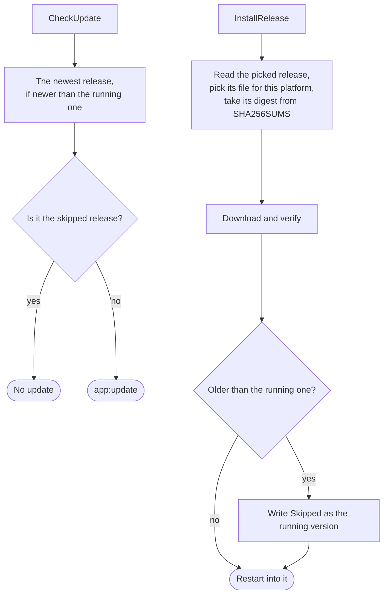

# app

[Architecture](../../ARCHITECTURE.md) › [Services](../../ARCHITECTURE.md#the-services) › app

The app service is PMT's own: its version and updates, its settings, its log and its windows. It also holds PMT's
folders on this machine and config.json, which every other service reads and writes. `main` opens the one `ConfigFile`
and hands it to them all, so the config exists once in memory.

**Uses** [files](../../internal/files/README.md), for the atomic write · **Used by**
[workspace](../workspace/README.md), [lsp](../lsp/README.md), [health](../health/README.md),
[steam](../steam/README.md), [terminal](../terminal/README.md), [wiki](../wiki/README.md), [agent](../agent/README.md).

## PMT's folders

`Dirs` is where PMT keeps its files. config.json sits in the user's config folder. The log, the caches and the trash
sit in the user's cache folder, each where the system puts it. The caches hold the schema and index caches, the wiki's
pages and the Steam snapshots. A reset empties them, so the log, which is open while the app runs, sits beside them. The
trash holds deleted files until the next start empties it.

## config.json

A `ConfigFile` is config.json held in memory. `Config` returns it as held, and the caller must not change it. `Update`
changes a copy under a lock, saves it whole and emits `config:changed` with the section it wrote. A change that returns
an error saves and emits nothing.

- A missing file is a first run. Any other read failure gives an empty config that is read only, so a passing fault
  never overwrites the real file.
- The config has no format version. A changed record means Reset data, never a migration.
- The records are plain. The open workspace's view of a mod, with its descriptor, is `workspace.Mod`, which embeds
  `Mod`.

## Settings

`Catalog` is the one list of every setting, and the page fetches it once. A row carries the setting's key, label, help,
section, type, default, choices or range, and the words the command palette also matches. A setting marked `Workspace`
is kept in the workspace's record, and any other in the config's own `Settings`. `LookupSetting` reads a value by that
rule and falls back to the default.

## The log and the running mark

`OpenLog` opens pmt.log and starts it over once it has grown too large. `ServiceStartup` writes a running mark beside
it, and `ServiceShutdown` removes it. A mark found at the next start means the last run never shut down, which
`CrashedLastRun` reports, except in a dev build (`DevBuild`), which is stopped without a clean shutdown each time it is
rebuilt. `BuildDiagnostics` writes what a bug report needs: the version, the system, the installs and the end of the
log.

## Updates

Wails's updater does the work, and the app gives it one provider, the `releaseSource`. With no version picked it is the
project's GitHub provider: it offers the newest release when that one is newer than the version running, and the
release's SHA256SUMS checks the download. That provider never offers an older release, which is why the source exists.
When the user picks a version, the source offers that release instead, newer or older.

- **Going back.** `InstallRelease` writes `Skipped` as the running version, so the updater does not offer it again
  until a newer release is out. The updater keeps the skip only while the app runs, and `ServiceStartup` sets it again
  from the config.
- **Errors.** A release with no file for this platform or no line in SHA256SUMS is refused, and so is the running
  version. The picked version is cleared after any failure.
- **One at a time.** A check or an install holds a lock, so a check cannot change the release an install is about to
  download.
- **The list.** `ListReleases` returns every published release, the newest first, without drafts, prereleases and the
  releases before `firstRelease` (0.5.0), which are an older app the repository keeps on GitHub. Each
  says whether it is the running one and whether it is older. A build that is no release, such as a dev build, gets the
  newest only.
- `FetchURL` downloads a web address with PMT's user agent, for this service and the others that read the web.

## Windows

No window has a frame of the system's: the page draws its own title bar and buttons, and the window moves by dragging
the bar's empty space, which `--wails-draggable` marks.

Wails's JavaScript runtime acts only on the window that calls it, so showing or closing another window goes through
this service. The main window opens as it was last closed, and 1400 by 900 on the first run. Its close is held and sent
to the page as `window:closing` until `CloseWindow` lets it through, and then the app quits. A window that `OpenWindow`
opens gets one `window:closing` before it closes, so the page can hand its tabs back. It closes when the page closes it
again, or after a timeout, and `window:closed` follows.

## Files

| file | what it holds |
|---|---|
| `app.go` | The service: its events, the log and the running mark, the settings, the windows, `FetchURL`. |
| `config.go` | PMT's folders, the records, the catalog of settings, and `ConfigFile`. |
| `update.go` | The check for a newer version, the install of any release, and the list of releases. |

## Events

| event | data | sent when |
|---|---|---|
| `config:changed` | the section written | config.json was written |
| `app:update` | an `Update` | a check found a newer version |
| `window:closing` | the window's name | a window waits for the page's answer before it closes |
| `window:closed` | the window's name | a window closed |

## Terms

- **Dirs**: the folders PMT keeps its files in.
- **Config**: the content of config.json.
- **ConfigFile**: config.json held in memory for every service.
- **Install**: one game install that PMT has recorded.
- **Workspace**: one recorded workspace: an install and its mods, in load order.
- **Mod**: one mod that a workspace records.
- **Calendar**: how a mod counts years and names months.
- **Era**: one era of a mod's calendar.
- **Agent**: one coding agent PMT can start for a chat.
- **Window**: how the main window was left: its size and whether it was maximized.
- **Setting**: one row of the catalog of settings.
- **Catalog**: the list of every setting.
- **Update**: the result of a check for a newer version.
- **Release**: one published version of the app, with its notes.
