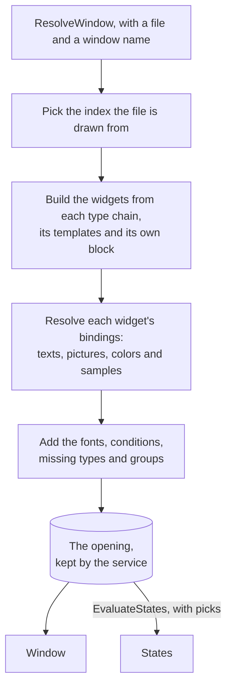
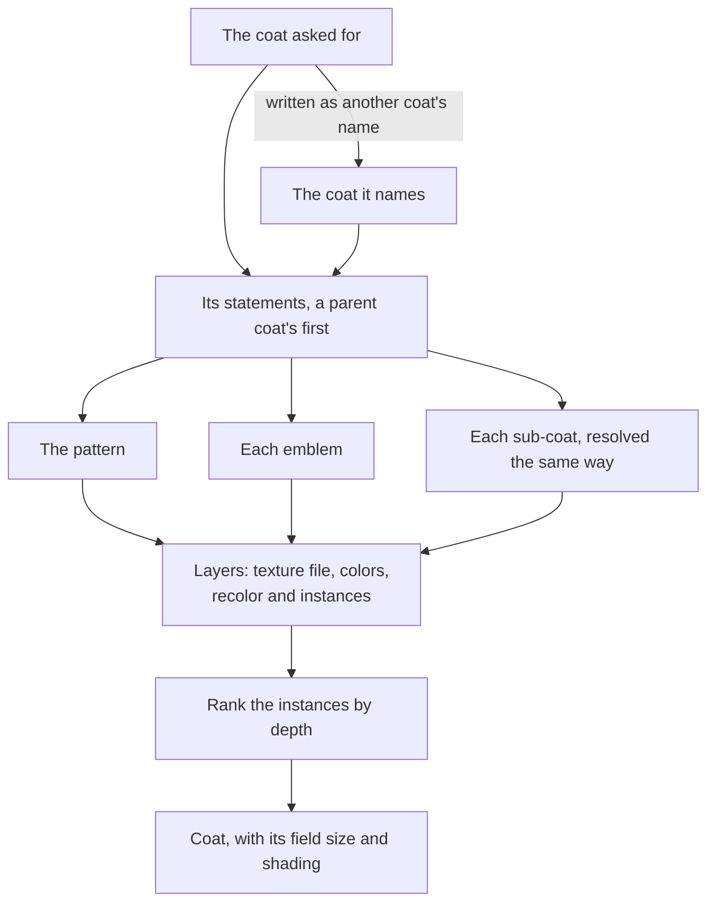

# draw

[Architecture](../../docs/ARCHITECTURE.md) › [Services](../../docs/ARCHITECTURE.md#the-services) › draw

The draw service builds what the Visual view shows. It resolves a GUI window into its widgets and a coat of arms into
its layers, and it makes the text edits the view's panels ask for. It also saves pictures as DDS files.

Go resolves and the browser lays out. A `Window` is a flat list of widgets, each with its properties as the game reads
them, its texts and its pictures. The page builds the window as DOM from them (`pages/ide/draw/picture.ts`) and draws a
coat on a canvas (`coat.ts`), as [the frontend](../../frontend/src/README.md) describes; no coordinate is computed here.
The game's inheritance rules are this package's, with the rows for GUI files and coats of arms beside the functions
that read them. What a file defines, and which definition the game keeps, come from the
[index](../../internal/index/README.md). What a data call reads and returns comes from
[lang](../../internal/lang/README.md). Every range is the [lsp](../lsp/README.md) service's.

**Uses** [files](../../internal/files/README.md), [game](../../internal/game/README.md),
[index](../../internal/index/README.md), [jomini](../../internal/jomini/README.md), [loc](../../internal/loc/README.md),
[lang](../../internal/lang/README.md), [texture](../../internal/texture/README.md), [lsp](../lsp/README.md),
[workspace](../workspace/README.md) · **Used by** [mcp](../mcp/README.md).

## Which index a file is drawn from

A file of the game is drawn from the game's own index, so its types, templates, pictures, colors, fonts and texts are
the game's, as the game draws it with no mod loaded. Any other file is drawn from the mods' index, on top of the game's.
`resolveIndex` makes that choice, and every entry point for a file calls it.

## Windows

`ListDrawables` lists what a GUI or coat file defines that the view can draw: a window, a type, a template or a coat,
nested ones included. The entry the view opens on comes first: the one named as the file, else the first window
(`shownFirst`), else the first type or template that draws something. The rest follow in document order.

`ResolveWindow` resolves one window. A widget's properties come from its type's chain, its templates and its own block,
and the last written of each key wins, keys matching without regard to case. A labeled block is read as written, or as
the widget's `blockoverride` replaces it. Of several definitions of a type or a template, the one the game keeps wins,
as it would if the game read the file being drawn. A constant, an expression or a `GetDefine` call is replaced by what
the game reads.

- A `Property` carries where it is written (`Origin`: widget, template or type), the type or template whose block wrote
  it (`Writer`), and both in words (`Source`).
- A type or template that no file defines is a property with the origin `missing`, and `Window.Missing` lists them
  widget by widget so the page can flag them.
- A window's `Holders` are the game windows it is laid out in, each its own widget alone.
- The window's properties and the textures laid over its widgets (`Overlays`) are tables on the `Window`. A widget holds
  the positions of its own, so each is sent once.

**Opening animations.** A widget opens as it looks once the animation it opens with has run. The states it opens in, and
those its holders' opening runs on it by name, each give their end values and the calls they run as they start, then
lead to the state their `next` names and to those their calls run by name (the `animation` constants). A state that fades the
widget out and runs calls as it ends takes it off the screen, so it is left out with all that would follow it. Each
state runs once.

## Edits, not writes

A method that changes an existing file does not write it. It returns `[]lsp.Edit`, which the editor applies to its own
model, so there is only ever one copy of the text and undo goes through the editor. Every edit is made against the text
before any of them.

`EditProperties` makes `Setting`s in any blocks, a widget's or a coat's. A `Setting` names its block by the range where
the block starts, and gives a key and a value. Where the block writes the key, its value is replaced. The keys a block
does not write are added together as its last statements, in the order given.

Only `CreateCoatFile` and `CopyCoat` write a script file, since they make a new one. `WriteDDS` writes the DDS files it
makes, and `ExportPNG` writes a PNG the page made to a file the user chose.

## Texts and their samples

A widget's `Texts` hold, by property key, the plain text and the data calls of each text it shows. A localization key
becomes its message's text in the session's language, each `$key$` inside it replaced by its own message's text.

A data call in a text shows sample text of its kind, in place of data the running game would give. The kind comes from
the type the call's last function returns, after the call's macros are expanded and its data contexts followed.
`callOutputs` maps a type to `number` or `text`.

- A number is digits shaped by the call's format codes: a digit is how many decimals, `percentCode` makes it a percent
  and `signCode` shows its plus sign.
- A call that `dateCallReturns` and `dateCallEndings` know shows a date in the game's own form (`dateKey`), its month in
  the session's language.
- A text is lorem words: two or three where the widget is not multiline, a sentence or two where it is multiline and
  resizes to fit, and a paragraph where it is fixed. A call of any other kind shows two words.

The text of the call seeds the sample, so the same call always shows the same sample. Each sample's kind is written in
`loc.Segment.Kind`. A sample that follows text with no space between them starts with one, since the game's own
functions bring their spacing.

## Pictures

The `library` finds the image file a picture leads to, and keeps what it looks up. A picture is written as a path, an
icon name or a texture binding.

- A path is looked up among the files the game reads.
- An icon name is looked up in the icon folders that the game's defines name, and in a folder's overrides file.
- A texture binding reads a field of a definition. Its last step reads a field of the object the step before leads to,
  or its name's first words name a kind of object.

A definition's picture is, in order, the field the binding reads, the file the defines for its kind and field give (a
folder, a prefix and a suffix), its picture keys or its name as an icon, and the one image it writes. A binding of a
kind of level (`levelEnding`) draws the first file of the folder that the kind's define names whose name starts
with the level prefix.

A mask, a coat of arms' or the widget's own (`maskKeys`), is found as a picture is. It is no texture of the
widget's.

Where a binding names no definition of its kind, the widget draws the first definition that shows a picture, and its
`Pictures` is a `PictureList` that the panel picks among. `ListPictures` lists the pictures a list may draw.

**Placeholders.** A picture that leads to no file draws a shape by what it is of. `describePicture` writes a phrase from
the picture's key, the object its binding reads and the step without its getter, or from the path's folders and name.
`findPlaceholder` picks the first placeholder one of whose kinds the phrase holds as whole words, else the
plain icon. A placeholder that only the running game can fill, such as a portrait or a coat of arms, looks for no file
at all, and a background, which only dresses its holder, gets none. The widget's `Placeholder` is the shape's name.

## Colors and rows from definitions

A binding whose last function returns a color (`colorType`) gets the color of a definition. It is the color
that the field the binding reads writes in the definition the binding names, else in the first definition of its
database that writes one. The field is a color block, or the name of a definition that is one. The widget's `Colors`
hold the CSS color by property key.

A data model's list that reads a database draws one `Row` for each of the database's first definitions, each name once
in load order, as many as the workspace's "Rows per list" setting (`draw.rows`) says. `ResolveWindow` finds them once
per window (`Window.Rows`), so a change of states does not list them again. Each row gives the widgets that read the
database the pictures and colors of its definition. A list whose item reads no database draws the page's sample rows.

## States

`EvaluateStates` works out which widgets of a window are hidden, and `Reveal` which picks make a hidden widget show.

A `Group` is one choice the panel lets the user switch: a data call the window's conditions read, a list of pictures, a
title's tier, or a coat's template list. A pick is the value chosen for a group, by its ID; `*every` stands for every
value at once and `none` for none. The `evaluator` works out a condition through And, Or, Not and Nor of any number of
operands. A call that reads the object of a data context is written from the window down to that object, so the same
call about two objects is two groups.

Each group carries how the panel writes its options (`Captions`): the text of the widget whose press sets an option,
All or None for `*every` and `none`, else the value as a GUI file writes it. Its `Box` is the box of the States tab it
starts in.

**Once per window.** The service keeps the window it resolved last as an `opening`: its index, file and name, its
evaluator at the values it opens with, its groups, and the library whose lookups later picks reuse. Each call that reads
the kept window holds the service's lock. `ResolveWindow` always resolves anew and replaces it. A change of states
starts from it, and resolves the window again only where its index, file, name or the rows setting differs. `States`
carries what the picks change: each group's value, the hidden widgets, what each group decides and the `Choice`s.

**How a window opens.** Every group is at `none`, except what holds as a window opens (`holdsOnOpening`), which is at
every value: an object exists or a list has items (`openingFacts`), and the facts of the sample the window is
drawn for (`sampleFacts`). Then come the values its opening states' calls set, and the first widget of each
strip of tabs pressed. A press runs the widget's clicks: a call such as `SelectTab('x')` selects `x` of the group on the
same object, and a call to the GUI's variable system sets, clears or toggles a variable.

A data model's size as the window opens is the "Rows per list" count, so `GetDataModelSize` is that number and
`IsDataModelEmpty` is false (`computeFact`). Such a fact is no group.

A property written as a choice between two values, a function named with `selectPrefix` such as
`Select_float(cond, a, b)`, takes the value its condition gives, as a `Choice`.

**Tiers.** Where the game draws a title's tier from a sheet of cells (`titleTiers`), each call of that function
is a group whose options are the game's tiers, with the widgets that write it as its readers. A tier picked gives each
reader's property its cell, counted from one.

## Coats of arms

`ResolveCoat` resolves a coat into its layers on its field, from the `game.Coat` row and the coat tables in `coat.go`. A parent coat's statements come
before the coat's own, without the parent's instances, and without its emblems where the coat writes emblems of its own.

- A `Layer` carries its texture's file, its colors as CSS with their names, how the game recolors its texture
  (`Recolor`), its mask and regions, and its `Instance`s.
- An `Instance` is one placement, with the game's defaults where the file sets none. Its `Rank` is its place among every
  instance of the coat in the order they draw: a larger depth is further back, and equal depths keep the order written.
- A value drawn from a template list draws the option picked for that list, else its heaviest option.
- The `Coat` carries its field's size, the game's `Shading` and its color slots.

`ListColors`, `ListTextures` and `ListFrames` give the panel the named colors, the textures of a role and the designer's
frames. `AddLayer`, `MoveLayer`, `RemoveBlock` and `AddInstance` make the layer edits. `CreateCoatFile` starts a coat
file in a mod, and `CopyCoat` copies a coat into one.

## Fonts and Save as DDS

A `Font` is one style of a font a window's texts are written in, with the file the game reads it from in the session's
language, else the base language, else the font's first group.

`FindPictureFiles` finds the pictures Save as DDS saves for a path: the picture, or the images directly in a folder that
are not DDS files. Each keeps the settings of the DDS beside it, else of the game's own DDS at the place its DDS will
have. `WriteDDS` writes each picture beside itself as a DDS in the given DXGI format, with or without mip levels.

## Files

| file | what it holds |
|---|---|
| `gui.go` | The service, the `Window` and its parts, listing what a file draws, resolving a window, property edits. |
| `texts.go` | The text a value in a GUI file shows, and the sample text a data call in it shows. |
| `states.go` | Groups, picks and the evaluator: which widgets the picks hide and which picks show a hidden widget. |
| `choices.go` | The values the picks give properties, the pictures a list may draw, and a data model's rows. |
| `textures.go` | The library of what definitions show: image files, icons, texture bindings and colors. |
| `coat.go` | Resolving a coat into layers, and the coat panel's edits and new files. |
| `fonts.go` | The files of the fonts a window names. |
| `dds.go` | Save as DDS. |

## Terms

- **Window**: one GUI window resolved for drawing.
- **Widget**: one element of a resolved window, with everything needed to draw it.
- **Property**: one property of a widget, with where it is written.
- **Overlay**: one texture laid over a widget's own, as a `modify_texture` block writes it.
- **Missing**: one type or template that a widget of a window uses and no file defines.
- **Setting**: one property to set in a block: the key and the value to write for it.
- **Group**: one choice the page lets the user switch.
- **Box**: one of the boxes that the States tab sorts a window's groups into.
- **Pick**: the value chosen for one group, by its id.
- **States**: one way of drawing a window: as it opens, changed by the picks.
- **Choice**: the value the picks give one property of a widget, with what it leads to.
- **Row**: one row a data model's list draws for one definition.
- **PictureList**: where the pictures are listed that a picture binding may draw.
- **Picture**: one picture a picture binding may draw.
- **Placeholder**: the shape drawn where a picture has no file.
- **Coat**: a coat of arms resolved for drawing, as its layers.
- **Layer**: one layer of a coat: the pattern, an emblem or a sub-coat.
- **Instance**: one placement of a layer on the field.
- **NamedColor**: one of the game's named colors, for the color picker.
- **Font**: one style of a font a window's texts are written in, with its file.
