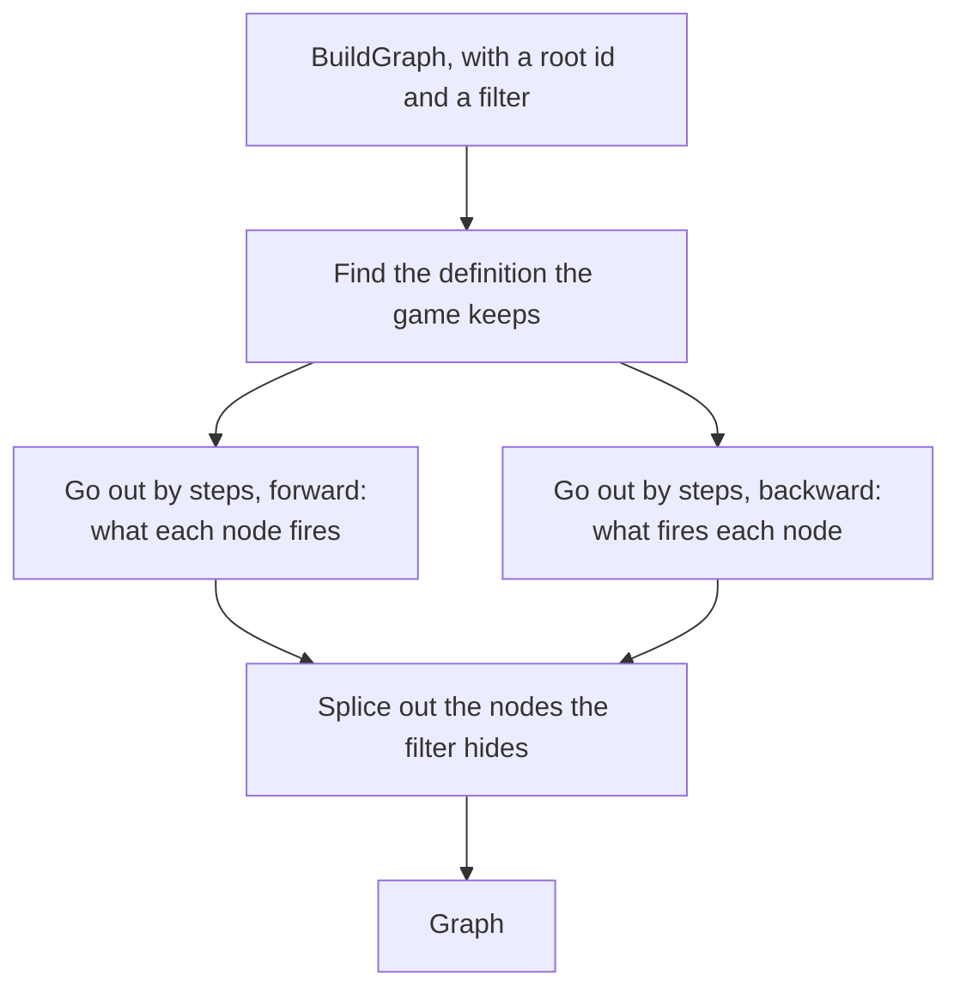

# graph

[Architecture](../../docs/ARCHITECTURE.md) › [Services](../../docs/ARCHITECTURE.md#the-services) › graph

The graph service builds the Event Graph: what fires what, from one root. It also builds the detail of one node, with
its texts, its firings and the game rules it reads.

What fires what is the [index](../../internal/index/README.md)'s: `ListFires` and `ListFiredBy` give the firings, and
`FindKept` the definition the game keeps of a name. This service adds the reach from a root by steps, the folds, the
splice of hidden nodes, where each firing sits in its definition, an event's picture, and the detail's texts. The
graph has no coordinates: the page lays it out with dagre and draws it with Vue Flow
(`pages/graph`, see [the frontend](../../frontend/src/README.md)).

**Uses** [index](../../internal/index/README.md), [jomini](../../internal/jomini/README.md),
[lang](../../internal/lang/README.md), [loc](../../internal/loc/README.md), [lsp](../lsp/README.md), [workspace](../workspace/README.md) · **Used by**
[mcp](../mcp/README.md).

## Building a graph

`BuildGraph` starts at the root and goes out by steps under a `Filter`:

- **Depth** stops the reach at a number of steps. A node the depth stops at that links further is marked `Deep`, and the
  filter's `Expand` opens it to go on.
- **Fan-out** draws a node's first firings and folds the rest into one fold, which `Expand` opens.
- **Limit** caps the nodes. A graph the limit cuts is `Truncated`, and `Total` says how many the reach found.
- **Databases** and **Origins** say which nodes are drawn. Databases picks among the kinds `Defaults` lists, so a firer
  of any other database is drawn whatever it holds. Origins applies to every node.
- **Follow** follows the scripted effects a firing passes through, so a firing through an effect counts. The effects
  are nodes on the way when Databases holds them, else they are named in the edge's `Via`.

A node the filter hides is spliced out: the edges into and out of it become one edge through it, with its name in `Via`,
keeping the first firing's delay and blocks. A node whose parent is hidden takes the nearest drawn one, and a deep mark
on a hidden node passes to the nearest drawn node before it. The root and the folds are never hidden.

`Defaults` is the filter of a new graph: the databases that are fired (`lang.Schema.FireDatabases`) and the scripted
effects, from the game and every mod, with every fold closed. `FindRoots` finds the nodes whose name holds a query, the
exact name first, then the names that start with it, then the rest. `ListOwnRoots` lists the events the workspace's mods
define that the game keeps, for the page's start.

## Nodes and edges

A `Node` is an event, an on_action, a decision, a message or a scripted effect, with where it is written, its title and
its step from the root, a firer's step negative. A firer of any other database is a node too, such as a character
interaction. Nothing fires it, so it has no firers of its own, and drawn as the root it shows what it fires. A node's id
is `database:name`, and a name has one node, which counts once toward the limit.

A node stands for a name, not for one copy of it. Its firings are those of every copy that acts (`ListActing`): the one
the game keeps and those it merges into it, or, where no source says which copy the game keeps, every copy in a file the
game reads. It is shown at the copy the game keeps, or at the first copy the graph meets where no source says which.
Where the game keeps no copy for every file, the node is the copy a file keeps for itself, such as a scripted effect an
events file defines.

A node says how the player sees it: an event shows a window or is hidden (`hidden = yes`), and a message is sent. An
event's node holds its background picture, found by the `Picture` chain of the game's `Events` row. At each hop of the
chain, of several copies of a key the first with no trigger of its own wins, or the one a `key[field=value]` names.
Every node holds the comment lines just above its definition and the origin of the copy of its name it hides.

A firer that the backward reach finds through a node the root itself fires, or through such a firer, is `Looped`: it
fires the root only round a loop of the root's own chain. It stays in the graph; the page folds it into a pill.

A fold is a node too, with the id `more:<id>` or `more-in:<id>`. It stands for the firings of one node past the filter's
fan-out, and `Count` says how many.

An `Edge` is one firing, from a firer to what it fires. It holds where it is written (`Site`), its delay in words
("7 days", "10–30 days"), the effect that writes it and that effect's title. Its `Steps` are the blocks around it from
the top of the definition: a branch of an if's chain, a weighted branch, a list, a link to another scope, an option or
another block. Each carries its `Conditions`: the step in words (`describeStep`, with an option's name and a branch's
weight), then its own condition. A firing written as an entry that an on_action's `random_events` picks by weight has
that entry as its last step. What kind a step is is read from what the walk decided at each statement. Which statement
is the effect that fires is the scan's: an occurrence's `Firing` says how many blocks above the reference it is
written (`index/fires.go`), and nothing here decides it again.

## Conditions in words

A condition in words is a block's limit, else its trigger, each statement a `Condition`. Where some of a trigger's
conditions are negated, `groupConditions` sets them under "must be true" and "must be false", so the page draws them
as they come.

- A key with words of its own reads them from `phrases` ("any of", "any province where"), and one that `Covers`
  what it holds reads its text as the player does (a `custom_tooltip`).
- A key that names a scope, or a parameter that stands for one, stays as written as the condition's `Subject`. Any other
  key is its words, a yes after it dropped and a no making it `Negated`.
- Each operator reads its words from `operatorSays`, but an = reads its words only between a scope and a value,
  and a ?= before a block reads "if it exists".
- A value stays as written, with `Title`, the in-game name of the definition a `prefix:name` value names. A key
  marked `ValueFirst` makes the value the subject (`exists = X` reads "X exists").
- A block that only wraps one condition folds into it: a negation (a phrase that `Negates`) makes it `Negated`, and a
  scope makes itself its subject. A negation around several stays a group, since moving its lines would change what they
  claim.

## The detail

`BuildDetail` reads the definition the game keeps of a node. A `Detail` holds the node, its source and a `Section` for
each key at its top, the options apart; a block's value is left to the source.

- A section that shows a text has its `Version`s: each text it can show in the workspace's language, else the base
  language, with the trigger that decides it in words and its pieces (`loc.Segments`), each data call made its words.
- A call that names a customizable localization reads as the texts it can show, joined by slashes ("daughter/son").
- A version whose key has no message in the detail's language is `Missing`, and shows the base language's text.

The detail also holds what fires the node, the node at the other end of each firing, and the game rules it reads with
their settings' texts. Where the definition hides a copy of its name, the detail holds that copy's node.

## Files

| file | what it holds |
|---|---|
| `graph.go` | The service, the graph and its parts, building a graph from a root, finding roots, the default filter. |
| `steps.go` | An edge: where a firing is written, the blocks around it, its delay, its effect and its title. |
| `conditions.go` | A block of triggers put into words. |
| `pictures.go` | An event's picture, found by a chain of definitions that ends in an image file. |
| `detail.go` | The detail of one node: its sections, texts, firings and rules. |

## Terms

- **Node**: one node of the event graph: the kept definition of an event, an on_action, a decision, a message, a
  scripted effect or another entry that fires one, or a fold.
- **Fold**: a node that stands for the firings of one node past the fan-out.
- **Edge**: one firing, from a firer to what it fires.
- **Step**: one block a firing is written inside, from the top of its definition.
- **Condition**: one statement of a block of triggers in words, with the statements of its block under it.
- **Filter**: what the graph shows and how far it reaches from its root.
- **Graph**: the event graph from one root, without coordinates.
- **Deep**: what a node is when the depth stopped at it and it links further.
- **Display**: how the player sees an event or a message: a window, hidden, or a message.
- **Copy**: the latest-loaded copy of a name that the definition the game keeps hides.
- **Detail**: what the page shows about one node.
- **Section**: one key at the top of a definition, as the page shows it.
- **Version**: one text a key can show, with the trigger that decides it.
- **Rule**: one game rule a definition reads, with its settings.
