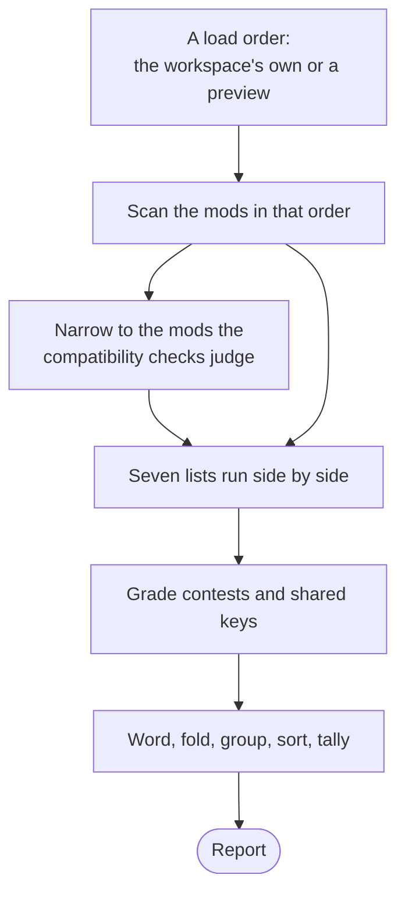

# health

[Architecture](../../ARCHITECTURE.md) › [Services](../../ARCHITECTURE.md#the-services) › health

The health service builds the Health report: how the open workspace's mods touch each other, and what is wrong in each
one. It also lists the game's error log, watches it, and keeps the pairs of mods whose conflicts the workspace ignores.

It judges nothing on its own. A file's problems come from the [lsp](../lsp/README.md) service, which also owns the table
of codes: each finding's wording, question, level and topic are its code's row. Which copy of a name the game keeps is
the [index](../../internal/index/README.md)'s. Health finds which names and files compete, which mods are at fault, and
how far each language covers a mod. The [Health page](../../frontend/src/README.md) renders the report as it comes.

**Uses** [app](../app/README.md), [files](../../internal/files/README.md), [game](../../internal/game/README.md),
[jomini](../../internal/jomini/README.md), [loc](../../internal/loc/README.md),
[schema](../../internal/schema/README.md), [index](../../internal/index/README.md), [lsp](../lsp/README.md),
[workspace](../workspace/README.md) · **Used by** [mcp](../mcp/README.md).

## Building a report

- A preview is a load order the page asks about. It is scanned with `workspace.Session.ScanOrder` and saved nowhere.
  The report then lists the `Changes` against the workspace's own order: each name or path whose kept copy moves to
  another mod.
- The seven lists are the definitions, the shipped paths, the shared localization keys, the descriptors, the unmounted
  folders, the editor's problems for every mod file, and the language coverage. The compatibility ones read the index
  narrowed to the checked mods. A mod the workspace marks `LeftOut` is not checked, but its own problems are still
  judged.
- The words, the fold, the groups and the sort are made in Go, so the page derives nothing again. Findings with the same
  code, owner, name and message are one: the first stands for them, and its `Count` adds theirs. A `Group` holds the
  findings of the compatibility or of one mod, worst level first, and the heaviest first within a check. A `Tally`
  counts a group's findings by level and words each count.

## Questions, levels and topics

Every finding answers one of three questions: `compatibility` (how the mods touch the same things), `health` (each
mod's own problems) or `log` (what the game's last run logged). A finding has a level by how much the game loses:
`critical`, `error`, `warning` or `info`. The game log rows have none.

## Contests

A **contest** is a name two or more mods define, or a file two or more mods ship in a folder the game reads, of which
the game keeps one copy. The kept copy's mod is the winner. The beaten mods are the others that have no kept copy.

- A contest is `info` when the winner declares every beaten mod as a dependency, or the workspace ignores the pair.
  Otherwise it is `critical`. A declared dependency forgiving a contest is Health's judgment, not a game rule.
- Where no source says which copy the game keeps (`index.ReasonUnsettled`), the copies are one `undecided-contest`
  with no site kept. So are two copies of a block that merged copies cannot both write, such as an on_action's effect.
  It is `info` when every pair of its mods is a declared dependency or an ignored pair, and `critical` otherwise. A pair
  with the game is never forgiven.
- A localization key that two or more mods define in one language is a `shared-message`, with no winner. It follows the
  same forgiveness, with a warning in place of `critical`.
- A name both a mod and the game define is an `override` where the game keeps the mod's copy. Where it keeps its own,
  each mod none of whose copies it uses has an `unused-copy`. A mod's file shipped over the game's own is a
  `removed-names`, instead of an `override`, when the game's file defines names that no file the game reads defines and
  the game's files still use.
- The load order decides only a file two mods ship at one path, and a name whose reason is `playset`. A critical
  contest of either kind, with one beaten mod that depends on the winner, carries in `Finding.Order` the load order
  that fixes it: the beaten mod moved just after the winner.

`Mods` lists the mods a finding concerns, in load order, and never the game. `Pairs` lists each two of them the finding
sets against each other, which the page offers to ignore.

## Dependencies and ignored pairs

A mod's declared dependencies are the ones its descriptor names that the workspace has, and their own dependencies count
all the way down. One the workspace lacks is a `missing-dependency`. A mod's own problems are judged by lsp with the
index narrowed to the mod and its dependencies, so a name only another mod defines is that mod's
`unresolved-reference`.

`AddIgnoredPair` and `RemoveIgnoredPair` change the workspace's record in `config.json`, each pair sorted. Each pair
whose two mods are in the workspace becomes an `ignored-pair` finding that counts the findings whose `Pairs` hold it.

## The error log

`ListErrorLog` reads the game's error log, where `game.ErrorLog` says it is. A message repeated at the same file and
line is one row, with its count and the last one's time. A row goes to a mod in `Origin` by one of two ties, which its
`why` fact names:

- `file`: the row names a line of a file that the game loads from the mod.
- `name`: the row names an identifier that is a definition, and all of its loaded copies lie in that one mod.

Any other row is the game's own. The game's debug log (`game.MountLog`) lists the folders the last run read. A row goes
to a mod only if that run read it: `Unloaded` lists the workspace's mods it did not read, and `Copies` the folder of
another copy it read in a mod's place. Without a debug log, every mod counts as read.

While a workspace is open the service watches the log, from the nearest folder above it that exists while its own does
not, and sends `errorlog:changed` once each burst of writes ends. The watch stops when the workspace closes.

## The translation scaffold

`WriteScaffold` writes the localization keys a mod lacks in a language: each of its base-language messages whose key has
no message of the mod in that language, with the base text as the placeholder. These are the keys `coverage` counts as
missing. A key goes at the end of the language's file that matches the base-language file it is in. A matching file that
is missing or empty is first made with only its header. `ListScaffolds` gives the same messages by file, for
[mcp](../mcp/README.md)'s preview.

## Files

| file | what it holds |
|---|---|
| `health.go` | The service, its payload types, `BuildReport` with the grouping, and the page's reads. |
| `contests.go` | Contests and shared keys: their winners, levels and pairs, and what a preview changes. |
| `ignored.go` | The ignored pairs and their findings, and the mods the compatibility checks judge. |
| `errorlog.go` | The game's error log: its rows, their mods, and the watch on it. |

## Events

| event | data | sent when |
|---|---|---|
| `errorlog:changed` | nothing | the game's error log grew while a workspace is open |

## Terms

- **Question**: one of the three things Health answers: compatibility, health and the game log.
- **Level**: how much the game loses by a finding: critical, error, warning or info.
- **Topic**: what a check is about: syntax, references, values, localization, definitions or descriptor.
- **Finding**: one row of the Health page: a problem or a fact, with the places it points at.
- **Use**: one name a finding is about, with how often the files the game reads use it and where they first do.
- **Report**: the findings for one load order, grouped and counted, and what that order changes.
- **Group**: the folded and sorted findings of the workspace's compatibility or of one mod, with their tally and checks.
- **Tally**: how many findings there are of each level, and the worst level.
- **Check**: one code at one level in a group, with how many findings it has.
- **Change**: one name or path whose kept copy moves to another mod in a previewed order.
- **GameLog**: the rows of the game's last error log, with its path and when it was written.
- **Overview**: what one mod holds, counted, and the mods it is judged with.
- **Compared**: the texts of two statements, side by side.
- **Snippet**: the code around one finding site, with the line it begins at.
- **Contest**: two or more mods defining one name or shipping one file, of which the game keeps one copy.
- **Undecided contest**: copies of one name in two or more of the mods and the game, of which no source says which the
  game keeps.
- **Unused copy**: a mod's copy of a name that the game never uses, because it keeps its own.
