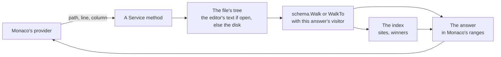

# lsp

[Architecture](../../docs/ARCHITECTURE.md) › [Services](../../docs/ARCHITECTURE.md#the-services) › lsp

The lsp service is the editor's language service. It answers what the editor asks about a file: hover cards,
completions, definitions, diagnostics, tokens, folds and the rest. Every range it returns is in Monaco's own form.

There is no protocol, no stream and no document table. Each of Monaco's providers calls one method of `Service`, and
the bindings type it from end to end. The session's buffers are the open files. An answer is computed when asked and
nothing is kept between calls.

It decides nothing about the language. What a key means is the [schema](../../internal/schema/README.md)'s, where a name
is defined and which copy the game keeps is the [index](../../internal/index/README.md)'s, and the open session is the
[workspace](../workspace/README.md)'s. This package adds the editor's view of them: the cards, the lists and the
problems in words.

**Uses** [app](../app/README.md), [workspace](../workspace/README.md), [files](../../internal/files/README.md),
[game](../../internal/game/README.md), [index](../../internal/index/README.md),
[jomini](../../internal/jomini/README.md), [loc](../../internal/loc/README.md),
[schema](../../internal/schema/README.md), [texture](../../internal/texture/README.md) · **Used by**
[draw](../draw/README.md), [graph](../graph/README.md), [health](../health/README.md), [mcp](../mcp/README.md),
[search](../search/), [terminal](../terminal/README.md), [wiki](../wiki/README.md).

## One answer

`SetText` gives the session the editor's text of an open file, which becomes the file's buffer, and answers with the
file's problems. `CloseFile` drops the buffer. Every other method reads the file's tree through the session, so an open
file is read as the editor holds it.

## Positions and ranges

A position comes in as Monaco gives it: a line from one and a UTF-16 column from one. An answer's `Range` is Monaco's
`IRange` with its own field names, so the page hands it over as it is. Every other package keeps UTF-8 byte offsets.
The one conversion between the two is in `lsp.go`: `ToOffset` and `ToSpan` take Monaco's position and range to byte
offsets, and `ToRange` and `ToEdits` take byte spans and the engine's edits to Monaco's. No other package converts.

## Sites

A `Site` is one place in a file that an answer points at: the file's `workspace.Place` and a line. `MakeSite` makes one
from an index occurrence and reads no file, so it has no range and no text. `LocateSite` reads the file's tree and adds
the range of the name and the text of its line. `MakeSites` makes the sites of a name's definitions, each with whether
the game keeps it and why, and the reason in words. Where no source says which copy the game keeps, no site is kept.

A hover card lists only what files define, wherever it is written: a title inside a title, a GUI block, an EU5
province in `definitions.txt`. It lists no second name of a definition, no name a command makes (a saved scope, a
variable, a list, a flag) and no key that only switches a name on. Peek and Find references reach every site.

## The answers

- **Hover.** `Hover` walks to the position and returns a `Card`: what the key or value is, a localization key's
  text, a color, the sites that define the name, the one the game keeps first, and its facts as `Card.Rows`. A row is
  a label and the fact in words, worded here and kept in the one order `rowLabels` lists: what the word takes, where
  it leads, a date in the mod's calendar, an image's size and format. The page draws the rows as given. A scope is
  worded one way on every row (`describeScope`), and a date as the date hint words it (`describeDate`). A definition's
  card also has its localized name and description, the comment lines just above it and, for a scripted effect or
  trigger, its parameters. A key in a call of one is a parameter, and its card names the definition it is given to. A
  value that is one of the choices its key takes, such as an event's type, is named by the key, with the choices and
  the key's own text. A command's card shows the scopes the dumps give it, or says they name none. Each link of a
  chain has its own card, and so has a link written as a value: it says the scope the link leads to. A fact learned
  only from the game's files marks the card inferred. `Classes` are the wiki lexicon's, in the order of its tabs, and
  `Card.Lexicon` names the one that lists what the card is about. `Card.Token` is the token type the editor colors
  the word by, so the page draws the card's label in the word's own color.
- **Completion.** `Complete` returns a `CompletionList`: the candidates, and whether a limit cut them short. Only the
  localization keys have a limit, and a key typed in full is listed first, before the cut. The editor asks again as
  typing narrows a list that is cut, and filters any other itself. At a key it returns what fits: the language's
  keywords for the block, then its commands, the scripted definitions the block's caller calls and, where the block
  reads links, the links written alone that run in its scope, `this`, `root`, `prev` and the scopes saved earlier,
  each ranked by its uses in the index, then its fields and the names of the database its keys name. The commands
  and the links are listed from each database's keys, which the schema sorts once. A block whose caller is any call, such as a command's
  block or a random list's branch, gets the definitions that act as a command it allows: scripted effects among
  effects, scripted triggers among triggers. At a value it returns what a call's row says it
  writes, yes and no or the field's choices, and the names of each database the walk finds the value refers to: its
  localization keys, its image files under the folder typed so far, or its definitions, after the link's prefix where
  one is typed. Where none of these apply, it returns the values the game's own files write there, without numbers or
  dates. A value that takes a target also gets the links and the link prefixes that lead to the scope it needs, and
  the scopes saved earlier in the definition. The value of a link is a target of the scope the link leads to. A word
  written alone in a block gets both lists, the values and the block's keys, since it may also be a key typed before
  its equals sign. A definition local to another file is never offered.
- **Navigation.** `Definition` returns where a name is defined, the kept definition first. `References` adds where it is
  used. `Rename` returns its edits grouped by the file they change, and `PrepareRename` refuses a name that a
  read-only file defines too (the game's or a Workshop mod's), or one nothing defines. All three read a file that is
  open in the editor from the editor's own text, since the index holds the saved file's positions. `ListSymbols` is a file's outline, and `FindSymbols` searches the workspace's
  definitions, or its localization keys, best match first. Only a script file is walked to a position, since the
  schema has no rules for the keys of any other file.
- **Tokens.** `Tokens` returns the color of every key and value of a script file in a range, from the walk the
  document keeps, and of every key and piece of markup of a localization file, from `loc`'s segments, encoded as
  Monaco's semantic tokens against `ListLegend`. Where the walk gives no category, a number, a date and a yes or
  no are numbers and any other key is a field. A list iterator such as `every_vassal` is a keyword, though the walk
  holds it as the command it also is. `ColorText` colors a text that is no open file, such as a snippet a
  page shows: it adds the comments, quoted texts and operators that Monaco colors by itself in the editor.
- **Edits.** `Format` keeps the file's own indentation, and gives no edits for a read-only file or a file that does
  not parse; its edits only ever replace white space. `ListFixes` gives the quick fixes: the nearest defined
  name for one nothing defines, which for a call is also a command the block allows, a missing key with its default, an entry mode out of place removed, and the file's
  localization keys that have no base-language text added to the mod's localization file, which the fix creates first
  if it is missing. `BuildOverride` copies an entry into a mod, and `DraftFile` names and starts a new file.
- **Details.** `ListFolds` returns every block that spans lines. `ListHints` reads each date in the mod's calendar and
  the text of each localization key a script file names. `ListColorSites` lists the colors a file writes, and
  `PresentColor` writes a color in the form the file already uses. `Signature` returns the parameters of the scripted
  definition a call names.

## Diagnostics

A `Diagnostic` is a code, a range and its facts, with its code's level and its message filled in. `Codes` is the one
table of every code: its id, the question Health asks it under, its level, its topic, its label, its description and its
message, a template that the facts fill. A sentence about a problem is written once, there, and the editor's markers
and Health's rows both read the level from it. `SplitMessage` fills a template as `Part`s, each fact in its style, and
`JoinParts` joins them into the plain text.

- `Diagnose` judges a file against the open session, without the checks the user turned off (`ide.checks`).
  `DiagnoseFile` does the same against any session and index. `DiagnoseFiles` judges many files in parallel, as Health
  does; the run reads the parameters of each callee's kept copy once for all its files, and a file's own definitions'
  parameters once for all the calls in that file. `DiagnoseText` judges the text a file would have, as a coding agent's
  change through PMT's tools, and is not bound to the page.
- A file of the game has its parse errors only. A mod's file is judged with the index narrowed to its mod and the mods
  it depends on. A name nothing defines there, but a mod it does not depend on does, has an `Elsewhere` message.
- The parse errors and the localization checks come from `jomini` and `loc`, under the same table.

**A check accuses only on firm ground.** A reference is dangling only where the walk did not mark it `Inferred`: its
database is known, holds no names made as the script runs, and the claim that makes it is not inferred from the
game's files alone (`schema`'s `judge` gives the one verdict). A name the game's own
files use is never dangling, unless every definition of it lies in a file the game does not read. A key is unknown, or
a value of the wrong type, only where a source that can accuse describes the block and the game's own files never
write otherwise.

**A name others share is judged by what the game keeps** (`index.FindWinner`):

- A copy with the same override priority as another loaded copy is `conflicting-priority`, which the game logs as an
  error.
- A localization key outside a replace folder is `duplicate-message` against its own mod's other copies, and against
  the game's only where the game logs that as an error. EU5's stages count as one folder for both checks.

## Files

| file | what it holds |
|---|---|
| `lsp.go` | `Service`, Monaco's ranges and their conversion, sites, and `SetText` and `CloseFile`. |
| `hover.go` | The hover card and the lexicon classes. |
| `complete.go` | Completion. |
| `navigate.go` | Definitions, references, rename and symbols. |
| `diagnostics.go` | The table of codes, levels and topics, the messages, and the checks of a script file. |
| `messages.go` | The checks of a localization file. |
| `tokens.go` | The semantic tokens. |
| `edits.go` | Formatting, quick fixes, overrides and new files. |
| `details.go` | Folds, hints, color sites and signature help. |

## Terms

- **Range**: a span as Monaco counts it: lines and UTF-16 columns from one, the end exclusive.
- **Site**: one place in a file that an answer points at, with its range, the text of its line and whether the game
  keeps it where the answer has them.
- **Edit**: one change to a file's text, as a range and the text that replaces it.
- **Card**: a hover card: what a key or a value is, and the facts about it in the words and the order the page shows.
- **CardRow**: one fact of a card, a label and the fact in words.
- **CompletionList**: what can be written at a position, with whether a limit cut the list short.
- **Class**: one class of the wiki's lexicon, which lists the commands the game declares in one way.
- **Completion**: one candidate in the completion list.
- **Symbol**: one entry of a file's outline.
- **WorkspaceSymbol**: one definition found by the symbol search across the workspace.
- **Code**: one type of problem, with its question, its level, its topic and its message.
- **Level**: how much the game loses by a finding: critical, error, warning or info.
- **Topic**: one group of the checks, in words.
- **Part**: one piece of a sentence: plain text, or a fact drawn in its style.
- **Diagnostic**: one problem found in a file: its code, its range and its facts.
- **Legend**: the token types and modifiers the semantic tokens are encoded against.
- **Fix**: one quick fix, with its edits grouped by file, a file it writes first, and where it leaves the caret.
- **Fold**: one foldable region.
- **Hint**: a text drawn inline beside the code.
- **ColorSite**: one color written in a file.
- **Signature**: the parameter list of a scripted definition at a call.
