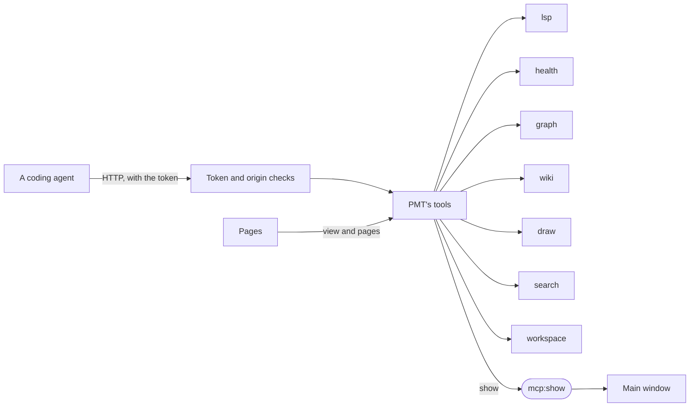

# mcp

[Architecture](../../docs/ARCHITECTURE.md) › [Services](../../docs/ARCHITECTURE.md#the-services) › mcp

The mcp service is PMT's tool server for coding agents. It serves PMT's tools, its instructions and its starter tasks
over MCP to the agents on this computer, and passes on to the main window what an agent asks it to show.

The tools hold no logic of their own. Each answers through the method of another service that answers the same
question for a page: the editor's, Health's, the Event Graph's, the wiki's, the Visual view's, the search's and the
workspace's. What the assistant pane says to an agent is [agent](../agent/README.md)'s.

**Uses** [files](../../internal/files/README.md), [jomini](../../internal/jomini/README.md),
[lang](../../internal/lang/README.md), [loc](../../internal/loc/README.md),
[terminal](../../internal/terminal/README.md),
[draw](../draw/README.md), [graph](../graph/README.md),
[health](../health/README.md), [lsp](../lsp/README.md), [search](../search/), [wiki](../wiki/README.md),
[workspace](../workspace/README.md) · **Used by** [agent](../agent/README.md), [terminal](../terminal/README.md).

## The server

The server listens at `http://127.0.0.1:<port>/mcp` from the app's start to its end. The port is the setting
`agents.port`, 47820 unless the user sets another, read at the start. If another program holds the port, the server
stays off until the next start and PMT's log says so. It is stateless: each request stands alone.

Three checks guard it:

- **The token.** A request is answered only with the token in its `Authorization` header (`Bearer <token>`). The token
  is the file `mcp-token` in PMT's app folder, made at the first start. `CreateToken` makes a new one, after which every
  agent must be registered again.
- **The Host.** The SDK refuses a request that arrives on the loopback address with another host name, which stops a web
  page from reaching the server through a rebound DNS name.
- **The Origin.** `http.CrossOriginProtection` refuses a request sent from a web page of another site. A request with no
  `Origin`, as an agent's is, passes.

PMT's own environment carries `PMT_MCP_URL` and `PMT_MCP_TOKEN`, so every program PMT starts has them. `Variables` lists
the two for the Terminal's settings.

## What an agent is told

The instructions say what PMT is and give the working rules: find a name with PMT's tools and never invent one,
diagnose a file before calling a change done, write only in the workspace's mods, and leave saving, uploading and
Settings to the user. Their first paragraph stands alone, since Codex may read no more. `read_guide` holds the rest, in
four topics: the pages and what `show` can bring to the front on each, how a change is made with PMT's tools, which
copy the game keeps when several definitions share a name, and the open workspace's game, mods and folders.

The starter tasks (`Tasks`) are served as MCP prompts, and `ListTasks` lists them for the assistant pane. Each text
works with the page's chip attached and, outside PMT, through `describe_view`. A task that changes the file it is about
is marked `Edits`, and the page offers it only with a file the user can change open.

Each tool has a short title, and a tool that changes no file is marked read only. `ListTools` lists them for the
assistant pane, which answers an agent's request to use a read-only tool itself, in every mode. `rename`, `apply_edit`
and `write_scaffold` are the tools not marked, and they ask.

## What the tools check

A tool given a name the workspace does not have answers with an error that says where the right one comes from, never
with an empty answer that reads as "none". The checks are in `checks.go`, each the one place its rule is written.

## Changes preview first

`rename`, `apply_edit` and `write_scaffold` change files, and only in the workspace's mods. Called without a token, each
answers with the change it would make and a token. Called again with that token, it makes the change once. A file with
text the user has not saved is left alone.

## Showing

`show` sends `mcp:show` with a `Show`: a page with its query, a file with its lines selected, a Visual view window with
the states it is drawn in, or a Wiki look-up. It checks the whole request first and sends nothing if any part is wrong.
Only the main window acts on the event: it opens the page or file, and a page reads what an agent sets as its route's
query.

`queryKeys` has a row for each key of each page's query that `show` takes, with its help, the values it takes where they
are few, and its check. The guide's lines on `show` are written from it, so the two cannot differ.

The windows tell the server what the user sees: the page shown and its chip (`SetView`), which `describe_view` returns,
and the page catalog the main window sends once (`SetPages`).

## Files

| file | what it holds |
|---|---|
| `mcp.go` | The service: the starter tasks, the instructions, the token, the tool list and the HTTP handler. |
| `tools.go` | The tools' inputs and answers, the guide's texts, and the write tools' previews and tokens. |
| `app.go` | The view and pages the windows sent, and `show`. |
| `checks.go` | The queries `show` takes, and the checks of what the tools and `show` are given. |

## Events

| event | data | sent when |
|---|---|---|
| `mcp:show` | a `Show` | an agent asked PMT to show something |

## Terms

- **Task**: a starter task, a prompt PMT offers an agent, with the chip of the page it carries.
- **Tool**: one of PMT's tools, with its title and whether it only reads.
- **Access**: the address and token an agent needs to reach the server.
- **View**: the page a window shows and its chip, as the window sent them last.
- **Chip**: what the page shown offers an agent's prompt, a file with its selected lines or a text.
- **Page**: one page of the app as its catalog describes it.
- **Show**: something an agent asks the main window to bring to the front.
- **Lookup**: what the IDE's Wiki pane looks up, a wiki page or a Lexicon entry.
- **Preview**: a write tool's answer before it changes anything, the change and the token that makes it.
