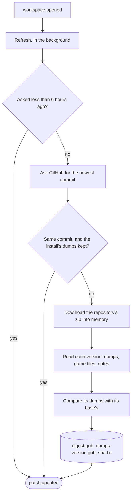

# patch

[Architecture](../../docs/ARCHITECTURE.md) › [Services](../../docs/ARCHITECTURE.md#the-services) › patch

The patch service reads the Modding Co-ops' digests of a game's updates into the game's patches, lists the versions
the Patch Center shows, and says what the patches mean for each mod of the open workspace. Only Vic3 and EU5 have a
Co-op; the game's row names its repository in `Digests`. A patch is plain data of the
[workspace](../workspace/README.md) service. The Co-ops' layout, and what the package refuses and reads past, are in
the package doc.

**Uses** [app](../app/README.md), [files](../../internal/files/README.md), [game](../../internal/game/README.md),
[health](../health/README.md), [index](../../internal/index/README.md), [lang](../../internal/lang/README.md),
[schema](../../internal/schema/README.md), [steam](../steam/README.md), [wiki](../wiki/README.md),
[workspace](../workspace/README.md)

## The refresh

`Refresh` runs in the background each time a workspace opens, and does nothing for CK3, which has no Co-op. While the
digest holds no patch of the installed version, it runs again every `recheck`, 6 hours, until the workspace closes or the
digest has the patch. It never asks GitHub less than `recheck` after it last did for the game, and keeps the time of the
last ask in `checked.txt` beside `sha.txt`, so a workspace opened again within 6 hours asks nothing. One request asks
GitHub for the newest commit. If it is the one the folder of patches was read from, and the folder holds the dumps
of each version an install is on that the digest has, nothing more is fetched. Otherwise the repository is downloaded as
one zip and read in memory, version by version, oldest first. The zip is never written to disk.

A version's dumps are those of its `docs` folder, each missing file taken from the newest earlier version. They are
compared with the dumps of its base, the latest earlier version that is not an open beta, by `schema.CompareDumps`, with
the open workspace's schema as the language: an old version has no game files to resolve the keys of a star key, as
`every_country_in_*`. The first version has no base and no dump changes.

The folder of patches is `workspace.ResolvePatchDir`, and the workspace's `ResolveDigestFile`, `ResolveShaFile` and
`ResolveCheckedFile` and `ResolveDumpsFile` name the files in it, for the writer and the readers alike: `digest.gob`
holds the patches, `sha.txt` the commit they were read from, `checked.txt` when GitHub was last asked, and `dumps-<version>.gob` the dumps of each version an install is on, with no file or
line on their commands, as the shipped backup has none. They are saved before `sha.txt`, so a failed save is read again
by the next refresh. A version's dumps file is written once and left alone at later commits, since a published
version's dumps never change and the file's time names the install's schema cache. A failure of any kind keeps the files that were saved, and `patch:updated` carries the error.

## The versions

`ListPatches` lists the versions the workspace's patches hold and the wiki's notes (`wiki.ListNotes`) that no patch
takes, newest first. The wiki writes one note for a release, as `1.15`, and one for its hotfixes, as `1.15.X` (measured
on the wiki listings of all three games). A patch whose numbers after the first two are all 0, as `1.15.0`, takes the
note `1.15`; any other patch of the release, as `1.15.1`, or an open beta of it, takes `1.15.X`. It is listed under its
own version with that note's fields, and the note has no row of its own. A patch the wiki has no note for has only its
`Version` of the wiki's fields. `Known` is whether a patch holds the version, `Beta` whether it is an open beta, and
`Mods` the ids of the open workspace's mods whose `supported_version` matches it. Until a refresh has fetched the wiki's
listing, it lists the patches' versions alone.

## What the patches mean for a mod

`ListImpacts` gives one `Impact` for each mod of the open workspace, in load order. Its range is `Session.ResolveRange`:
the version the mod is made for, or the version it is compared from, to the install's. `Judged` is true where the mod's
`supported_version` decides the start; it is false for a blank one or one the launcher's reading of is not known, as
`1.13*`, and the start is then the version it is compared from. Its findings are the mod's
findings in Health's patch question, which `ListImpacts` asks `Health` for and does not work out again: the names the
game renamed or removed, the game files the mod replaces that the game changed, and the mod's supported version. Its
ties are the articles of the patches in its range that touch it.

An article ties to a mod only by an exact link or key, so an article that names neither a folder nor a key ties to no
mod, and the page says so. The article links the type doc of a folder (`Article.Folders`) that the mod writes files in,
or writes a key in backticks (`Article.Keys`) that the mod defines or uses, by the mods' index. A tie's `Count` is the
mod's files in those folders, with its definitions and uses of those keys. A file is in a folder by its path as the game
reads it, in lower case.

`FindPatch` gives one version's patch and the ties of every mod whose range holds it. A version no patch holds comes back
as the zero patch with no version, which is a version whose changes are not known yet.

`UpdateSupportedVersion` writes the install's release, as `1.15.*` for `1.15.1`, which `workspace.ToSupportedVersion`
makes, as the mod's supported version. A mod of the user's own has a Publish listing, so the write goes through
`steam.WriteListing`, which keeps the descriptor and the Workshop version tag the same; any other mod's descriptor is
written alone.

## Files

| file | what it holds |
|---|---|
| `patch.go` | The service, its event, the refresh and the folder of patches. |
| `archive.go` | Asking GitHub for the repository and opening its zip. |
| `digest.go` | A repository's versions, their dumps and changed game files, read into patches. |
| `articles.go` | A version's note files, read into articles and key renames. |
| `notes.go` | The versions the Patch Center lists. |
| `impacts.go` | What the patches mean for each mod: its findings and ties, and making it made for the install's release. |

## Events

| event | data | sent when |
|---|---|---|
| `patch:updated` | the error's text, "" when it worked | a refresh finished |

## Terms

- **Digest**: the Modding Co-op's repository of one game, with a folder for each version of the game.
- **Archive**: a digest's zip as it was downloaded, its files by path.
- **Patch**: what one version of a game changed against its base, as the [workspace](../workspace/README.md) service
  says.
- **Note**: one version the Patch Center lists, with the wiki's note of it, whether a patch holds it and the mods made for it.
- **Note file**: one of the files in which a digest writes a version's notes. Its `##` headings are articles.
- **Section**: the lines under one `##` heading of a note file.
- **Kept dumps**: the dumps of the version an install is on, saved from the digest.
- **Impact**: what the patches in one mod's range mean for it: its findings and its ties.
- **Tie**: an article of a patch that touches a mod, by a folder it links the type doc of or a key it writes in backticks.
