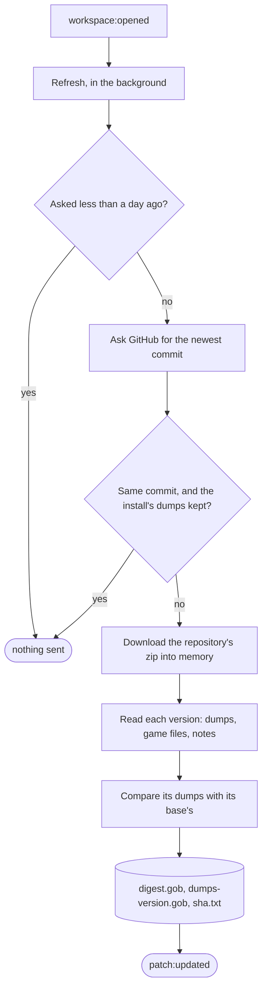

# patch

[Architecture](../../docs/ARCHITECTURE.md) › [Services](../../docs/ARCHITECTURE.md#the-services) › patch

The patch service reads the Modding Co-ops' digests of a game's updates into the game's patches, lists the versions
the Patch Center shows, and says which of the digests' articles touch each mod of the open workspace. Only Vic3 and EU5 have a
Co-op; the game's row names its repository in `Digests`. A patch is plain data of the engine's
[patch](../../internal/patch/README.md) package. The Co-ops' layout, and what the package refuses and reads past, are in
the package doc.

**Uses** [app](../app/README.md), [files](../../internal/files/README.md), [game](../../internal/game/README.md),
[index](../../internal/index/README.md), [lang](../../internal/lang/README.md),
[patch](../../internal/patch/README.md), [schema](../../internal/schema/README.md), [wiki](../wiki/README.md),
[workspace](../workspace/README.md)

## The refresh

`Refresh` runs in the background each time a workspace opens, and does nothing for CK3, which has no Co-op. While the
digest holds no patch of the installed version, it runs again every `recheck`, a day, until the workspace closes or the
digest has the patch. It never asks GitHub less than `recheck` after it last did for the game: the time of `sha.txt`
is the time of the last ask, so a workspace opened again within a day asks nothing. One request asks
GitHub for the newest commit. If it is the one the folder of patches was read from, and the folder holds the dumps
of each version an install is on that the digest has, nothing more is fetched. Otherwise the repository is downloaded as
one zip and read in memory, version by version, oldest first. The zip is never written to disk.

A version's dumps are those of its `docs` folder, each missing file taken from the newest earlier version. They are
compared with the dumps of its base, the latest earlier version that is not an open beta, by `schema.CompareDumps`, with
the open workspace's schema as the language: an old version has no game files to resolve the keys of a star key, as
`every_country_in_*`. The first version has no base and no dump changes.

The folder of patches and its files are [patch](../../internal/patch/README.md)'s: the service hands it the digest's
patches, the commit they were read from and the dumps of each version an install is on (`patch.SaveDigest`), and asks
it when GitHub was last asked and whether the folder is current (`patch.FindAsked`, `patch.IsCurrent`). After a save the session
loads the patches again (`Session.LoadPatches`) and `patch:updated` is sent. A failure of any kind keeps the files
that were saved, and `patch:updated` carries the error.

## The versions

`ListPatches` lists the versions the workspace's patches hold and the wiki's notes (`wiki.ListNotes`) that no patch
takes, newest first. The wiki writes one note for a release, as `1.15`, and one for its hotfixes, as `1.15.X` (measured
on the wiki listings of all three games). Which note holds a version is the wiki's rule, `wiki.ResolveNote`: a patch
whose numbers after the first two are all 0, as `1.15.0`, takes the note `1.15`; any other patch of the release, as
`1.15.1`, or an open beta of it, takes `1.15.X`. It is listed under its
own version with that note's fields, and the note has no row of its own. A patch the wiki has no note for has only its
`Version` of the wiki's fields. `Release` is the version's release, as `1.15` for `1.15.1`, which the page groups the
versions by. `Known` is whether a patch holds the version, `Beta` whether it is an open beta, and
`Mods` the ids of the open workspace's mods whose `supported_version` matches it. Until a refresh has fetched the wiki's
listing, it lists the patches' versions alone.

## The articles that touch a mod

`ListTies` gives the articles of each mod's patches that touch the mod, the mods in load order. A mod's patches are
those after the version it is made for, up to the install's (`Session.ListModPatches`). The page reads the rest of
what the patches mean for a mod where it already is: the mod's range on the workspace's mods (`Mod.Start`,
`Mod.Judged`), and the names the game renamed or removed and the game files it changed in Health's patch question.

An article is kept as a document (`Article.HTML`): its heading, with the article's `ID`, then its markdown rendered
and sanitized by [app](../app/README.md)'s `RenderMarkdown`. Its links follow the digest's rule (`makeLinkRule`): a
link to a file the Co-ops generate leads to the version's own tab (`data-tab`), a web address stays, and any other
link into the digest leads to the file on GitHub.

An article ties to a mod only by an exact link or key, so an article that names neither a folder nor a key ties to no
mod, and the page says so. The article links the type doc of a folder (`Article.Folders`) that the mod writes files in,
or writes a key in backticks (`Article.Keys`) that the mod defines or uses, by the mods' index. A tie's `Count` is the
mod's files in those folders, with its definitions and uses of those keys. A file is in a folder by its path as the game
reads it, in lower case.

`FindPatch` gives one version's patch. A version no patch holds comes back as the zero patch with no version, which is
a version whose changes are not known yet.

`UpdateSupportedVersion` writes the install's release, as `1.15.*` for `1.15.1`, which `workspace.ToSupportedVersion`
makes, as the supported version of a mod of the user's own. It writes the mod's descriptor (`Session.WriteDescriptor`)
and nothing else, so the Workshop's version tag changes when the listing is next saved in Publish. An external mod is
refused: it is never patched.

## Files

| file | what it holds |
|---|---|
| `patch.go` | The service, its event, the refresh and the folder of patches. |
| `digest.go` | Asking GitHub for the repository, opening its zip, and its versions, their dumps and changed game files, read into patches. |
| `articles.go` | A version's note files, read into articles and key renames. |
| `notes.go` | The versions the Patch Center lists, and the patch of one. |
| `ties.go` | The articles that touch each mod, and making a mod made for the install's release. |

## Events

| event | data | sent when |
|---|---|---|
| `patch:updated` | the error's text, "" when it worked | a refresh saved new patches, or failed |

## Terms

- **Digest**: the Modding Co-op's repository of one game, with a folder for each version of the game.
- **Archive**: a digest's zip as it was downloaded, its files by path.
- **Patch**: what one version of a game changed against its base, as the engine's
  [patch](../../internal/patch/README.md) package says.
- **Note**: one version the Patch Center lists, with the wiki's note of it, whether a patch holds it and the mods made for it.
- **Note file**: one of the files in which a digest writes a version's notes. Its `##` headings are articles.
- **Section**: the lines under one `##` heading of a note file.
- **Kept dumps**: the dumps of the version an install is on, saved from the digest.
- **Tie**: an article of a patch that touches a mod, by a folder it links the type doc of or a key it writes in backticks.
