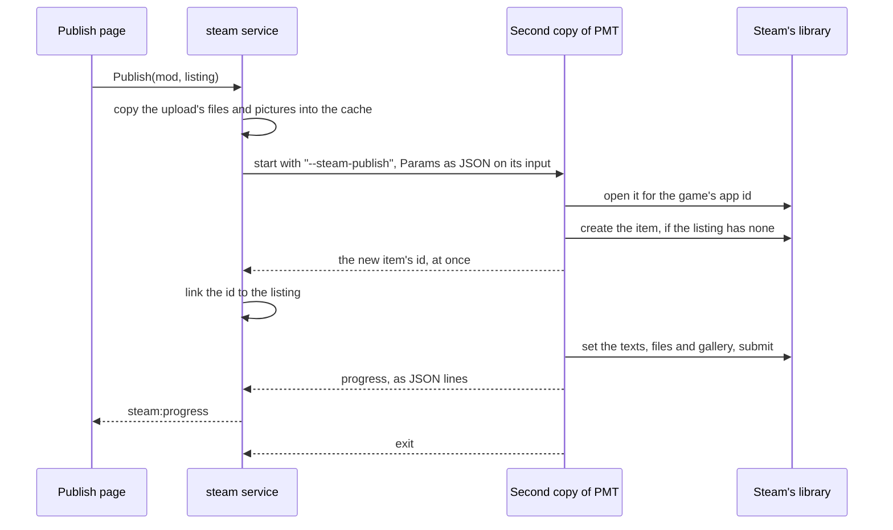

# steam

[Architecture](../../docs/ARCHITECTURE.md) › [Services](../../docs/ARCHITECTURE.md#the-services) › steam

The steam service publishes mods to the Steam Workshop. It keeps each mod's Workshop pages, called listings, in the
mod's own files, shows what the next upload changes against what Steam has, and uploads from a second copy of the app
that loads the game's own copy of Steam's library. The [Publish page](../../frontend/src/README.md) edits the listings,
shows the compare and starts the upload.

PMT ships nothing of Steam's. The game's install keeps the library where `Game.SteamLibrary` says, and the second copy
loads it through purego and opens it for the game's app id. What a mod is, its descriptor and every write into it belong
to the [workspace](../workspace/README.md) service, and a change note is drafted from the [git](../git/README.md)
service's history.

**Uses** [agent](../agent/README.md), [app](../app/README.md), [files](../../internal/files/README.md),
[game](../../internal/game/README.md), [git](../git/README.md), [index](../../internal/index/README.md),
[jomini](../../internal/jomini/README.md), [wiki](../wiki/README.md), [workspace](../workspace/README.md) · **Used by**
`main.go`, which runs the second copy before anything else.

## The second copy

`ServePublish` runs first in `main`. If the app was started with one of the flags, it does that one kind of work and
exits: it reads its `Params` as JSON on standard input, opens Steam's library, does the work and prints its answer as
JSON lines. An error goes to standard error as one JSON line, with exit code 1. The flags upload a listing
(`--steam-publish`), read an item's details (`--steam-details`), read whether Steam can take an upload
(`--steam-status`), and download an item (`--steam-download`). Only one second copy runs at a time.

The library's functions are bound by name. The ones an upload needs must be there. The ones that read an item's DLC and
change its required items are optional: if the library lacks them, the details leave those fields nil, the compare
leaves out their difference, and an upload leaves them as Steam has them.

## What an upload does

`Publish` takes a visibility (`public`, `friends`, `private` or `unlisted`), or "" to keep the item's own. It reads the
item's details first and makes the update a diff against them. The compare lists exactly these changes.

- **DLC.** Removed and added to match the listing. When Steam listed only some of them, none is removed.
- **Required items.** One is added for each dependency with a Workshop id. One is removed only if it is a mod of the
  workspace that the descriptor does not name, so an item added on Steam's page stays.
- **The gallery** is replaced only when its labels differ. **The tags** are sent with the version tag last.
- **Pictures.** A thumbnail or gallery picture of 1 MB or more is sent as a smaller copy made in a folder of its own in
  the cache. One with transparency stays a PNG, any other becomes a JPEG, and both are scaled down until they fit. A GIF
  that big is refused, since shrinking would lose its animation.
- **A new item's id** is linked to the listing as soon as Steam makes it, even if the upload then fails.
- **Someone else's item** is refused. `Details.Owned` says whether the signed-in Steam user owns the item; a
  contributor the owner added counts as not the owner.
- **Canceling** ends the second copy, and the error says Steam may already have applied part of the upload.

`DescribeSteam` says why Steam cannot take an upload now, or nothing if it can.

## The listings

A `Listing` is what one of a mod's Workshop pages shows, as the mod's own files hold it. A mod has its own listing,
whose key is "", and an older listing for each older game version it still serves. An older listing is a separate
Workshop item, and its key is that game version.

- **The mod's own listing** keeps its title, versions, tags, thumbnail and Workshop id in the mod's descriptor, and the
  Workshop id in the mod's record too. Its page files are in the mod's `.workshop` folder: the description and the
  change note as BBCode, the DLC it requires, and the gallery's pictures and video links. The dot keeps `.workshop` out
  of every upload.
- **An older listing** is a folder `.workshop/<key>/` with the same page files and a `listing.json` for its record,
  which names the zip its files come from. The key is the game version without a closing `.*`. `CreateListing` makes
  one from a zip, and `ImportListing` from an existing Workshop item, with Steam's page, gallery and DLC, so its first
  upload changes nothing that nobody edited. Both refuse a game version the mod has a listing for.
- **Reading** a listing leaves the version tag out of its category tags, and works out the version tag from the
  supported version. Each dependency carries the Workshop id of the workspace mod that answers it, as
  `workspace.FindMod` finds it.
- **Writing** happens as the user types and writes only the files whose text changed, each through the workspace. It
  never writes the gallery, which only the preview methods change, or the Workshop id, which only `LinkItem` changes,
  so a page's copy from before an upload linked its new item cannot unlink it.

## The upload set

An `Upload` is the set of files a listing's next upload sends. The own listing sends the mod's folder. An older one
sends the files of its zip, read where they are, from the one folder in the zip that holds them all, if there is one.
Its descriptor goes with the listing's name, versions and Workshop id, and the zip itself is never changed.

Either way, `ListUpload` leaves out what the rules name: files that start with a dot, though the `.metadata` folder
stays, the coding agents' instruction files, and what the mod's `.gitignore` and its own exclusions cover. The upload
sends copies of the set, made in a folder of their own, so Steam gets those files and no others.

## The compare

Steam is the compare's reference. A `Snapshot` is the hashes of an item's files as Steam has them, the folder Steam
keeps them in and the time Steam last updated the item. PMT keeps no copy of the files. The service also keeps Steam's
answer about each item, its `Details` or why they could not be read, with when it asked.

- `CompareUpload` asks Steam only when no answer is kept for the item, a failed one included, so the page can compare at
  every save. Comparisons that need the same item while Steam is asked wait for that one answer. `FetchItem` drops the
  answer and compares again, and so does an upload.
- When Steam is asked, a second copy reads the details. Steam downloads the item, and its files are hashed again, only
  when Steam's time differs from the snapshot's. A file's diff, its lines and an import read Steam's own folder, and
  Steam downloads the item again if that folder is gone.
- A `Comparison` lists each `Difference` the next upload makes. The page: the title, the description, and the lists of
  tags, gallery, DLC and required items. The files: the version, then each file added, changed or removed, with the
  lines a text file gains and loses. Both sides are filtered by the upload's rules.
- Hashes are kept by a file's path, size and time, so a comparison hashes again only what changed.
- The status is `new` with no item, `unknown` with a reason when Steam could not be asked or its files could not be
  downloaded, else `same` or `changed`.

## The cache

The service keeps in PMT's cache a snapshot for each item, as `snapshot-<id>.json`, the tags of each app id, and the
`copy-` and `pictures-` folders an upload sends from, which it deletes when it ends. At each start, `ServiceStartup`
deletes in the background the snapshot of each item that no listing of a recorded mod names, by the mod's record, its
descriptor or an older listing's `listing.json`, and every `copy-` and `pictures-` folder, which only an upload that
was stopped with the app leaves.

## Tags, change notes and BBCode

- **Tags.** `ListTags` fetches the tags a game's Workshop browse page declares, leaves out those only Steam's admins may
  set, and keeps them in the cache for each app id, to use when a later fetch fails. The group whose tags start with a
  version number is the version tags. The category tags add those the workspace's mods carry.
- **Change notes.** `ListChangeNotes` drafts the next note from git, with one line for the subject of each commit of the
  mod's folder since Steam last updated the item, and from the section of the mod's changelog file under the first
  heading that holds the version. `1.2` is not in `## 1.21`.
- **BBCode.** The description is BBCode. `ToHTML` draws it as Steam would, for the editor, and `ToBBCode` turns the
  editor's HTML back, both from one table of Steam's tags. A tag Steam does not draw stays as text. A link is drawn only
  for a web address, so nothing in it can run in the app's window.

## Files

| file | what it holds |
|---|---|
| `steam.go` | The service, the gallery's methods, `Publish`, and the copies of the files Steam is sent. |
| `listing.go` | Listings: reading, writing, creating and importing them, the upload set and an older listing's zip. |
| `compare.go` | The compare, Steam's kept answers and the snapshots. |
| `notes.go` | The drafts of a change note. |
| `pictures.go` | The smaller copies of pictures Steam refuses for their size. |
| `workshop.go` | The rules, the DLCs and the tags a listing can choose from. |
| `ugc.go` | Steam's library bound through purego: its Workshop calls and their results. |
| `bbcode.go` | The conversion between BBCode and the editor's HTML. |
| `publish.go` | The second copy: its flags, how the service starts it, and the work each flag does. |
| `steam_windows.go`, `steam_linux.go` | How each system loads the library, and its struct packing. |

## Events

| event | data | sent when |
|---|---|---|
| `steam:progress` | a `Progress` | an upload reaches a stage or moves bytes |
| `release:changed` | the mod's id | a mod's listing files were written |

## Terms

- **Listing**: what one of a mod's Workshop pages shows, as the mod's own files hold it.
- **Key**: which of a mod's listings it is: "" for its own, the game version for an older one.
- **Record**: the fields of a listing that its descriptor or its `listing.json` holds.
- **Preview**: one picture or video in the page's gallery.
- **Label**: what tells one preview from another: a picture's file name without its extension, a video's link.
- **Dependency**: one mod a listing's mod depends on, with the Workshop id of the workspace mod that answers it.
- **Upload**: the set of files a listing's next upload sends.
- **Rule**: one pattern of files an upload leaves out, with its reason.
- **Snapshot**: the hashes of an item's files as Steam has them, and the folder Steam keeps them in.
- **Source**: where an upload reads its files: the mod's folder, or an older listing's zip.
- **Details**: what Steam reports about an item.
- **Answer**: Steam's details of an item, or why they are missing, kept with when Steam was asked.
- **Comparison**: what the next upload changes against what Steam has.
- **Difference**: one thing the next upload changes on Steam.
- **Change note**: one draft of the note an upload sends with it.
- **Client**: a connection to the game's copy of Steam's library, in a second copy of the app.
- **Params**: everything a second copy needs to do its work.
- **Progress**: one stage of an upload.
- **DLC**: one DLC of the game an item may require, with its Steam id.
- **Workshop item**: Steam's own word for a mod's page on the Workshop (`CreateItem`).
