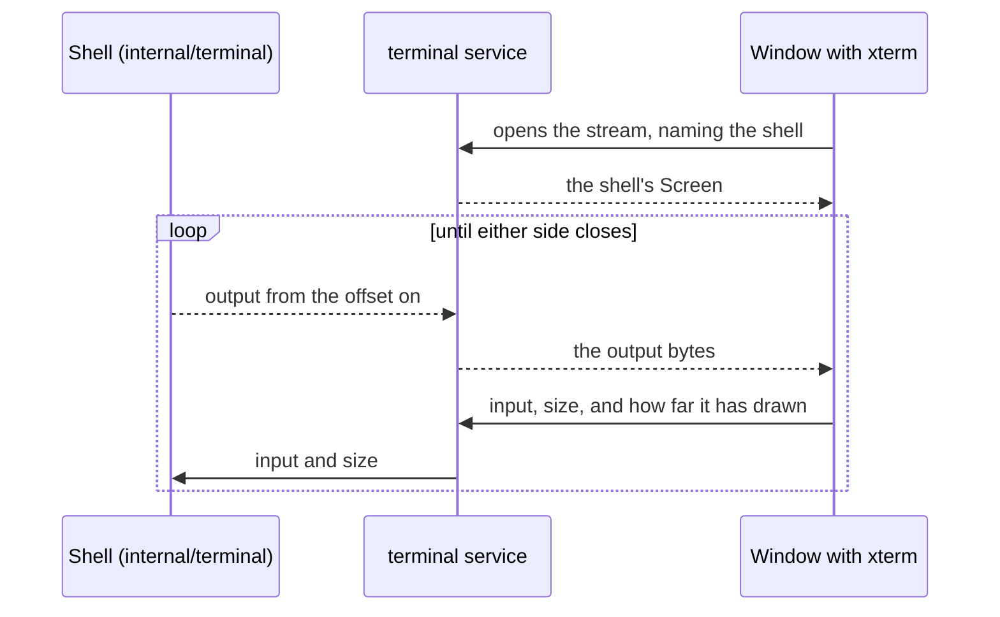

# terminal

[Architecture](../../ARCHITECTURE.md) › [Services](../../ARCHITECTURE.md#the-services) › terminal

The terminal service runs the shells of the IDE's Terminal. It starts them, holds each by id until it ends, streams each
to the window that shows it, and finds the files that a shell's output names.

The shells themselves are [internal/terminal](../../internal/terminal/README.md)'s. This service gives them their
program and folder, and asks the [workspace](../workspace/README.md) for the folder's mod and for a file's place. The
page is the Terminal panel (see the [frontend](../../frontend/src/README.md)), which draws each shell with xterm.

**Uses** [files](../../internal/files/README.md), [terminal](../../internal/terminal/README.md),
[app](../app/README.md), [lsp](../lsp/README.md), [mcp](../mcp/README.md), [workspace](../workspace/README.md) ·
**Used by** no other package.

## Starting a shell

`Start` takes the active file's path, which may be "", the path of the program to run, and the terminal's size. A
program of "" is the default shell: the `terminal.shell` setting, else the first shell the system has
(`ListPrograms`). A program in that list starts with its arguments, such as the ones that make Git Bash read the user's
profile. Any other program starts with none.

`Run` starts a command, a program with its arguments as given, such as a coding agent's sign-in. Both start the shell in
the folder `workspace.ResolveFolder` gives for the file.

A shell ends when its tab closes, when its program exits, or when the app quits. `ListEnvironment` lists what every
shell is given: PMT's address and token for coding agents (`mcp.Variables`), then the engine's own variables.

## The stream

Each window that shows a shell opens the Wails stream `terminal` to it. No port is opened. The window's first message
names the shell. Go answers with the shell's `Screen`, then sends the shell's output from that screen's offset on.

The window's later messages carry what is typed, its new size, and the offset of the output it has drawn up to. The
shell may run only so far past that offset: beyond it, the shell waits for the window.

A window that hands its shells to another one first sends their screens with `SetScreen`. The next window draws the same
screen, full-screen programs included, then the output that came after it.

## Links and references

- **Links.** `FindLinks` reads one line of output for file names followed by a line, in the forms VS Code's terminal
  reads. A name is tried as a full path, then from the shell's folder, then as a path the workspace loads. Only a file
  under a root of the workspace links. A `Link` gives its position in the line and the file's place as an `lsp.Site`.
- **References.** `ResolveReference` gives the text that names a file to an agent running in the shell, as Claude Code
  and Copilot CLI read it: an `@` and the path from the shell's folder, or the full path for a file outside it.

## Files

| file | what it holds |
|---|---|
| `terminal.go` | The service: starting, closing and holding shells, and the stream to a window. |
| `links.go` | `FindLinks` and `ResolveReference`: the files a line of output names, and a file named to an agent. |

## Events

| event | data | sent when |
|---|---|---|
| `shell:started` | the shell's id | a shell started |
| `shell:exited` | the shell's id | a shell ended, by its tab, its program or the app |

## Terms

- **Link**: a file name in a line of a shell's output, with the file's place and the line it names.
