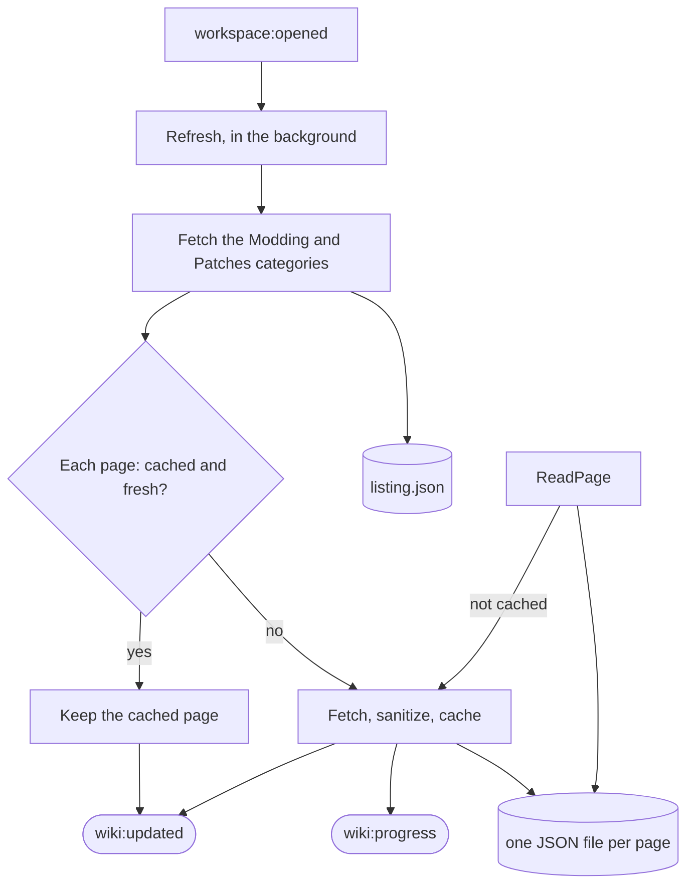

# wiki

[Architecture](../../docs/ARCHITECTURE.md) › [Services](../../docs/ARCHITECTURE.md#the-services) › wiki

The wiki service reads the community wiki of the open workspace's game. It caches the wiki's pages, lists the patch
notes, finds the pages that belong to a file, and builds the lexicon of the game's commands. The game's row names its
wiki. The [Wiki pane](../../frontend/src/README.md) shows the pages and the lexicon, and the Patch Notes page shows the
notes.

The lexicon reads the definitions the dumps fill in the [schema](../../internal/schema/README.md) (the effects, the
triggers, the links and the scope types) and its data functions. The examples of an effect, a trigger and a link are
its first uses in the [index](../../internal/index/README.md), and the [workspace](../workspace/README.md) places each
one. The
[lsp](../lsp/README.md) service owns the table of lexicon classes.

**Uses** [app](../app/README.md), [files](../../internal/files/README.md), [game](../../internal/game/README.md),
[index](../../internal/index/README.md), [schema](../../internal/schema/README.md), [lsp](../lsp/README.md),
[workspace](../workspace/README.md) · **Used by** [mcp](../mcp/README.md), and [steam](../steam/README.md), which reads
an element's attribute with `LookupAttribute`.

## The refresh and the cache

A `Client` reads one game's wiki through its API, rate limited, with a timeout. It caches each page, its HTML
sanitized, as one JSON file, and the game's listing of pages as another, in the wiki's folder of the app's cache. The
service makes a client when a workspace first needs one, and a new one when a workspace of another game opens.

`Refresh` runs in the background each time a workspace opens. It fetches the listing, which holds the titles of the
wiki's Modding category and the patch versions of its Patches category. Then it fetches every page that is not cached
or whose cached copy is more than seven days old. A page that cannot be fetched does not stop the others; their errors
are joined. `ReadPage` returns a cached page, or fetches it.

## Sanitizing

`Sanitize` strips a page's HTML down to what the article pane shows. The wiki's own chrome, citations and pictures are
dropped, and so are the See also, References, External links and Further reading sections. The scripting tools section
goes last, and a table of more than two rows is folded closed. A link is made absolute against the wiki's address, and
a link to another page of the wiki carries that page's title as `data-page`. A link keeps its address only if it is a
web address.

## The pages of a file

`FindPages` returns the wiki pages that belong to a file: those whose title holds the name of the file's database or
the topics the game's table gives for its format and folder. The database's own page comes first, then its plural, then
the pages that hold either, then the format's page. `SearchPages` searches the modding pages, the titles first and then
the text of the cached pages.

## Patch notes

A `Note` is one patch's notes page. Its title is `Patch 1.20`, or `Patch 1.20.X` for a minor version's hotfix notes.
`ListNotes` lists them newest first, by semver, with a minor version's hotfix notes after all of its numbered patches.
A note's page is read as any other page. Its `Modding` flag says whether it has a Modding section, and it is false for a
note whose page is not cached.

## The lexicon

`ListClasses` returns the lexicon's classes in the order the Lexicon tab shows them, and `BuildLexicon` builds the rows
of one class. A `LexiconRow` carries the dump's blurb and usage, the scopes it runs in, the scope it leads to, and a
site for each example use. Effects and triggers also take in the scripted ones the game and the workspace's mods
define, one row for each name the game keeps a copy of, with `Defined` where that copy is. The service keeps the rows
of each class for the mods' index they were built from, and builds them again for another index.

## Files

| file | what it holds |
|---|---|
| `wiki.go` | The service: its events, reading a page, listing the notes and refreshing. |
| `client.go` | The client of one game's wiki, its pages and their cache. |
| `refresh.go` | The listing of the wiki's categories and the refresh of its pages. |
| `sanitize.go` | Cutting a page's HTML down to what the pane shows. |
| `pages.go` | Finding and searching pages, and the facts of a patch note. |
| `lexicon.go` | The lexicon's rows. |

## Events

| event | data | sent when |
|---|---|---|
| `wiki:progress` | a `Progress` | a refresh fetched a page |
| `wiki:updated` | the error's text, "" when it worked | a refresh finished |

## Terms

- **Client**: what fetches one game's wiki, rate limited, and caches its pages.
- **Page**: one wiki page as the cache keeps it, its HTML sanitized.
- **Summary**: one page in the listing: its title and its category.
- **Listing**: what the wiki has for one game: its modding pages and its patch versions.
- **Note**: one patch's notes page.
- **Progress**: how far a refresh has come.
- **LexiconRow**: one effect, trigger, link, scope or data function the dumps declare, or one scripted effect or
  trigger.
