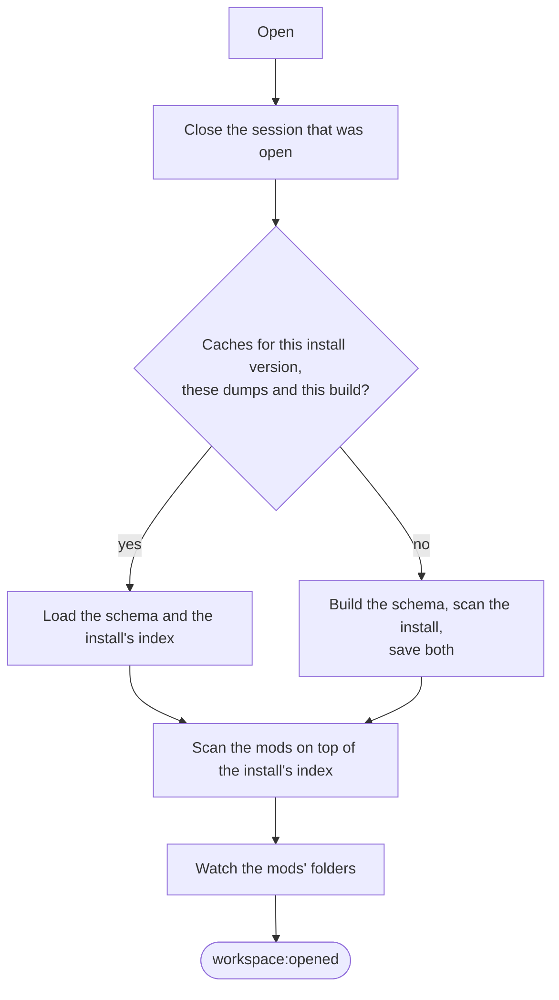
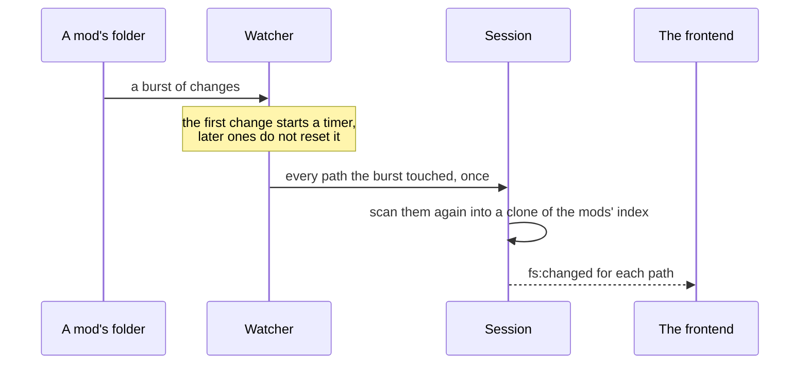

# workspace

[Architecture](../../ARCHITECTURE.md) › [Services](../../ARCHITECTURE.md#the-services) › workspace

The workspace service holds the one open workspace: a game install and the mods being edited, in load order. Opening
one loads the install's schema and index, or builds them, scans the mods on top and watches their folders. Every other
service asks it for the open session at each call, so the workspace's state exists once.

It also keeps the records of installs, workspaces and mods, reads and writes the mods' files, and serves files to the
page. What a key means is the [schema](../../internal/schema/README.md)'s; where a name is defined is the
[index](../../internal/index/README.md)'s.

**Uses** [app](../app/README.md), [files](../../internal/files/README.md), [game](../../internal/game/README.md),
[jomini](../../internal/jomini/README.md), [loc](../../internal/loc/README.md), [schema](../../internal/schema/README.md),
[index](../../internal/index/README.md), [texture](../../internal/texture/README.md) · **Used by** every other service
but app.

## Opening a workspace

- The open runs in the background and holds the service's lock, so a call that needs the session waits for it.
  `install:scanning` reports each stage, and `workspace:opened` or `workspace:failed` ends it.
- The schema and the install's index are cached as two gob files, in a folder named for the install's version, the
  time of its dumps and PMT's version. A game patch, fresh dumps or a new build of PMT each scan again, and the open
  deletes the game's older cache folders.
- Changing what the open read (the install, the language, or the mods and their order) opens the workspace again. So
  does moving or rescanning its install.

## The session

A `Session` is the open workspace as the services read it: the game's row, the schema, the install's index, the mods'
index, the mods in load order and the language.

- **No locks for readers.** The mods' index sits in an atomic pointer. A reader loads it once and keeps that copy to
  its end, and a rescan changes a clone and swaps it in.
- **Each file parsed once.** A `Document` is one file parsed in its format's dialect. An open file's document is the
  editor's text, its buffer, which the lsp service hands over as the user types. Any other file is parsed when asked
  and kept in a bounded cache.
- **Texts.** A localization key's text comes in the workspace's language, else the base language, with the message
  the game keeps. A definition's title is the text the game shows it by.
- **Other load orders.** `ScanOrder` scans the mods in another order and keeps the result nowhere, for Health's
  preview of a load order.

## Places

A `Place` is where one file sits in the workspace: its root (the game or a mod), its path from that root, its
database, whether it is read only and whether the Visual view draws it. Every payload that names a file carries a
place, and the page shows its fields as they are. The game's own files and a Workshop mod's copy are read only.

## Reading and writing

- Writes are refused outside the workspace's mods. A write is atomic and keeps the file's encoding.
- `CreateCopy` copies a file of the game or of another mod to the same path in a mod, where it overrides the original.
- `Delete` moves a file into PMT's trash, which empties at the next start, so `Restore` can bring it back.
- `RevertHunks` gives a file back its text from before a coding agent's edits.
- `ServeHTTP` serves files to the page at `/files`. A DDS or TGA is decoded to PNG first, since the browser cannot
  show it.

## The watcher

The watcher reports a burst of changes on disk together:

It watches the mods' folders and every folder made under them. Hidden folders are left out, but for the dot folders
the explorer shows: the coding agents' `.claude`, `.codex` and `.github`, and the Workshop listing's `.workshop`.
Renaming or deleting a folder stops watching under it for the move, since Windows refuses to move a folder that is
being watched.

## Mods

A `Mod` is the config's record of a mod with its `Descriptor`, its thumbnail, and whether it is broken (its folder is
missing) or a Workshop mod's copy. The descriptor is the mod's own description: CK3's `.mod` file, or Vic3's and EU5's
`.metadata/metadata.json`. Writing it back keeps the fields PMT does not model.

- `CreateMod` makes a new mod's skeleton: its folder, the folders the game expects, a descriptor, a launcher file
  where the game needs one, and a localization file with only its header.
- `ResolveFolder` gives the folder a shell or a coding agent starts in: the mod that holds the active file, else the
  first mod whose folder exists, else the home folder.
- `Launch` starts the game with its debug flag. When the game exits, `game:exited` says whether it wrote fresher dumps
  than the schema's.

## Files

| file | what it holds |
|---|---|
| `workspace.go` | The service: installs, workspaces, the open, Launch, reading and writing files, serving them. |
| `session.go` | The open session: its documents, buffers, texts and rescans. |
| `mod.go` | Mods, their descriptors, and a new mod's skeleton. |
| `locate.go` | Places: where a file sits, and every copy of a path in load order. |
| `revert.go` | Taking a coding agent's edits back. |
| `watcher.go` | The watcher on the mods' folders. |

## Events

| event | data | sent when |
|---|---|---|
| `workspace:opened` | the workspace's id | a workspace is open with its index built |
| `workspace:failed` | the error's text | a workspace could not be opened |
| `workspace:closed` | nothing | the open workspace closed |
| `install:scanning` | a `Scanning` | an install's scan reports a stage |
| `install:scanned` | the install's id | an install's scan finished |
| `fs:changed` | a `FileChange` | a file of the open workspace changed on disk, and the index has it |
| `game:exited` | whether the dumps are fresher | the launched game exited |

## Terms

- **Session**: the open workspace as every service reads it.
- **Document**: one file parsed once in the dialect of its format.
- **Buffer**: the document of the editor's text for one open file.
- **Place**: where one file sits in the workspace.
- **Workspace**: one recorded workspace as the pages list it: its install, its game and its mods.
- **Mod**: one mod of the open workspace: the recorded mod with its descriptor.
- **Descriptor**: a mod's own description, as its game writes it.
- **Broken**: a mod whose folder is missing.
- **Watcher**: what watches the mods' folders and reports a burst of changes together.
- **State**: the open workspace as the frontend sees it.
- **FileText**: a file's text in its encoding, with its place and the editor's draft.
- **FileChange**: one file that changed or was deleted on disk.
- **Scanning**: one stage of an install's scan, with the percent of its files done.
