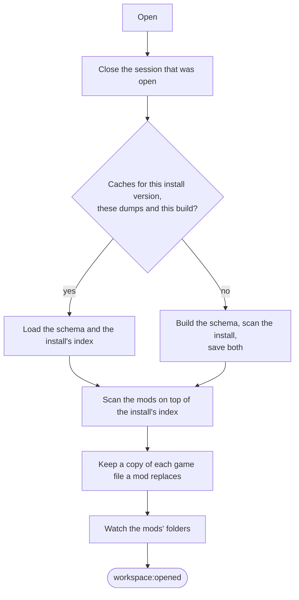
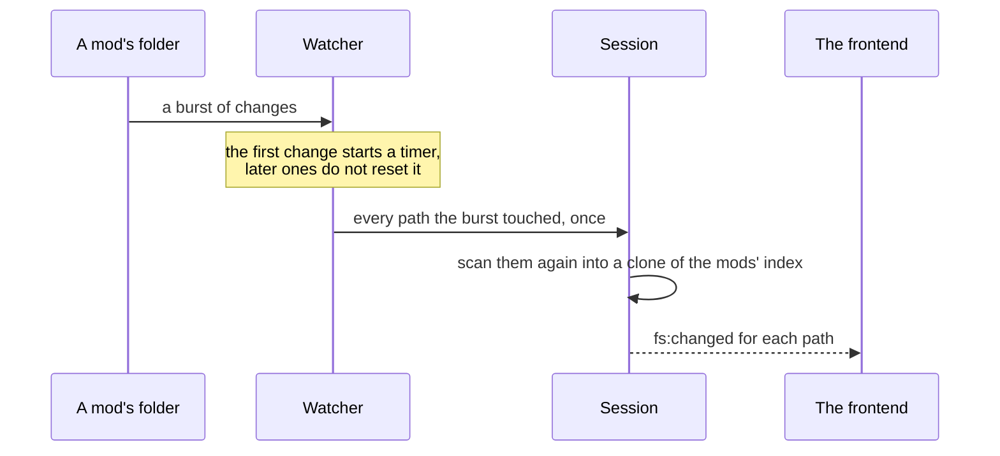

# workspace

[Architecture](../../docs/ARCHITECTURE.md) › [Services](../../docs/ARCHITECTURE.md#the-services) › workspace

The workspace service holds the one open workspace: a game install and the mods being edited, in load order. Opening
one loads the install's schema and index, or builds them, scans the mods on top and watches their folders. Every other
service asks it for the open session at each call, so the workspace's state exists once.

It also keeps the records of installs, workspaces and mods, reads and writes the mods' files, keeps the review of the
files a coding agent edits, keeps a game's patches (what each version of the game changed), and serves files to the
page. What a key means is [lang](../../internal/lang/README.md)'s;
where a name is defined is the [index](../../internal/index/README.md)'s.

**Uses** [app](../app/README.md), [files](../../internal/files/README.md), [game](../../internal/game/README.md),
[jomini](../../internal/jomini/README.md), [lang](../../internal/lang/README.md), [loc](../../internal/loc/README.md),
[schema](../../internal/schema/README.md),
[index](../../internal/index/README.md), [texture](../../internal/texture/README.md) · **Used by** every other service
but app.

## Opening a workspace

- The open runs in the background and holds the service's lock, so a call that needs the session waits for it.
  `install:scanning` reports each stage in words, and `workspace:opened` or `workspace:failed` ends it.
- The schema and the install's index are cached as two gob files, in a folder named for the install's version, the
  time of its dumps, the time of the digest's dumps of that version (0 for none) and PMT's version. A game patch, fresh
  dumps, digest dumps saved later or a new build of PMT each scan again, and the open deletes the game's older cache
  folders.
- Whenever the open builds the schema or the install's index (`keepVersion`), the game's folder of patches keeps the
  version's keys (`ResolveKeysFile`): the keys the docs document (`ListDocKeys`) and the names the install's files
  define (`ListDefinedKeys`), localization keys included. Where the build used the install's own dumps and they are not
  older than the install, it keeps them too (`ResolveOwnFile`). Each is one file for each version an install is on,
  since the user may keep an older version of the game as an install of its own.
- The build first compares the version with what is kept of the newest older version and saves the result as a local
  patch of the new version, based on that one (`compareKept`). It compares the dumps (`schema.CompareDumps`), the
  documented keys and the defined names (`schema.CompareKeys`), and the hashes of the game's files from the record
  below. A part is compared where the older version's side is kept, so the dumps wait for the user to run `script_docs`
  after an update, while the docs' keys, the defined names and the files need none. A part that cannot be compared
  stays as the local patch of the version had it, if that was compared with the same version, since the record drops the
  older version when no mod needs it. A version kept of the same or a newer version, or none kept before, is compared
  with nothing. What is kept of a version no install is on is deleted once the build used the install's own dumps. The
  open then loads the game's patches into the session, where per version the digest's patch wins over the shipped
  history's, which wins over the local one, and each part the winner lacks comes from the next that has it
  (`MergePatches`).
- After the mods are scanned, the open keeps the game files they replace (`saveCopies`), which is the next section.
- Changing what the open read (the install, the language, or the mods and their order) opens the workspace again. So
  does moving or rescanning its install.

## Kept copies of game files

A mod's file at the path of a game file replaces it (`findReplaced`; a DLC's file is read over the base game's, so the
last one in load order is the game's). The game's folder of patches keeps what a three-way compare of the mod's file
needs, and what tells a mod that the game changed a file under it:

- **The record** (`ResolveCopiesFile`) holds, for each game version PMT has seen, the SHA-256 of each game file's
  content at that version, by its path from the game's folder. The index scan takes each hash (`files.File.Hash`) of
  each file it reads, so the record holds every script, GUI, font, GFX, table and base-language localization file the
  game reads (`listHashes`), and no picture or other file the scan does not read. A file a mod replaces is added to it
  whether the scan read it or not (`writeCopy` hashes one the scan did not).
- **The copies** are the text files' content, gzipped and named by its hash in the folder `copies`, so a file that did
  not change between versions is kept once. A picture or mesh is hashed and not copied, since a compare and merge reads
  text.
- **`FindBase`** returns the version and hash that is a valid base for a mod's file: the hash at the mod's range
  start, or at the latest version before it when every patch in between lists the files it changed and none lists
  this one. A version between that has no patch is not known, and is read as unchanged. It returns false for none. It
  is the one place that decides whether a file has a base.
- **`FindCopyFile`** returns the file of the copy of the base `FindBase` gives, and false where the file is not text or
  no mod replaced it when PMT saw that version, since the record holds more files than the copies do. **`FindCopy`**
  returns that copy's text, and false for none, which is where the compare stays two-way.
- **`ListStaleFiles`** lists the game files a mod replaces that changed in its range: the patches' files with their
  status, and any other whose hash at the range start differs from now ("modified") or whose file the game has dropped
  ("deleted"), which is how a game with no digest tells.
- **Dropping.** The same open deletes each version no install of the game is on and that no mod of any workspace of
  the game needs, which is the latest recorded version at or before the mod's range start, and then each copy that no
  version left in the record names (`deleteCopies`). The copies are shared by every workspace of the game, so a
  workspace's open reads the other workspaces' mods.

## The session

A `Session` is the open workspace as the services read it: the game's row, the schema, the install's index, the mods'
index, the mods in load order and the language.

- **No locks for readers.** The mods' index sits in an atomic pointer. A reader loads it once and keeps that copy to
  its end, and a rescan changes a clone and swaps it in.
- **Each file parsed once.** A `Document` is one file parsed in its format's dialect. An open file's document is the
  editor's text, its buffer, which the lsp service hands over as the user types; `Edits` counts each change to the
  buffers. Any other file is parsed when asked and kept in a bounded cache.
- **Texts.** A localization key's text comes in the workspace's language, else the base language, with the message
  the game keeps. A definition's title and description are the texts the game shows it by: the keys it writes, else
  the keys `game.DefinitionTexts` builds from its name.
- **Other load orders.** `PreviewOrder` returns the mods' index as another load order would have it, for Health's
  preview. It is `index.Index.Reorder`: the same files and occurrences mounted in the other order, with no file read
  again, and it is kept nowhere.

## Places

A `Place` is where one file sits in the workspace: its root (the game or a mod), its path from that root, its
database, whether it is read only and whether the Visual view draws it. Every payload that names a file carries a
place, and the page shows its fields as they are. The game's own files and a Workshop mod's copy are read only.

## Reading and writing

- Writes are refused outside the workspace's mods. A write is atomic and keeps the file's encoding.
- `CreateCopy` copies a file of the game or of another mod to the same path in a mod, where it overrides the original.
- `Delete` moves a file into PMT's trash, which empties at the next start, so `Restore` can bring it back.
- `MergeGameFile` applies the game's changes to a game file to the mod's file that replaces it. It diffs the kept copy
  (`FindCopy`) against the game's file now by lines and gives each run of changed lines as a `Hunk`, with the unchanged
  lines around it as its anchors. The anchors grow a line on each side at a time until the hunk's lines are in the copy
  once, and hunks whose anchors share or touch a line are one. A hunk lands where its copy's lines are in the mod's
  file once, through `revertHunk` with its sides swapped; one the mod made already fits as it is. Any other is counted
  and left out: an earlier hunk's lines can make a later one's appear twice. It starts the review first, and returns
  how many hunks did not fit.
- `TrackEdits` starts the review of a file a coding agent edits or a merge writes, once. The review's baseline is the file's text on
  disk with the agent's edits undone, in the file's own line endings. A file the agent created that is not on disk
  yet has the baseline "". It is refused if an edit's lines are not in the file once.
- `ListReviews` lists the files under review, each a `Review`: its place and the lines its text adds and removes
  against its baseline (`files.CountLines`). `Baseline` returns a file's baseline, and `SetBaseline`
  replaces it, which is how the page keeps one change. `KeepFile` ends a review and leaves the file as it is.
  `UndoFile` writes the baseline back, or moves a file the agent created to the trash, and ends the review. It refuses
  while the editor holds unsaved text for the file.
- A review ends on `KeepFile` (which Source control's Discard calls for each file it discards), on `UndoFile`, on
  `SetBaseline` with the file's text on disk, and when the watcher
  reports the file with lines on disk equal to its baseline's, whatever their line endings (a file the agent created:
  when it is deleted). The counts compare lines the same way. The
  reviews live in the session, so closing the workspace drops them and leaves the files as the agent wrote them.
- `ServeHTTP` serves files to the page at `/files`. A DDS or TGA is decoded to PNG first, since the browser cannot
  show it.

## The watcher

The watcher reports a burst of changes on disk together:

It watches the mods' folders and every folder made under them. Hidden folders are left out, but for the coding agents'
`.claude`, `.codex` and `.github`, and the Workshop listing's `.workshop`.
Renaming or deleting a folder stops watching under it for the move, since Windows refuses to move a folder that is
being watched.

## Mods

A `Mod` is the config's record of a mod with its `Descriptor`, its thumbnail, and whether it is broken (its folder is
missing) or a Workshop mod's copy. The descriptor is the mod's own description: CK3's `.mod` file, or Vic3's and EU5's
`.metadata/metadata.json`. Writing it back keeps the fields PMT does not model. The thumbnail is the picture the
descriptor names, else the mod's `thumbnail.*` file (`findThumbnail`): the one rule for the picture the app shows for
the mod and the one an upload sends.

A mod is the user's own or an external mod: someone else's, which the workspace checks the user's mods against and
PMT never publishes. `External` is on its record, set by `AddMod` and `SetExternal`; Steam's copy of a Workshop mod
is always one, whatever its record says, so every page reads the one field. `ListWorkshopMods` lists the mods Steam
has downloaded for an install's game, from the Workshop folder in each of Steam's libraries, to add as external mods.

- `CreateMod` makes a new mod's skeleton: its folder, the folders the game expects, a descriptor, a launcher file
  where the game needs one, and a localization file with only its header. The folder can be any folder, except for a
  game whose launcher reads local mods only from its mod folder (`Game.FixedModFolder`). The launcher file always goes
  in the game's mod folder.
- `ResolveFolder` gives the folder a shell or a coding agent starts in: the mod that holds the active file, else the
  first mod whose folder exists, else the home folder.
- `Launch` starts the game with its debug flag. When the game exits, `game:exited` says whether it wrote fresher dumps
  than the schema's.

## Files

| file | what it holds |
|---|---|
| `workspace.go` | The service: installs, workspaces, the open, Launch, reading and writing files, serving them. |
| `session.go` | The open session: its documents, buffers, texts and rescans. |
| `mod.go` | Mods, their descriptors, and a new mod's skeleton. |
| `locate.go` | Places: where a file sits, and every copy of a path in load order. |
| `patches.go` | A game's patches as plain data, their files, the history the app ships, the session's loading of them, and a mod's range of versions. |
| `copies.go` | The kept copies of the game files mods replace, by game version, the files of a mod's range that changed, and the merge of the game's changes into a mod's file. |
| `review.go` | The review of a coding agent's edits, and the matching of its hunks to a file's lines. |
| `watcher.go` | The watcher on the mods' folders. |

## Events

| event | data | sent when |
|---|---|---|
| `workspace:opened` | the workspace's id | a workspace is open with its index built |
| `workspace:failed` | the error's text | a workspace could not be opened |
| `workspace:closed` | nothing | the open workspace closed |
| `install:scanning` | a `Scanning` | an install's scan reports a stage |
| `install:scanned` | the install's id | an install's scan finished |
| `fs:changed` | a `FileChange` | a file of the open workspace changed on disk, and the index has it |
| `game:exited` | whether the dumps are fresher | the launched game exited |
| `review:changed` | the file's path | a file's review started, its baseline or its text on disk changed, or the review ended |

## Terms

- **Session**: the open workspace as every service reads it.
- **Document**: one file parsed once in the dialect of its format.
- **Buffer**: the document of the editor's text for one open file.
- **Review**: a file a coding agent edited that the user has not kept or undone yet. The session holds it.
- **Baseline**: a reviewed file's text from before the agent's edits that are not kept, in the file's own line endings.
- **Hunk**: one run of lines an agent's edit changed in a file, as its lines before and after the edit.
- **Place**: where one file sits in the workspace.
- **Workspace**: one recorded workspace as the pages list it: its install, its game and its mods.
- **Mod**: one mod of the open workspace: the recorded mod with its descriptor.
- **Descriptor**: a mod's own description, as its game writes it.
- **Broken**: a mod whose folder is missing.
- **External mod**: someone else's mod, which the workspace checks the user's mods against and PMT never publishes.
- **Watcher**: what watches the mods' folders and reports a burst of changes together.
- **State**: the open workspace as the frontend sees it.
- **FileText**: a file's text in its encoding, with its place and the editor's draft.
- **FileChange**: one file that changed or was deleted on disk.
- **Patch**: what one version of a game changed against its base: its dump changes, key renames, game files,
  articles, document changes and definition changes. A local patch is one PMT compared itself, when the game updated
  or when it made the shipped history, and a digest's patch is one the Co-op wrote.
- **History**: the patches the app ships for a game (`LoadHistory`), embedded from `shipped/<game>.gob` and written by
  the `gen` command of [schema](../../internal/schema/README.md). It holds each version `gen` saw an install on, and for
  Crusader Kings III the dump changes of the versions from 1.0.3 to 1.10.2 from OldEnt's dumps. Versions between that
  and the first `gen` saw are not in it.
- **DocChanges**, **DefinitionChanges**: the keys the game's docs began or stopped to document, and the names the
  game's files began or stopped to define, as `schema.KeyChange`s.
- **Base**: the version a patch is compared against: the latest earlier version that is not an open beta.
- **KeyRename**: a key a patch gave a new key, with its replacement.
- **GameFile**: a file of the game that a patch added, modified or deleted, as git says.
- **Article**: one titled part of a digest's written notes, with the folders and keys it names.
- **Patches**: a game's patches, oldest version first, and the range of them after one version up to another.
  `ResolvePatchDir` is the folder of the app's cache that holds them, which the [patch](../patch/README.md) service
  saves. The session's `Patches` are the digest's file, the history and the local file merged (`LoadPatches`), which
  the open and the patch service's refresh each call.
- **Range**: the versions a mod's patches run from and to, as `ResolveRange` says. The end is the install's version.
  The start is the oldest version the mod's supported version matches, else the mod's `Base` where the supported
  version is blank or cannot be judged (`1.13*`), else "" for none. Open betas count only where the install is on one.
- **Install versions**: the version each recorded install of a game is on, once each (`ListInstallVersions`), which
  the patch service keeps the digest's dumps for and the session keeps its own dumps and keys for.
- **Copy**: a gzipped copy of a text game file's content as it was at a game version, named by the hash of the content.
  `FindBase` finds the hash that is a valid base for a mod's file, `FindCopyFile` the copy of it, and `FindCopy`
  returns its text.
- **Stale file**: a game file a mod replaces that changed within the mod's range, as `ListStaleFiles` lists it.
- **Mod base**: the game version a mod with no readable supported version is compared from, kept in the mod's
  record and written by `UpdateMod`.
- **Scanning**: one stage of an install's scan, in words, with the percent of its files done, or -1 for a stage that
  reports none.
